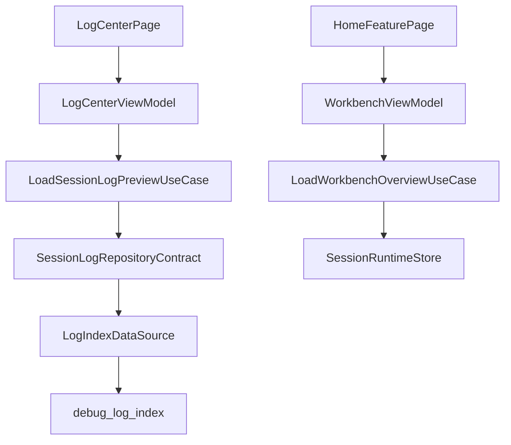
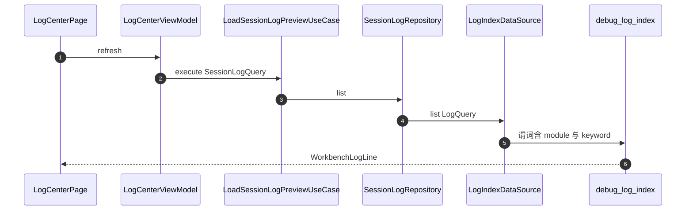
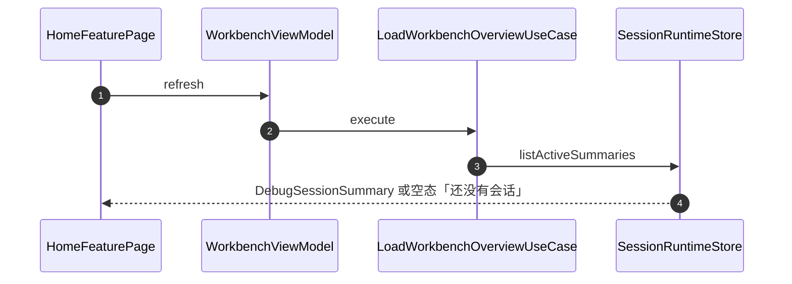

# APP-005 壳接到唯一读模型

## 1. 条目与非目标

清单 `APP-005`，判定「支持」。

- Given：写入侧已经进入 `debug_log_index`
- When：追踪壳上的一次会话行读取，以及工作台最近会话
- Then：日志中心走 `LoadSessionLogPreviewUseCase` → `SessionLogRepositoryContract` → `LogIndexDataSource`。工作台最近会话走 `LoadWorkbenchOverviewUseCase` → `SessionRuntimeStore`。两条都不读 `YoLog` 或 hilog

本条输入是壳上的列表。输出分两种，不许混用：

1. 会话行（日志中心、日志详情）：UI → ViewModel/State → `LoadSessionLogPreviewUseCase` → `SessionLogRepositoryContract` → `LogIndexDataSource` → 表 `debug_log_index`。
2. 最近会话（工作台）：UI → ViewModel/State → `LoadWorkbenchOverviewUseCase` → `SessionRuntimeStore` 的 `DebugSessionSummary`。不读表，也不读 `YoLog`。

失败是列表改读 `FileAppender`、`MemoryRingAppender`、hilog，或每个射频模块再存一份会话行。

非目标：不新增 logger。不把 `DebugLogRecord` 再持久化到另一张表。不把最近会话改成查 `debug_log_index`。

壳行为引用 `139ddc61d1f82e3d8f5c92980d420f19230bffec`。状态胶囊见 WB-003，不读 `debug_log_index`。LOG-004 与 LOG-008 保持支持。

关系库见 `开发/指南/开发/应用框架/ArkData（方舟数据管理）/应用数据持久化/通过关系型数据库实现数据持久化 (ArkTS).md`。hilog 见 `开发/API参考/系统/调测调优/Performance Analysis Kit（性能分析服务）/ArkTS API/ohos.hilog HiLog日志打印.md`。

## 2. 模块边界与分层

`LogRepository.list` 的查询体在 `common/storage` 的 `LogIndexDataSource`，只查表 `debug_log_index`。`LogRepository.list` 调用这一处。`LogIndexFilterUtil` 不再作为第二份过滤。`SessionLogRepository` 是 debug_core 里契约的实现，是用例唯一的存储入口。`LoadSessionLogPreviewUseCase` 不出现 `LogRepository`。

`module` 与 `keyword` 在存储 `LogQuery` 和领域 `SessionLogQuery` 上。关键字匹配 `summary`。`WorkbenchLogLine` 带 `module`、`protocol`、`sessionId`。没有第二行类型。

| 步骤 | 归属 |
| --- | --- |
| 日志中心 / 详情 UI | `features/home` 的 `LogCenterPage`、`LogDetailPage`。`product/phone` 推进同一棵 `NavPathStack` |
| 页面状态 | `LogCenterViewModel` |
| 用例 | `LoadSessionLogPreviewUseCase`、`ExportSessionLogUseCase`、`ClearSessionLogUseCase` |
| 契约 | `SessionLogRepositoryContract` |
| 数据源 | `LogIndexDataSource.list` |
| 最近会话 | `WorkbenchViewModel` → `LoadWorkbenchOverviewUseCase` → `SessionRuntimeStore` |

## 3. 架构图

两条图没有交叉边。最近会话不查询 `debug_log_index`。

## 4. 序列图

### 会话行

### 最近会话

### 失败路径

会话列表改读 hilog 或 `YoLog`。当前壳页面没有这些 import。

## 5. 数据模型

| 模型 | 用途 |
| --- | --- |
| `SessionLogQuery` | 领域查询。含 sessionId、offset、limit、direction、recordType、startMs、endMs、module、keyword |
| `LogQuery` | 存储查询。同样带 module、keyword、protocol。只在 `SessionLogRepository.toStorageQuery` 出现 |
| `WorkbenchLogLine` | 页面投影。含 module、protocol、sessionId |
| `DebugSessionSummary` | 最近会话。来自 `SessionRuntimeStore` |

详情页的 HEX 显示资源 `log_hex_missing`「未记录」。不编造未加载的字节。

## 6. 层间接口

与 APP-003 的 `SessionLogRepositoryContract` 相同。`LogIndexDataSource.list` 是唯一谓词实现：`module`、`protocol` 用 `equalTo`，关键字对 `summary` 做 `like`。导出把同一组 module、keyword、protocol 放进 `LogQuery`，不再走客户端二次过滤。

## 7. 权限与生命周期

日志中心不申请射频权限。离开导航目的地不另开栈。清空先确认。无筛选时 `ClearSessionLogUseCase` 再 `cleanup(0)`。

## 8. 日志

读终点表名是 `debug_log_index`。写路径仍是 LOG-004 的 `LogCaptureService`。LOG-008 保持支持：会话列表不读 `YoLog` 或 hilog。

## 9. 反模式

- 不把 `debug_log_index` 的行当作最近会话。
- 不让页面或用例 import `LogRepository`、`YoLog` 或 hilog 来列会话。
- 不恢复 `LogIndexFilterUtil` 作为第二套关键字过滤。
- 不把工作台状态胶囊改成查询 `debug_log_index`。
