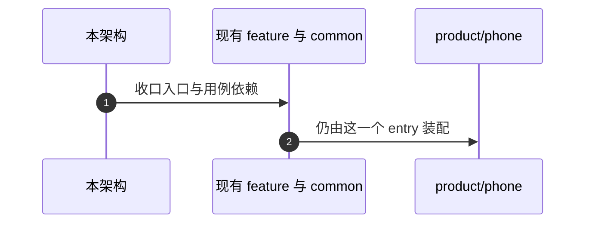
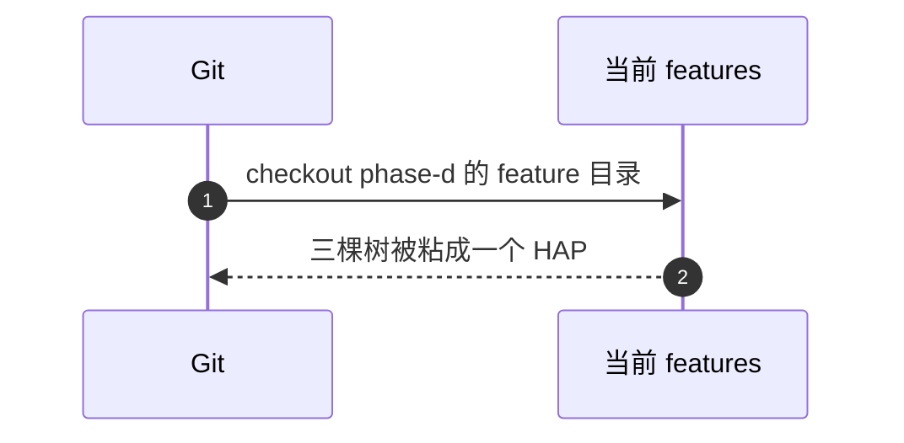

# APP-006 没有按射频拆开的产品模块

## 1. 条目与非目标

清单 `APP-006`，判定「支持」。

- Given：三个射频能力都在 feature HAR
- When：查找第二个 entry，或把 phase-d 的 `features/*` checkout 进当前树
- Then：没有这种 product。当前代码不是三棵树拼起来的目录。射频仍是待真机

本条输入是集成方式。输出是继续在现有模块上改契约，而不是拼接提交。失败是 `git checkout <phase-d> -- features/bluetooth`、`features/nearlink` 或 `features/wifi_network`。

证据提交只说明行为，不是要合并的树：

- Wi-Fi `7295d1771288a0fb957021bd0e948073f435d96c`
- 蓝牙 `fba7e5d6dc3dd725f1baf3af4dea322943baf506`
- 星闪 `d58de1c9b6e7681bada1e642c1955c1a02079570`

非目标：不复制 `docs/goal/ui/`。不改 PR #20。不重画三个模块自己的 BT / NL / WN 架构。不声称真机已测。

## 2. 模块边界与分层

设计前与设计后相同：射频实现留在现有 feature 与 `common/yobluetooth`。壳要补的页面落在 `features/home` 的页面状态和 `product/phone` 的同一棵导航里。见 APP-002。

适配是改这些模块的入口和用例依赖，使它们符合 APP-003 与 APP-004。不是把三份 phase-d 快照覆盖到当前树。

## 3. 架构图

虚线不是目录合并。

## 4. 序列图

### 成功路径

### 失败路径

## 5. 数据模型

没有新的持久化字段。三个模块的领域模型仍在各自目录。跨模块只使用 APP-003 列出的 common 契约。

## 6. 层间接口

不从 phase-d 树引入第二套页面 API。壳使用的符号以当前 `product/phone` 已经 import 的蓝牙视图，以及 `NearLinkFeaturePage`、`WifiFeaturePage`、`HomeFeaturePage` 为起点，再按 APP-003 收口。

## 7. 权限与生命周期

不把三个模块的权限声明拆进三个 HAP。声明留在 `product/phone`。

## 8. 日志

三个模块的写入侧已经进入同一张 `debug_log_index`（LOG-004）。本条不新增日志库。读侧见 APP-005。

## 9. 反模式

- 不把 phase-d checkout 称作集成。
- 不把「射频待真机」写成「射频不可用所以不要装配进 phone」。装配进这一个 HAP，真机验证另计。
- 不刷新按模块拆开的旧打包物来代替这一个 phone 源码包。
