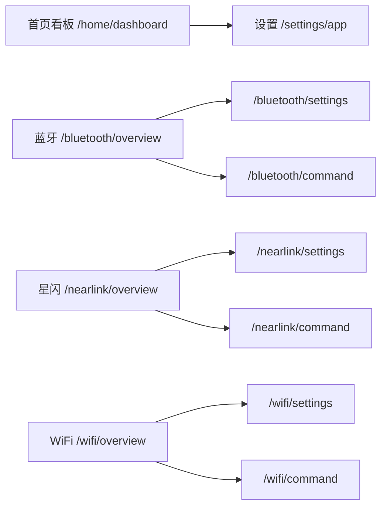
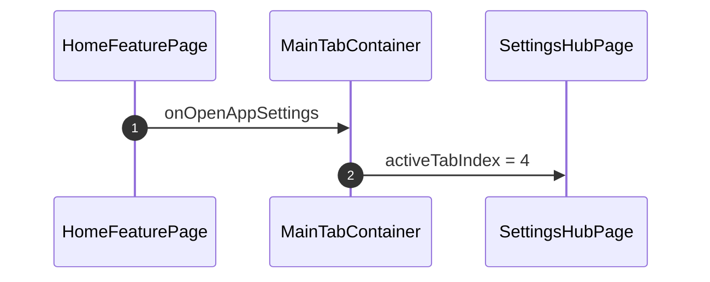

# APP-007 只有五个主页面

## 1. 条目与非目标

清单 `APP-007`，判定「支持」。没有单独屏幕。底栏五个槽位。

- Given：`MainTabContainer` 的 `tabContent0` 到 `tabContent4`
- When：数主页面和主路由
- Then：槽位 0 首页看板 `/home/dashboard`，1 蓝牙 `/bluetooth/overview`，2 星闪 `/nearlink/overview`，3 WiFi `/wifi/overview`，4 设置 `/settings/app`。没有第六个主页面，也没有「更多」槽位

本条输入是底栏。输出是五个主路由。失败是再出现一个主 Tab，或把日志、命令、模块设置做成第六页。视觉不在本 PR。射频仍是待真机。

非目标：不重画首页看板。不下钻计数。不把三个射频的命令写进同一个实现。

## 2. 模块边界与分层

`product/phone` 装配底栏和唯一 `NavPathStack`。`feature_home` 提供首页看板、应用设置内容、日志页和命令模板。三个射频 feature 提供自己的模块设置页。phone 把模块设置和命令页 push 进同一棵栈。

| 步骤 | 归属 |
| --- | --- |
| 五个主页面 | `MainTabContainer` |
| 应用设置 | `AppSettingsPage` 包 `SettingsHubPage` |
| 模块设置 | `BluetoothSettingsPage`、`NearLinkSettingsPage`、`WifiSettingsPage` |
| 命令模板 | `CommandPanelTemplate`，由三个命令页扩展 |
| 日志 | `LogCenterPage`、`LogDetailPage`，只压栈 |

## 3. 架构图

首页到设置只改槽位。模块设置和命令留在功能栈。

## 4. 序列图

没有第二条应用设置路由。

## 5. 数据模型

主路由常量在 `AppRoutes`：`HOME`、`BLUETOOTH`、`NEARLINK`、`WIFI`、`SETTINGS`。槽位常量是 `TAB_INDEX_HOME` 到 `TAB_INDEX_SETTINGS`。

## 6. 层间接口

页面不调用 Kit。应用设置、模块设置、命令各自的用例见 [APP-003](APP-003.md)。路径仍是 UI → ViewModel/State → UseCase → RepositoryContract → DataSource。

## 7. 权限与生命周期

五个主页面切换不新开 Navigation。应用设置不申请射频权限。模块设置页也不申请。

## 8. 日志

本条不读会话日志。日志中心仍是压栈页。

## 9. 反模式

- 不恢复「更多」枢纽。
- 不把日志和应用设置放在同一页。
- 不把命令放进应用设置，也不让命令和设置共用视图模型或用例。
- 不把蓝牙、星闪、WiFi 的命令逻辑写进同一个实现。
