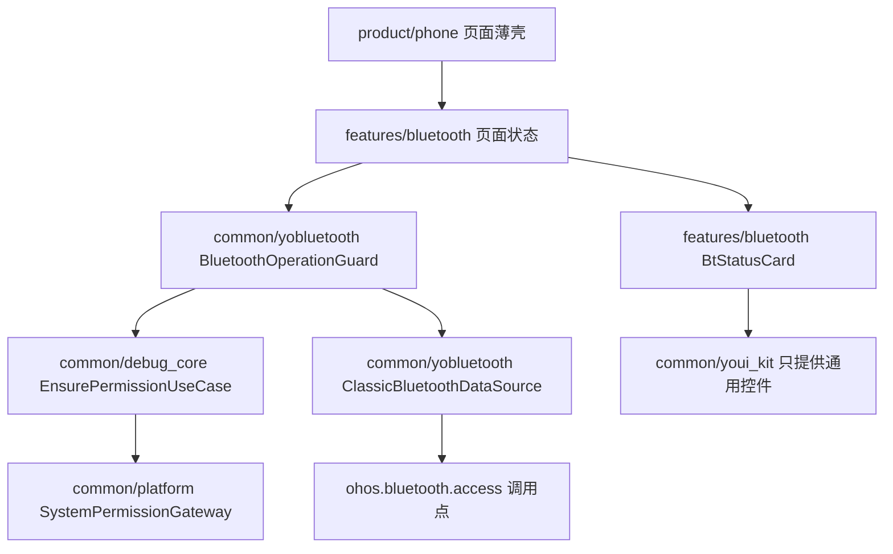
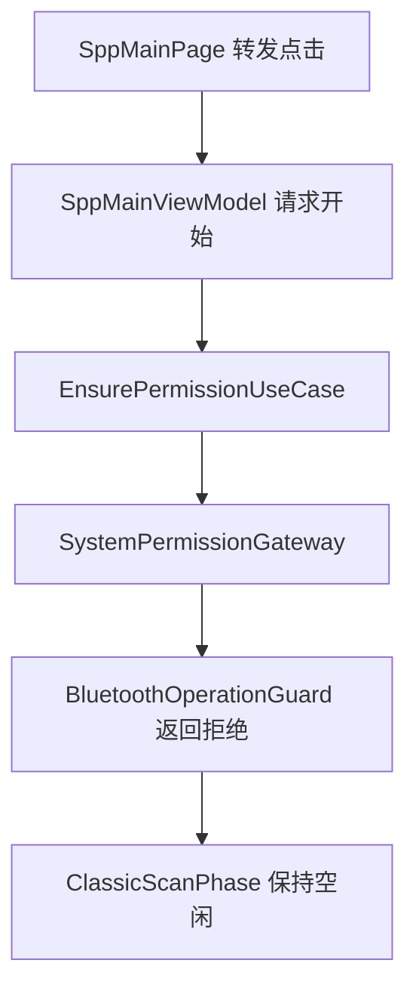
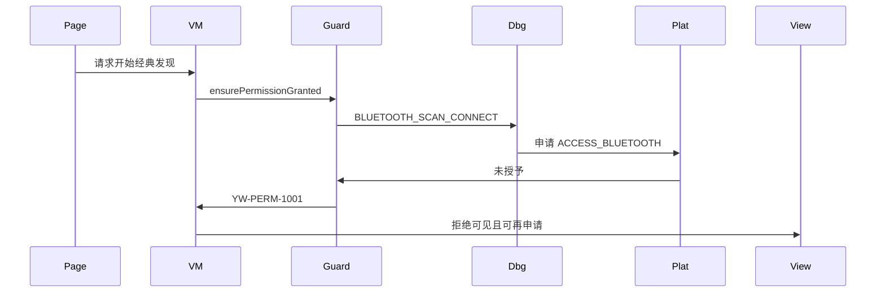
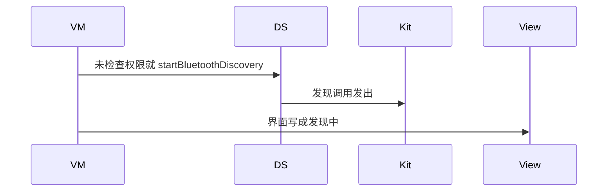

# BT-001 未授予权限时不开始经典发现

## 1. 条目与非目标

**判定：** 支持

**Given** 未授予 `ohos.permission.ACCESS_BLUETOOTH`

**When** 用户请求开始经典发现

**Then** 不出现「发现中」；不新增设备；可见拒绝，并可再次申请

**证据：** `开发/指南/开发/系统/网络/Connectivity Kit（短距通信服务）/蓝牙/传统蓝牙/查找设备.md`。行为以已接受的研究笔记和清单为准，本文件不重开行业调查。

**本条输入：** `SppMainPage` 转发的开始发现请求，以及 `PermissionScenario.BLUETOOTH_SCAN_CONNECT` 的当前决定。

**本条输出：** `ClassicScanPhase` 保持空闲；`SppMainViewModel` 给出可再次申请的拒绝；设备列表不增加。

**本条失败：** 权限拒绝之后仍然进入发现中，或 `StartClassicScanUseCase` 已经调用 `startBluetoothDiscovery`。

**本条所有者：** `features/bluetooth` 的 `SppMainViewModel` 展示拒绝；`common/yobluetooth` 的 `BluetoothOperationGuard.ensurePermissionGranted` 在 `StartClassicScanUseCase` 之前返回 `YW-PERM-1001`；`common/debug_core` 的 `EnsurePermissionUseCase` 使用 `PermissionScenario.BLUETOOTH_SCAN_CONNECT`；`common/platform` 的 `SystemPermissionGateway` 申请 `AppPermission.ACCESS_BLUETOOTH`。

**非目标：**

- 不在本条里启动 BLE 扫描。
- 不把 `USE_BLUETOOTH` 当作替代权限。
- 不由 `common/youi_kit` 决定能否发现。
- 不新增 `common/yobluetooth` 以外的蓝牙栈，不增加包装层或版本兼容层。版本判断留在本条调用点。

## 2. 模块边界与分层

本组是权限与适配器。依赖方向是 `product/phone` → `features/bluetooth` → `common/yobluetooth`。权限、生命周期和系统设置走 `common/platform` 与 `common/debug_core`。字节与 `Result` 走 `common/core`。日志门面走 `common/yolog`。收藏、会话记录和导出走 `common/storage`。`common/youi_kit` 只提供通用控件，不解释蓝牙状态。

**调用点：** 本条在进入 `ClassicBluetoothDataSource` 之前结束，没有版本分支。

| 包 | 类型 | 职责 |
| --- | --- | --- |
| product/phone | SppMainPage | 转发开始点击，不调用 Kit |
| features/bluetooth | SppMainViewModel | 收口拒绝文案和再次申请 |
| common/debug_core | EnsurePermissionUseCase | 按场景查询并申请权限 |
| common/platform | SystemPermissionGateway | 对系统提交 ACCESS_BLUETOOTH |
| common/yobluetooth | BluetoothOperationGuard | 未授予则失败，用例不再向下 |
| common/yobluetooth | StartClassicScanUseCase | 只有 Result.ok 才进入发现 |

**设计前：** 守卫已经能返回 `PERMISSION_DENIED`，但页面状态仍可能被写成发现中。

**设计后：** 拒绝停在守卫。`ClassicScanPhase` 不变，`ClassicBluetoothDataSource` 不被调用。再次申请仍走同一权限场景。

## 3. 架构图

本组总图放在本文件。权限与适配器里其余条目各自再画本条链路，链接不能代替本条的输入、输出、失败和所有者。

本条链路：

## 4. 序列图

### 成功路径

### 错误路径

## 5. 数据模型

领域模型放在 `common/yobluetooth`，持久化模型放在 `common/storage`，平台传输对象只出现在数据源调用点，跨层用 `common/core` 的 `Result` 与 `ResultError`。错误只带类别和结构化字段，不把界面句子塞进邻层错误。

| 模型 | 所在层 | 字段 | 来源 |
| --- | --- | --- | --- |
| PermissionDecision | common/platform | granted | 系统申请结果 |
| ResultError YW-PERM-1001 | common/yobluetooth | code | 守卫映射，不含界面句子 |
| ClassicScanPhase | common/yobluetooth | idle | 拒绝时不改相位 |

## 6. 层间接口

| 从 | 到 | 接口 | 成功 | 失败 |
| --- | --- | --- | --- | --- |
| SppMainViewModel | StartClassicScanUseCase | execute | 不到达 | 守卫先失败 |
| BluetoothOperationGuard | EnsurePermissionUseCase | execute 场景 | granted | denied |
| EnsurePermissionUseCase | SystemPermissionGateway | request ACCESS_BLUETOOTH | 用户允许 | 用户拒绝 |
| StartClassicScanUseCase | ClassicBluetoothDataSource | startDiscovery | 本条不调用 | 权限失败时禁止调用 |

下层不持有页面类型。结果用 `Result` 或已有观察者回传。`common/yobluetooth` 的 `Index.ets` 继续只导出用例、领域模型和必要门面，不把数据源具体类变成第二套公开栈。

## 7. 权限与生命周期

使用已有 `BusinessPermissionGroup.BLUETOOTH_SCAN_CONNECT`，只含 `ACCESS_BLUETOOTH`。拒绝后同一场景可再次申请。

发现订阅尚未注册。页面离开不需要补一次 `stopBluetoothDiscovery`。`product/phone` 只转发，不保存发现相位。

## 8. 日志

- `YoLogTag.PERM` 记录场景与 granted=0。
- `BtLogTag.SCAN` 不记录发现开始。
- 领域标签加在已有 `BtLogTag`，不在 `common/yolog` 的 `YoLogTag` 里再开一套蓝牙标签。
- 日志走 `YoLog`，不在页面里直接写 hilog。

## 9. 反模式

- 权限失败仍把相位写成发现中。
- 页面自己弹一套与 `PermissionOrchestrator` 平行的申请。
- 捕获异常后继续调用发现接口。
- 用新的蓝牙 HAR、适配器或 `ApiCompat` 把本条版本差异包起来。版本判断只留在上面写明的调用点。
- 页面或 `common/youi_kit` 直接调用 `ohos.bluetooth.*`。
