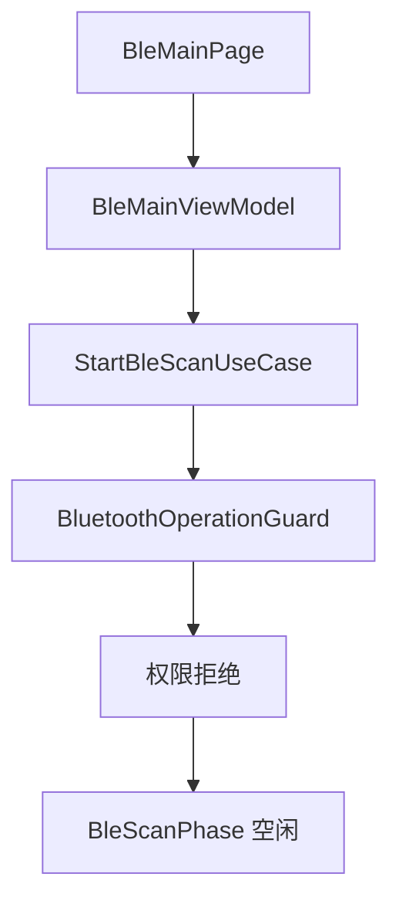
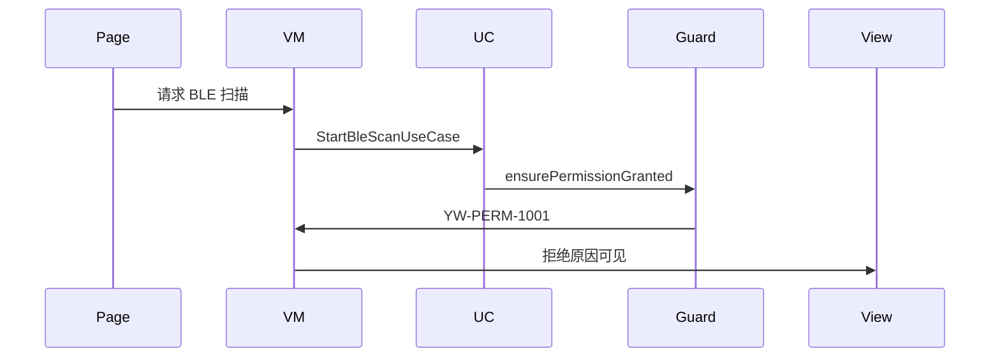
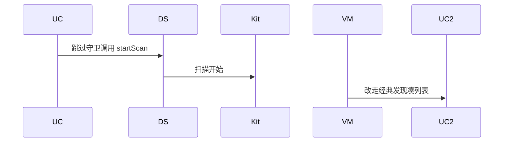

# BT-002 未授予权限时不开始 BLE 扫描

## 1. 条目与非目标

**判定：** 支持

**Given** 未授予 `ohos.permission.ACCESS_BLUETOOTH`

**When** 用户请求 BLE 扫描

**Then** 不调用成功的扫描；列表不增加；拒绝原因可见

**证据：** `开发/指南/开发/系统/网络/Connectivity Kit（短距通信服务）/蓝牙/低功耗蓝牙/查找设备.md`。行为以已接受的研究笔记和清单为准，本文件不重开行业调查。

**本条输入：** `BleMainPage` 转发的开始扫描，以及同一蓝牙权限决定。

**本条输出：** `BleScanPhase` 保持空闲；`BleMainViewModel` 展示拒绝；`BleScannerDataSource` 不调用 `startScan`。

**本条失败：** 拒绝后列表增加，或把经典发现当成 BLE 扫描的替代。

**本条所有者：** `features/bluetooth` 的 `BleMainViewModel` 展示拒绝；`StartBleScanUseCase` 与 `StartBleScanWithFilterUseCase` 共用 `BluetoothOperationGuard`；权限场景仍是 `common/debug_core` 的 `BLUETOOTH_SCAN_CONNECT`。

**非目标：**

- 不退回 `startBluetoothDiscovery` 凑 BLE 列表。
- 不单独发明 BLE 定位权限。
- 不新增 `common/yobluetooth` 以外的蓝牙栈，不增加包装层或版本兼容层。版本判断留在本条调用点。

## 2. 模块边界与分层

本组是权限与适配器。依赖方向是 `product/phone` → `features/bluetooth` → `common/yobluetooth`。权限、生命周期和系统设置走 `common/platform` 与 `common/debug_core`。字节与 `Result` 走 `common/core`。日志门面走 `common/yolog`。收藏、会话记录和导出走 `common/storage`。`common/youi_kit` 只提供通用控件，不解释蓝牙状态。

**调用点：** 本条不到达 `BleScannerDataSource`，因此没有 API 14 与 API 15 的扫描器分支。

| 包 | 类型 | 职责 |
| --- | --- | --- |
| product/phone | BleMainPage | 转发开始扫描 |
| features/bluetooth | BleMainViewModel | 展示拒绝，不改扫描相位 |
| common/yobluetooth | StartBleScanUseCase | 先走守卫 |
| common/yobluetooth | BluetoothOperationGuard | 未授予则返回 YW-PERM-1001 |
| common/platform | SystemPermissionGateway | 申请 ACCESS_BLUETOOTH |

**设计前：** BLE 页仍是薄壳，扫描入口若直接接数据源，会绕过守卫。

**设计后：** 两条 BLE 开始用例都先经过同一守卫。未授予时 `BleScannerDataSource` 不创建 `BleScanner`。

## 3. 架构图

本组总图在 [`BT-001.md`](BT-001.md)。下图只覆盖本条。

## 4. 序列图

### 成功路径

### 错误路径

## 5. 数据模型

领域模型放在 `common/yobluetooth`，持久化模型放在 `common/storage`，平台传输对象只出现在数据源调用点，跨层用 `common/core` 的 `Result` 与 `ResultError`。错误只带类别和结构化字段，不把界面句子塞进邻层错误。

| 模型 | 所在层 | 字段 | 来源 |
| --- | --- | --- | --- |
| PermissionDecision | common/platform | granted | 与经典发现同一权限 |
| BleScanPhase | common/yobluetooth | idle | 拒绝时保持 |
| ResultError YW-PERM-1001 | common/yobluetooth | code | BLE 与经典共用码 |

## 6. 层间接口

| 从 | 到 | 接口 | 成功 | 失败 |
| --- | --- | --- | --- | --- |
| BleMainViewModel | StartBleScanUseCase | execute | 不到达数据源 | 权限失败 |
| BleMainViewModel | StartBleScanWithFilterUseCase | execute | 同样先守卫 | 权限失败 |
| StartBleScanUseCase | BleScannerDataSource | startScan | 本条不调用 | 禁止调用 |

下层不持有页面类型。结果用 `Result` 或已有观察者回传。`common/yobluetooth` 的 `Index.ets` 继续只导出用例、领域模型和必要门面，不把数据源具体类变成第二套公开栈。

## 7. 权限与生命周期

与 BT-001 同一 `ACCESS_BLUETOOTH`。不因为 BLE 另建权限场景。

扫描订阅未建立。离开页面时没有需要停止的扫描。

## 8. 日志

- `YoLogTag.PERM` 记录 BLE 入口与 granted=0。
- `BtLogTag.SCAN` 区分 rail=ble，且不写 start。
- 领域标签加在已有 `BtLogTag`，不在 `common/yolog` 的 `YoLogTag` 里再开一套蓝牙标签。
- 日志走 `YoLog`，不在页面里直接写 hilog。

## 9. 反模式

- BLE 权限失败时改调经典发现。
- 过滤扫描用例绕过守卫。
- 空列表被写成附近没有设备。
- 用新的蓝牙 HAR、适配器或 `ApiCompat` 把本条版本差异包起来。版本判断只留在上面写明的调用点。
- 页面或 `common/youi_kit` 直接调用 `ohos.bluetooth.*`。
