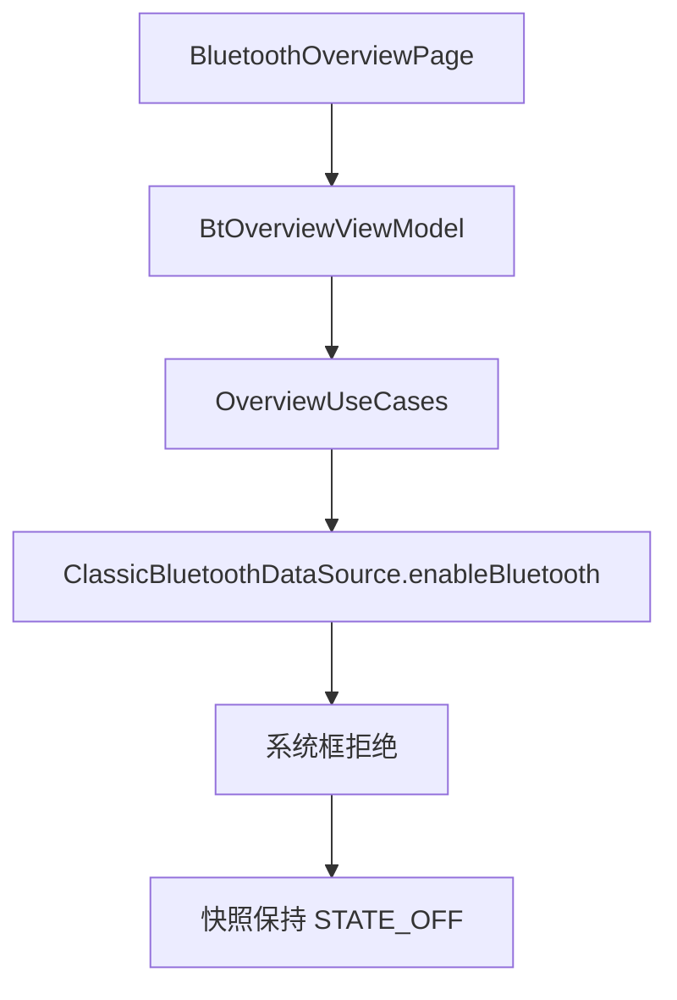
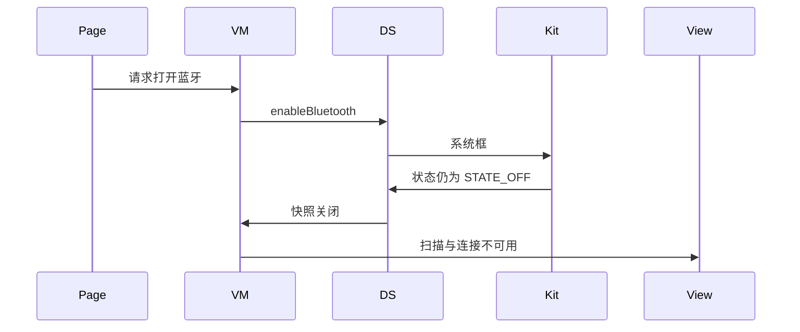
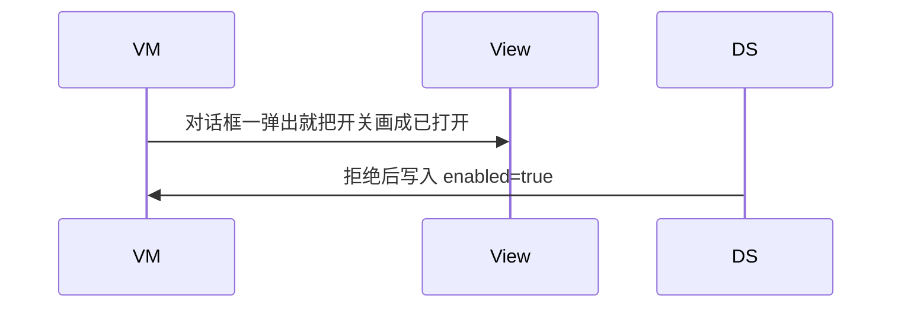

# BT-003 用户拒绝打开蓝牙后保持关闭

## 1. 条目与非目标

**判定：** 支持

**Given** 状态为 `STATE_OFF`

**When** 应用调用 `enableBluetooth` 且用户在系统框拒绝

**Then** 状态回到 `STATE_OFF`；扫描与连接入口保持不可用

**证据：** `开发/指南/开发/系统/网络/Connectivity Kit（短距通信服务）/蓝牙/蓝牙设置.md`。行为以已接受的研究笔记和清单为准，本文件不重开行业调查。

**本条输入：** 总览页的打开请求，当前适配器快照为 `STATE_OFF`。

**本条输出：** `BluetoothAdapterSnapshot.state` 仍为 `STATE_OFF`；发现、SPP、GATT 入口保持不可用。

**本条失败：** 系统框拒绝后把 `enabled` 写成 true，或应用自己把状态改成打开。

**本条所有者：** `features/bluetooth` 的 `BtOverviewViewModel` 展示关闭；`common/yobluetooth` 的 `ClassicBluetoothDataSource` 调用 `access.enableBluetooth` 并订阅状态；领域快照由 `BluetoothAdapterSnapshot` 持有。

**非目标：**

- 不在应用内画第二套蓝牙开关结果。
- 不在拒绝后自动重试打开。
- 不新增 `common/yobluetooth` 以外的蓝牙栈，不增加包装层或版本兼容层。版本判断留在本条调用点。

## 2. 模块边界与分层

本组是权限与适配器。依赖方向是 `product/phone` → `features/bluetooth` → `common/yobluetooth`。权限、生命周期和系统设置走 `common/platform` 与 `common/debug_core`。字节与 `Result` 走 `common/core`。日志门面走 `common/yolog`。收藏、会话记录和导出走 `common/storage`。`common/youi_kit` 只提供通用控件，不解释蓝牙状态。

**调用点：** `ClassicBluetoothDataSource` 直接调用 `access.enableBluetooth`。不包一层开关兼容对象。

| 包 | 类型 | 职责 |
| --- | --- | --- |
| product/phone | BluetoothOverviewPage | 转发打开请求 |
| features/bluetooth | BtOverviewViewModel | 按快照禁用扫描和连接 |
| common/yobluetooth | OverviewUseCases | 请求打开并观察状态 |
| common/yobluetooth | ClassicBluetoothDataSource | 调用 enableBluetooth 并读状态 |

**设计前：** 数据源把开关收成布尔 `enabled`，拒绝和过渡态容易被压成同一值。

**设计后：** 快照保留 `BluetoothState`。只有状态事件回到 `STATE_ON` 才把入口放开。用户拒绝则保持 `STATE_OFF`。

## 3. 架构图

本组总图在 [`BT-001.md`](BT-001.md)。下图只覆盖本条。

## 4. 序列图

### 成功路径

### 错误路径

## 5. 数据模型

领域模型放在 `common/yobluetooth`，持久化模型放在 `common/storage`，平台传输对象只出现在数据源调用点，跨层用 `common/core` 的 `Result` 与 `ResultError`。错误只带类别和结构化字段，不把界面句子塞进邻层错误。

| 模型 | 所在层 | 字段 | 来源 |
| --- | --- | --- | --- |
| BluetoothAdapterSnapshot | common/yobluetooth | state 与 enabled | enabled 仅当 STATE_ON |
| BluetoothState | 调用点平台枚举 | STATE_OFF | 状态回调 |

## 6. 层间接口

| 从 | 到 | 接口 | 成功 | 失败 |
| --- | --- | --- | --- | --- |
| BtOverviewViewModel | LoadBluetoothOverviewUseCase | 请求打开 | 等待状态事件 | 保持关闭 |
| ClassicBluetoothDataSource | access | enableBluetooth | 随后可能到 STATE_ON | 用户拒绝则 STATE_OFF |
| BtOverviewViewModel | 扫描用例 | 开始发现或扫描 | STATE_ON 才允许 | STATE_OFF 不调用 |

下层不持有页面类型。结果用 `Result` 或已有观察者回传。`common/yobluetooth` 的 `Index.ets` 继续只导出用例、领域模型和必要门面，不把数据源具体类变成第二套公开栈。

## 7. 权限与生命周期

打开蓝牙使用系统框，不把 `ACCESS_BLUETOOTH` 的授予当成用户已经同意打开适配器。

状态订阅由 `BluetoothSubscriptionBundle` 成对 `on/off`。页面重建不额外再订一次开关事件。

## 8. 日志

- `BtLogTag.CONN` 记录请求打开与结果状态枚举名。
- 不记录系统框上的用户隐私文案。
- 领域标签加在已有 `BtLogTag`，不在 `common/yolog` 的 `YoLogTag` 里再开一套蓝牙标签。
- 日志走 `YoLog`，不在页面里直接写 hilog。

## 9. 反模式

- 用定时器猜测用户已经点了允许。
- 拒绝后循环调用 `enableBluetooth`。
- 用布尔值覆盖 `STATE_OFF` 与 `STATE_TURNING_ON` 的差别。
- 用新的蓝牙 HAR、适配器或 `ApiCompat` 把本条版本差异包起来。版本判断只留在上面写明的调用点。
- 页面或 `common/youi_kit` 直接调用 `ohos.bluetooth.*`。
