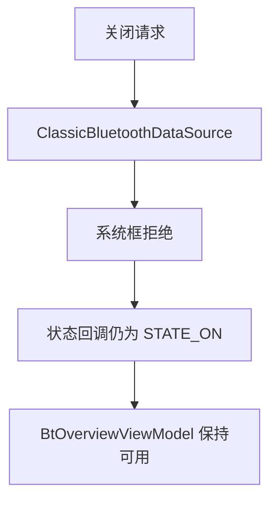
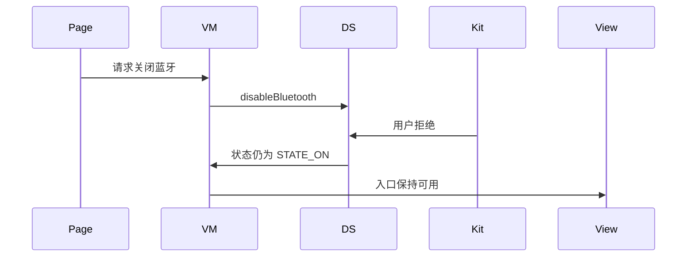
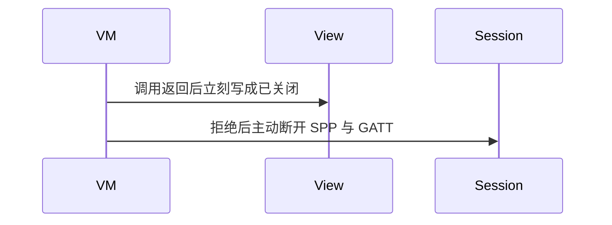

# BT-004 用户拒绝关闭蓝牙后保持开启

## 1. 条目与非目标

**判定：** 支持

**Given** 状态为 `STATE_ON`

**When** 应用调用 `disableBluetooth` 且用户拒绝

**Then** 状态保持 `STATE_ON`

**证据：** `开发/指南/开发/系统/网络/Connectivity Kit（短距通信服务）/蓝牙/蓝牙设置.md`。行为以已接受的研究笔记和清单为准，本文件不重开行业调查。

**本条输入：** 总览页的关闭请求，当前快照为 `STATE_ON`。

**本条输出：** 快照保持 `STATE_ON`。已有会话不因这次拒绝被应用主动拆掉。

**本条失败：** 用户拒绝后界面写成已关闭，或应用自行停止扫描与连接。

**本条所有者：** `BtOverviewViewModel` 展示仍可用；`ClassicBluetoothDataSource` 调用 `access.disableBluetooth`，以状态回调而不是 Promise 作为开关真相。

**非目标：**

- 不在拒绝关闭时顺便停止 SPP 或 GATT。
- 不实现应用内强制关闭。
- 不新增 `common/yobluetooth` 以外的蓝牙栈，不增加包装层或版本兼容层。版本判断留在本条调用点。

## 2. 模块边界与分层

本组是权限与适配器。依赖方向是 `product/phone` → `features/bluetooth` → `common/yobluetooth`。权限、生命周期和系统设置走 `common/platform` 与 `common/debug_core`。字节与 `Result` 走 `common/core`。日志门面走 `common/yolog`。收藏、会话记录和导出走 `common/storage`。`common/youi_kit` 只提供通用控件，不解释蓝牙状态。

**调用点：** `ClassicBluetoothDataSource` 直接调用 `access.disableBluetooth`。

| 包 | 类型 | 职责 |
| --- | --- | --- |
| product/phone | BluetoothOverviewPage | 转发关闭请求 |
| features/bluetooth | BtOverviewViewModel | 在状态事件前保持开启 |
| common/yobluetooth | ClassicBluetoothDataSource | 调用 disableBluetooth |

**设计前：** 关闭请求的返回容易被页面当成已经关闭。

**设计后：** 只有状态离开 `STATE_ON` 才更新快照。用户拒绝则保持 `STATE_ON`，会话所有者不变。

## 3. 架构图

本组总图在 [`BT-001.md`](BT-001.md)。下图只覆盖本条。

## 4. 序列图

### 成功路径

### 错误路径

## 5. 数据模型

领域模型放在 `common/yobluetooth`，持久化模型放在 `common/storage`，平台传输对象只出现在数据源调用点，跨层用 `common/core` 的 `Result` 与 `ResultError`。错误只带类别和结构化字段，不把界面句子塞进邻层错误。

| 模型 | 所在层 | 字段 | 来源 |
| --- | --- | --- | --- |
| BluetoothAdapterSnapshot | common/yobluetooth | state=STATE_ON | 状态回调 |

## 6. 层间接口

| 从 | 到 | 接口 | 成功 | 失败 |
| --- | --- | --- | --- | --- |
| BtOverviewViewModel | ClassicBluetoothDataSource | disableBluetooth | 等待状态 | 拒绝则不变 |
| 数据源 | 页面状态 | 状态观察 | STATE_ON | 不会因为拒绝变成 OFF |

下层不持有页面类型。结果用 `Result` 或已有观察者回传。`common/yobluetooth` 的 `Index.ets` 继续只导出用例、领域模型和必要门面，不把数据源具体类变成第二套公开栈。

## 7. 权限与生命周期

关闭同样走系统框。权限授予不等于可以跳过用户确认。

拒绝关闭不改变 `BluetoothSubscriptionBundle` 的订阅，也不取消长时任务。

## 8. 日志

- `BtLogTag.CONN` 记录 disable 请求与最终状态仍为 ON。
- 领域标签加在已有 `BtLogTag`，不在 `common/yolog` 的 `YoLogTag` 里再开一套蓝牙标签。
- 日志走 `YoLog`，不在页面里直接写 hilog。

## 9. 反模式

- 把 Promise 完成写成适配器已关闭。
- 拒绝后把扫描按钮禁用。
- 用新的蓝牙 HAR、适配器或 `ApiCompat` 把本条版本差异包起来。版本判断只留在上面写明的调用点。
- 页面或 `common/youi_kit` 直接调用 `ohos.bluetooth.*`。
