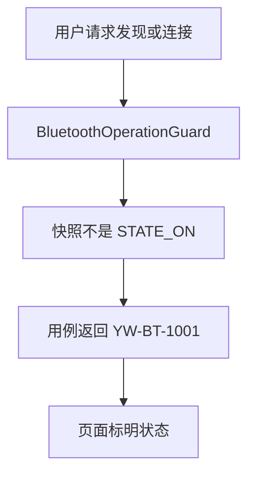
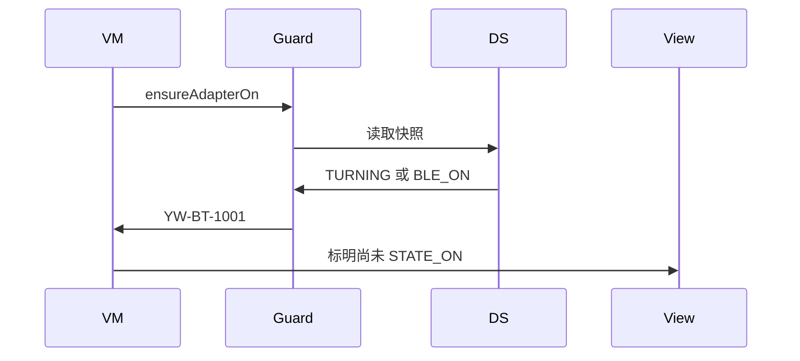
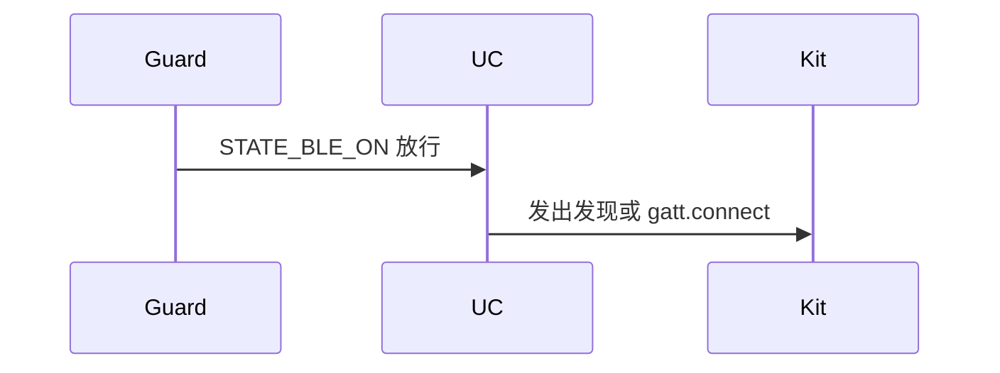

# BT-005 开关切换过程中不可用

## 1. 条目与非目标

**判定：** 支持

**Given** 状态为 `STATE_TURNING_ON`、`STATE_TURNING_OFF`、`STATE_BLE_TURNING_ON` 或 `STATE_BLE_ON` 之一

**When** 用户请求发现或 GATT 连接

**Then** 请求不发出；界面标明尚未 `STATE_ON`

**证据：** `ohos.bluetooth.access 的 BluetoothState；蓝牙设置指南只把 STATE_ON 定为可使用其他功能`。行为以已接受的研究笔记和清单为准，本文件不重开行业调查。

**本条输入：** 当前 `BluetoothAdapterSnapshot.state` 不是 `STATE_ON`，以及发现或 GATT 连接请求。

**本条输出：** 请求不进入 `ClassicBluetoothDataSource.startDiscovery` 或 `GattClientDataSource.connect`。界面标明尚未 `STATE_ON`。

**本条失败：** `STATE_BLE_ON` 被当成可以扫描或连接，或过渡态期间发出请求。

**本条所有者：** `BluetoothOperationGuard.ensureAdapterOn` 以 `STATE_ON` 为唯一可操作态；`BtOverviewViewModel`、`SppMainViewModel`、`BleMainViewModel` 只展示守卫结果。

**非目标：**

- 不把 `STATE_BLE_ON` 设计成半开可用。
- 不在过渡态排队请求，等打开后再自动发出。
- 不新增 `common/yobluetooth` 以外的蓝牙栈，不增加包装层或版本兼容层。版本判断留在本条调用点。

## 2. 模块边界与分层

本组是权限与适配器。依赖方向是 `product/phone` → `features/bluetooth` → `common/yobluetooth`。权限、生命周期和系统设置走 `common/platform` 与 `common/debug_core`。字节与 `Result` 走 `common/core`。日志门面走 `common/yolog`。收藏、会话记录和导出走 `common/storage`。`common/youi_kit` 只提供通用控件，不解释蓝牙状态。

**调用点：** 状态枚举在 `ClassicBluetoothDataSource` 读取 `access.getState` 与状态回调时映射，不另建状态兼容表模块。

| 包 | 类型 | 职责 |
| --- | --- | --- |
| features/bluetooth | 各页 ViewModel | 展示尚未 STATE_ON |
| common/yobluetooth | BluetoothOperationGuard | 非 STATE_ON 返回 YW-BT-1001 |
| common/yobluetooth | ClassicBluetoothDataSource | 读取并映射 BluetoothState |
| common/yobluetooth | 发现与 GATT 用例 | 守卫失败则不调用数据源 |

**设计前：** `ensureAdapterOn` 只看布尔 `enabled`，可能把非 `STATE_ON` 收成可用或不可用而不标明状态。

**设计后：** 守卫比较状态枚举。四个过渡或 BLE 态都拒绝，并把状态名带回页面。数据源不被调用。

## 3. 架构图

本组总图在 [`BT-001.md`](BT-001.md)。下图只覆盖本条。

## 4. 序列图

### 成功路径

### 错误路径

## 5. 数据模型

领域模型放在 `common/yobluetooth`，持久化模型放在 `common/storage`，平台传输对象只出现在数据源调用点，跨层用 `common/core` 的 `Result` 与 `ResultError`。错误只带类别和结构化字段，不把界面句子塞进邻层错误。

| 模型 | 所在层 | 字段 | 来源 |
| --- | --- | --- | --- |
| BluetoothAdapterSnapshot | common/yobluetooth | state | access.BluetoothState |
| ResultError YW-BT-1001 | common/yobluetooth | code 与 state 名 | 守卫 |

## 6. 层间接口

| 从 | 到 | 接口 | 成功 | 失败 |
| --- | --- | --- | --- | --- |
| 发现用例 | BluetoothOperationGuard | ensureAdapterOn | 仅 STATE_ON | 其余状态失败 |
| ConnectGattUseCase | BluetoothOperationGuard | ensureAdapterOn | 仅 STATE_ON | 不调用 connect |
| ViewModel | 视图 | 状态展示 | 不可用且标明状态 | 不显示发现中 |

下层不持有页面类型。结果用 `Result` 或已有观察者回传。`common/yobluetooth` 的 `Index.ets` 继续只导出用例、领域模型和必要门面，不把数据源具体类变成第二套公开栈。

## 7. 权限与生命周期

本条不新申请权限。权限已有时仍要等 `STATE_ON`。

过渡态不注册发现或 GATT 订阅。状态订阅本身保持一对。

## 8. 日志

- `BtLogTag.CONN` 记录被拒绝的 state 名和入口 kind。
- 领域标签加在已有 `BtLogTag`，不在 `common/yolog` 的 `YoLogTag` 里再开一套蓝牙标签。
- 日志走 `YoLog`，不在页面里直接写 hilog。

## 9. 反模式

- 过渡态把请求放进队列稍后自动执行。
- 只判断 `STATE_OFF`，放行其余非 ON 状态。
- 用新的蓝牙 HAR、适配器或 `ApiCompat` 把本条版本差异包起来。版本判断只留在上面写明的调用点。
- 页面或 `common/youi_kit` 直接调用 `ohos.bluetooth.*`。
