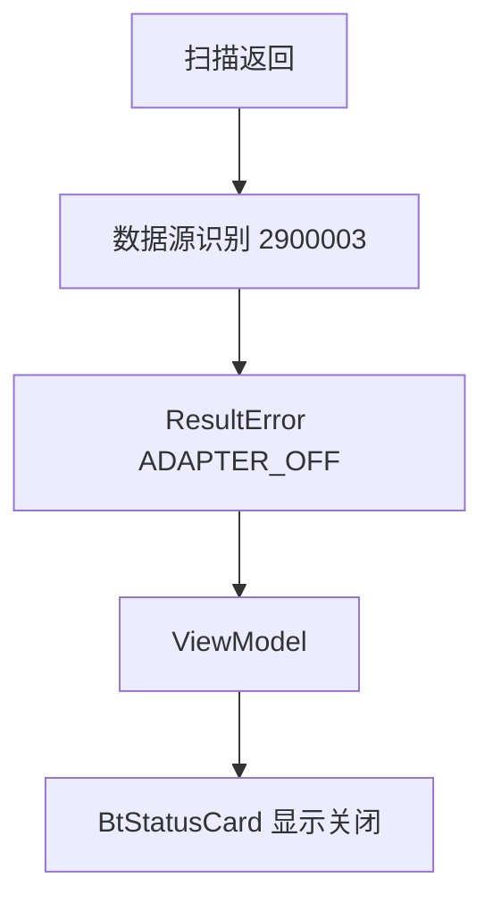
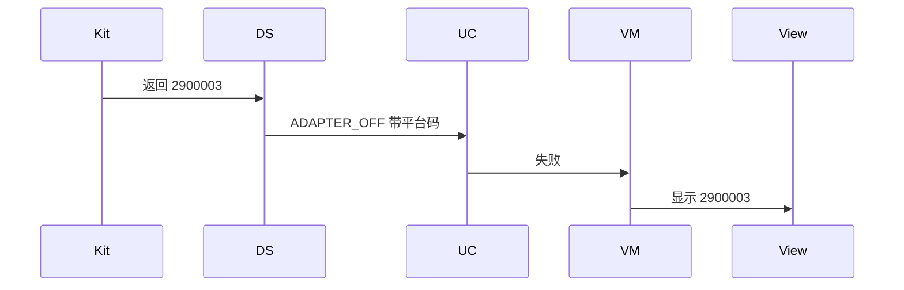
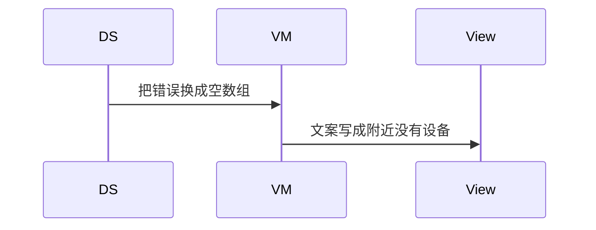

# BT-006 蓝牙关闭时的错误不是空列表

## 1. 条目与非目标

**判定：** 支持

**Given** 蓝牙关闭

**When** 扫描接口返回

**Then** 可见错误码 2900003，而不是「附近没有设备」

**证据：** `开发/API参考/系统/网络/Connectivity Kit（短距通信服务）/错误码/蓝牙服务子系统错误码.md`。行为以已接受的研究笔记和清单为准，本文件不重开行业调查。

**本条输入：** 适配器关闭时仍然到达扫描数据源的返回，或守卫已经判定关闭。

**本条输出：** 页面展示平台码 2900003 与领域码 `YW-BT-1001`。列表保持原样，不显示空结果成功。

**本条失败：** 把 2900003 映射成空设备列表。

**本条所有者：** `ClassicBluetoothDataSource` 与 `BleScannerDataSource` 在调用点识别 2900003；`BluetoothErrorCodes.ADAPTER_OFF` 是领域类别；ViewModel 用码选择文案。

**非目标：**

- 不把关闭错误改写成扫描失败 2902050。
- 不清除已有列表来假装刷新成功。
- 不新增 `common/yobluetooth` 以外的蓝牙栈，不增加包装层或版本兼容层。版本判断留在本条调用点。

## 2. 模块边界与分层

本组是权限与适配器。依赖方向是 `product/phone` → `features/bluetooth` → `common/yobluetooth`。权限、生命周期和系统设置走 `common/platform` 与 `common/debug_core`。字节与 `Result` 走 `common/core`。日志门面走 `common/yolog`。收藏、会话记录和导出走 `common/storage`。`common/youi_kit` 只提供通用控件，不解释蓝牙状态。

**调用点：** 平台码到领域码的映射写在发出扫描的数据源里，不新建错误码适配包。

| 包 | 类型 | 职责 |
| --- | --- | --- |
| common/yobluetooth | 扫描数据源 | 识别平台码 2900003 |
| common/yobluetooth | BluetoothErrorCodes | 映射为 ADAPTER_OFF |
| features/bluetooth | 扫描 ViewModel | 展示错误而不是空列表 |
| common/core | ResultError | 携带 code 与平台码字段 |

**设计前：** 关闭时若扫描返回被吞掉，页面只会看到合并后的空列表。

**设计后：** 2900003 沿 Result 上传。空列表只表示一次成功扫描没有设备，与本错误分开。

## 3. 架构图

本组总图在 [`BT-001.md`](BT-001.md)。下图只覆盖本条。

## 4. 序列图

### 成功路径

### 错误路径

## 5. 数据模型

领域模型放在 `common/yobluetooth`，持久化模型放在 `common/storage`，平台传输对象只出现在数据源调用点，跨层用 `common/core` 的 `Result` 与 `ResultError`。错误只带类别和结构化字段，不把界面句子塞进邻层错误。

| 模型 | 所在层 | 字段 | 来源 |
| --- | --- | --- | --- |
| ResultError | common/core | code 与 platformCode | 数据源填写 |
| BluetoothErrorCodes.ADAPTER_OFF | common/yobluetooth | YW-BT-1001 | 对应 2900003 |

## 6. 层间接口

| 从 | 到 | 接口 | 成功 | 失败 |
| --- | --- | --- | --- | --- |
| BleScannerDataSource | StartBleScanUseCase | Result | 不用于本条 | platformCode=2900003 |
| ClassicBluetoothDataSource | StartClassicScanUseCase | Result | 不用于本条 | platformCode=2900003 |
| ViewModel | BtStatusCard | 状态 | 展示码 | 不展示空成功 |

下层不持有页面类型。结果用 `Result` 或已有观察者回传。`common/yobluetooth` 的 `Index.ets` 继续只导出用例、领域模型和必要门面，不把数据源具体类变成第二套公开栈。

## 7. 权限与生命周期

关闭错误与权限拒绝分开。2900003 不触发再次申请权限。

收到 2900003 时扫描相位结束，不保持扫描中。

## 8. 日志

- `BtLogTag.SCAN` 记录 platformCode=2900003 与 rail。
- 领域标签加在已有 `BtLogTag`，不在 `common/yolog` 的 `YoLogTag` 里再开一套蓝牙标签。
- 日志走 `YoLog`，不在页面里直接写 hilog。

## 9. 反模式

- 空列表与错误共用一个 UI 状态。
- 捕获后重试扫描直到变成空列表。
- 用新的蓝牙 HAR、适配器或 `ApiCompat` 把本条版本差异包起来。版本判断只留在上面写明的调用点。
- 页面或 `common/youi_kit` 直接调用 `ohos.bluetooth.*`。
