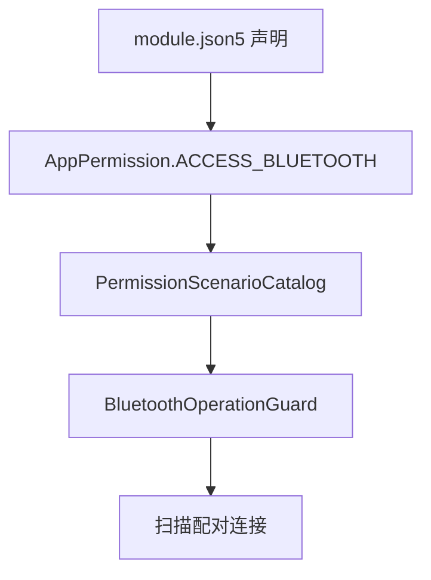
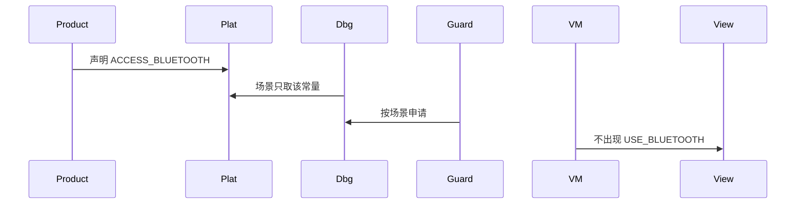
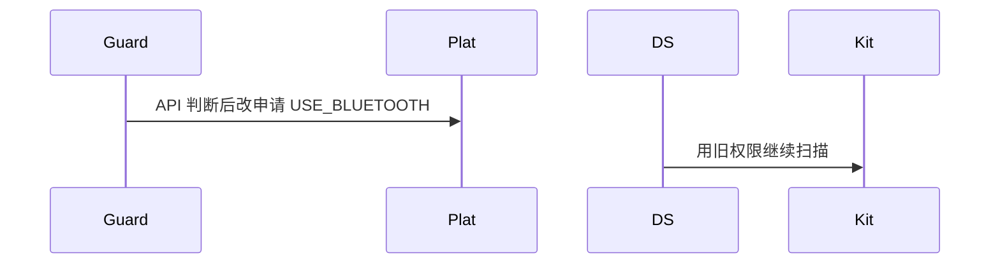

# BT-007 不使用已废弃的 USE_BLUETOOTH 作为 API 10+ 权限

## 1. 条目与非目标

**判定：** 支持

**Given** 应用目标为 API 10 及以上

**When** 检查声明的蓝牙权限

**Then** 接入能力对应 `ACCESS_BLUETOOTH`；`USE_BLUETOOTH` 不作为扫描、配对、连接的权限

**证据：** `开发/FAQ/系统开发/网络/短距通信（Connectivity）/USE_BLUETOOTH 和 ACCESS_BLUETOOTH的区别是什么.md`。行为以已接受的研究笔记和清单为准，本文件不重开行业调查。

**本条输入：** `product/phone` 的 `module.json5` 权限声明，以及 `AppPermission` 常量。

**本条输出：** 扫描、配对、连接只引用 `AppPermission.ACCESS_BLUETOOTH`。声明与场景目录里不出现 `USE_BLUETOOTH`。

**本条失败：** 按 API 等级在运行时切换两套权限名。

**本条所有者：** 声明归 `product/phone` 的 `module.json5`；常量归 `common/platform` 的 `AppPermission`；场景归 `common/debug_core` 的 `PermissionScenarioCatalog`。`common/yobluetooth` 只消费场景，不写权限字符串。

**非目标：**

- 不恢复 API 7 到 9 的旧权限路径。
- 不在用例里写权限名版本分支。
- 不新增 `common/yobluetooth` 以外的蓝牙栈，不增加包装层或版本兼容层。版本判断留在本条调用点。

## 2. 模块边界与分层

本组是权限与适配器。依赖方向是 `product/phone` → `features/bluetooth` → `common/yobluetooth`。权限、生命周期和系统设置走 `common/platform` 与 `common/debug_core`。字节与 `Result` 走 `common/core`。日志门面走 `common/yolog`。收藏、会话记录和导出走 `common/storage`。`common/youi_kit` 只提供通用控件，不解释蓝牙状态。

**调用点：** 没有运行时版本门。API 10+ 固定使用 `ACCESS_BLUETOOTH`，不在调用点保留旧权限分支。

| 包 | 类型 | 职责 |
| --- | --- | --- |
| product/phone | module.json5 | 声明 ACCESS_BLUETOOTH |
| common/platform | AppPermission | 只保留 ACCESS_BLUETOOTH 常量 |
| common/debug_core | PermissionScenarioCatalog | 场景映射到该常量 |
| common/yobluetooth | BluetoothOperationGuard | 只传场景，不写权限字符串 |

**设计前：** 权限字符串若散落在蓝牙用例中，容易把废弃权限和现行权限并列为双轨。

**设计后：** 权限名只存在于 platform 常量、产品声明和 debug_core 目录。蓝牙引擎不出现 `USE_BLUETOOTH`。

## 3. 架构图

本组总图在 [`BT-001.md`](BT-001.md)。下图只覆盖本条。

## 4. 序列图

### 成功路径

### 错误路径

## 5. 数据模型

领域模型放在 `common/yobluetooth`，持久化模型放在 `common/storage`，平台传输对象只出现在数据源调用点，跨层用 `common/core` 的 `Result` 与 `ResultError`。错误只带类别和结构化字段，不把界面句子塞进邻层错误。

| 模型 | 所在层 | 字段 | 来源 |
| --- | --- | --- | --- |
| PlatformPermission | common/platform | 权限名字符串 | AppPermission 单点 |
| PermissionScenario | common/debug_core | BLUETOOTH_SCAN_CONNECT | 映射目录 |

## 6. 层间接口

| 从 | 到 | 接口 | 成功 | 失败 |
| --- | --- | --- | --- | --- |
| BluetoothOperationGuard | EnsurePermissionUseCase | 场景枚举 | ACCESS_BLUETOOTH | 不含 USE_BLUETOOTH |
| PermissionScenarioCatalog | AppPermission | permissionsFor | 单常量 | 不返回旧权限 |

下层不持有页面类型。结果用 `Result` 或已有观察者回传。`common/yobluetooth` 的 `Index.ets` 继续只导出用例、领域模型和必要门面，不把数据源具体类变成第二套公开栈。

## 7. 权限与生命周期

`product/phone` 已声明 `ACCESS_BLUETOOTH`。本条要求配对和连接继续用它，不追加废弃权限。

权限声明是安装清单，不随页面生命周期变化。

## 8. 日志

- 权限日志只打印场景名，不打印第二套权限名。
- 领域标签加在已有 `BtLogTag`，不在 `common/yolog` 的 `YoLogTag` 里再开一套蓝牙标签。
- 日志走 `YoLog`，不在页面里直接写 hilog。

## 9. 反模式

- 在 `yobluetooth` 内硬编码 `ohos.permission.USE_BLUETOOTH`。
- 为旧 API 保留双权限申请。
- 用新的蓝牙 HAR、适配器或 `ApiCompat` 把本条版本差异包起来。版本判断只留在上面写明的调用点。
- 页面或 `common/youi_kit` 直接调用 `ohos.bluetooth.*`。
