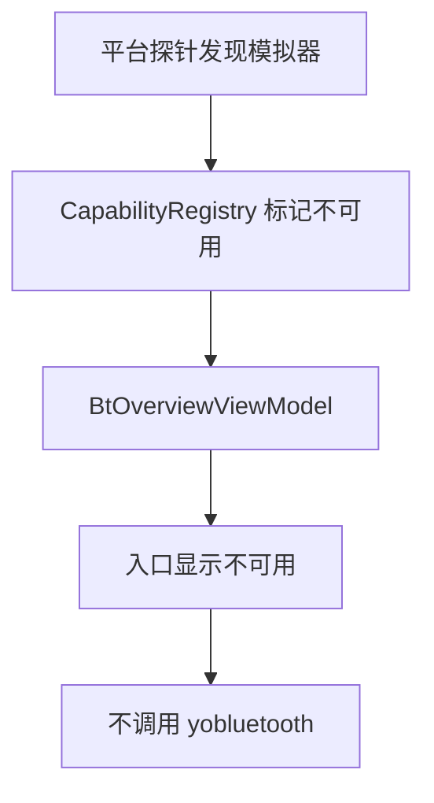
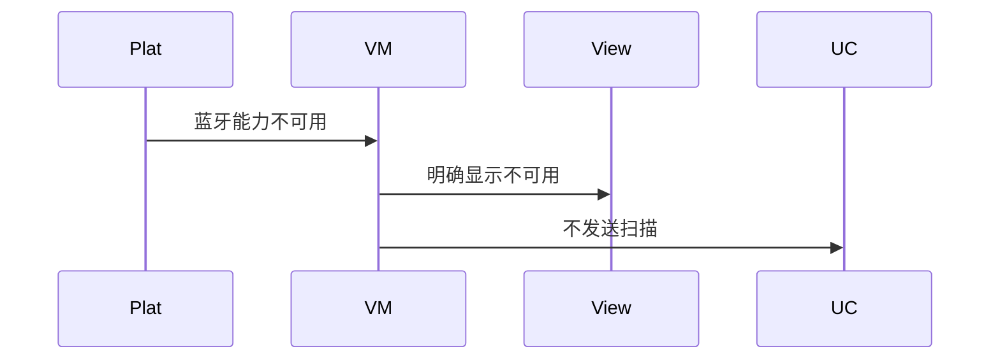
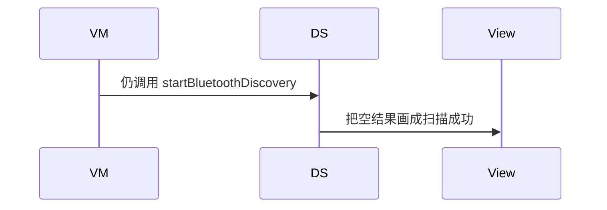

# BT-008 模拟器上蓝牙标为不可用

## 1. 条目与非目标

**判定：** 缺口

**Given** 运行在模拟器

**When** 打开蓝牙调试入口

**Then** 明确显示蓝牙不可用；不展示会成功的扫描按钮结果

**证据：** `开发/指南/开发/系统/网络/Connectivity Kit（短距通信服务）/蓝牙/蓝牙服务开发概述.md`。行为以已接受的研究笔记和清单为准，本文件不重开行业调查。

**本条输入：** 进程运行环境是模拟器，用户打开蓝牙入口。

**本条输出：** 入口显示蓝牙不可用。扫描、配对、连接按钮不产生成功结果。

**本条失败：** 模拟器上仍展示一次成功扫描，或调用 Kit 后把空列表当成功。

**本条所有者：** 运行环境判断放在 `common/platform` 的能力探针，结果进入已有 `CapabilityRegistry`。`features/bluetooth` 的 `BtOverviewViewModel` 读取该结果并停用入口。`common/yobluetooth` 在此结果下不被调用。

本条按缺口设计。完成态只包含清单允许看见的结果，不包含把缺口做成已成功的路径。

**非目标：**

- 不写模拟器专用蓝牙桩去返回假设备。
- 不把模拟器缺口做成可切换的成功模式。
- 不新增 `common/yobluetooth` 以外的蓝牙栈，不增加包装层或版本兼容层。版本判断留在本条调用点。

## 2. 模块边界与分层

本组是权限与适配器。依赖方向是 `product/phone` → `features/bluetooth` → `common/yobluetooth`。权限、生命周期和系统设置走 `common/platform` 与 `common/debug_core`。字节与 `Result` 走 `common/core`。日志门面走 `common/yolog`。收藏、会话记录和导出走 `common/storage`。`common/youi_kit` 只提供通用控件，不解释蓝牙状态。

**调用点：** 本条不进入 Kit 调用点。没有可以在模拟器上成功的蓝牙 API 分支。

| 包 | 类型 | 职责 |
| --- | --- | --- |
| common/platform | ICapabilityProbe | 判断蓝牙模块在模拟器不可用 |
| common/platform | CapabilityRegistry | 记录 BLUETOOTH 不可用 |
| common/debug_core | CapabilityId | 沿用 BLUETOOTH_ADAPTER_STATE 等标识 |
| features/bluetooth | BtOverviewViewModel | 展示不可用并停用操作 |
| product/phone | BluetoothOverviewPage | 只绑定该状态 |

**设计前：** 入口没有模拟器判断，扫描按钮看起来可以成功。

**设计后：** 探针为不可用时，页面状态直接停用。用例与数据源不运行，因此没有成功扫描结果。

## 3. 架构图

本组总图在 [`BT-001.md`](BT-001.md)。下图只覆盖本条。

## 4. 序列图

### 成功路径

缺口条目的成功路径是用户看见限制。缺失能力没有被画成已经成功。

### 错误路径

错误路径把缺口做成了成功。这条路径不进入目标分层。

## 5. 数据模型

领域模型放在 `common/yobluetooth`，持久化模型放在 `common/storage`，平台传输对象只出现在数据源调用点，跨层用 `common/core` 的 `Result` 与 `ResultError`。错误只带类别和结构化字段，不把界面句子塞进邻层错误。

| 模型 | 所在层 | 字段 | 来源 |
| --- | --- | --- | --- |
| CapabilityResult | common/platform | available=false 与 reason | 模拟器探针 |
| BluetoothCapabilitySnapshot | common/yobluetooth | 本条不生成成功快照 | 不被调用 |

## 6. 层间接口

| 从 | 到 | 接口 | 成功 | 失败 |
| --- | --- | --- | --- | --- |
| BtOverviewViewModel | CapabilityRegistry | 读取蓝牙能力 | 不可用 | 无成功扫描 |
| BtOverviewViewModel | StartClassicScanUseCase | execute | 不调用 | 模拟器上禁止 |
| BtOverviewViewModel | StartBleScanUseCase | execute | 不调用 | 模拟器上禁止 |

下层不持有页面类型。结果用 `Result` 或已有观察者回传。`common/yobluetooth` 的 `Index.ets` 继续只导出用例、领域模型和必要门面，不把数据源具体类变成第二套公开栈。

## 7. 权限与生命周期

不在模拟器上申请蓝牙权限来换取一次假成功。

没有扫描或连接订阅。离开页面只是离开不可用说明。

## 8. 日志

- `YoLogTag.CAP` 记录 module=bluetooth available=0 reason=emulator。
- 不写 `BtLogTag.SCAN` 的开始事件。
- 领域标签加在已有 `BtLogTag`，不在 `common/yolog` 的 `YoLogTag` 里再开一套蓝牙标签。
- 日志走 `YoLog`，不在页面里直接写 hilog。

## 9. 反模式

- 用假数据源返回固定设备。
- 捕获 Kit 异常后显示附近没有设备。
- 提供仍会成功的扫描按钮。
- 用新的蓝牙 HAR、适配器或 `ApiCompat` 把本条版本差异包起来。版本判断只留在上面写明的调用点。
- 页面或 `common/youi_kit` 直接调用 `ohos.bluetooth.*`。
