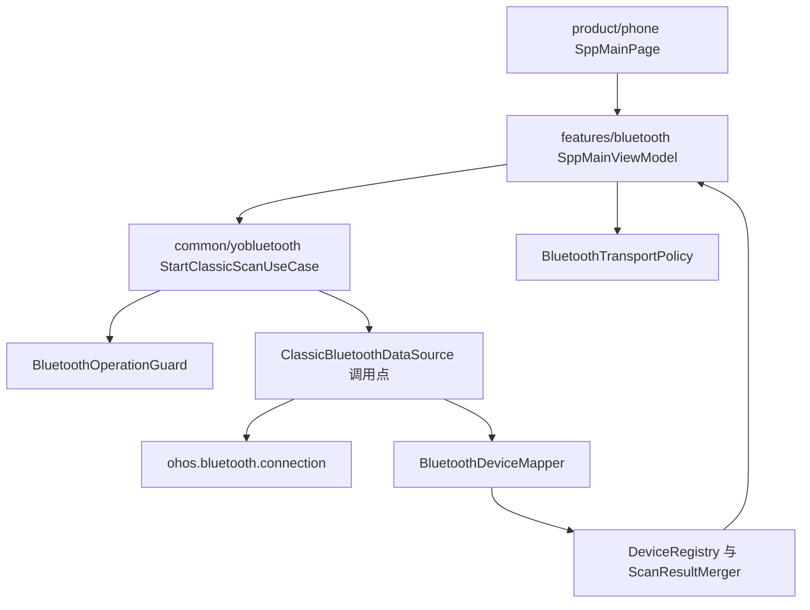
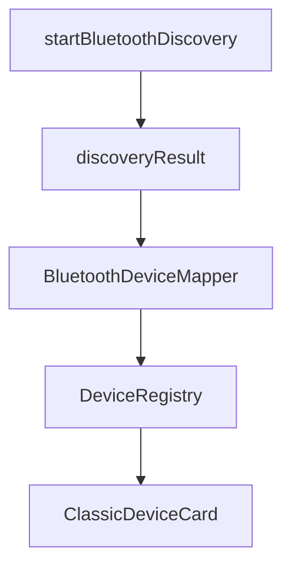
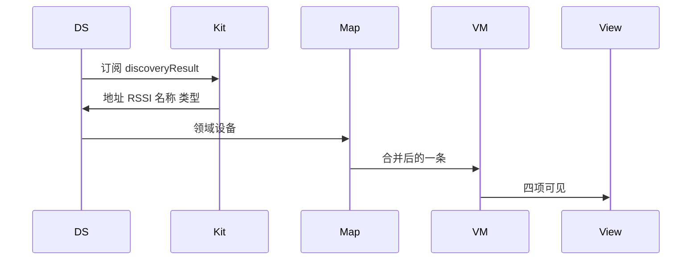
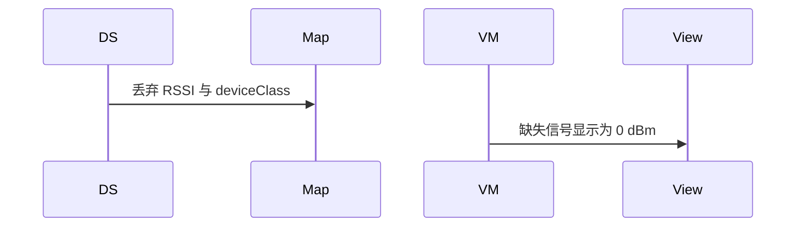

# BT-009 API 18+ 发现结果含信号与类型

## 1. 条目与非目标

**判定：** 支持

**Given** API 18+ 且已开始发现

**When** 收到 `discoveryResult`

**Then** 每条可见虚拟地址、RSSI（dBm）、名称、设备类型

**证据：** `ohos.bluetooth.connection 的 DiscoveryResult18+；传统蓝牙查找设备指南`。行为以已接受的研究笔记和清单为准，本文件不重开行业调查。

**本条输入：** API 18+ 上一次经典发现的 `discoveryResult`。

**本条输出：** `BluetoothDevice` 带虚拟 `deviceId`、RSSI、名称、`deviceClass`。SPP 页列表能看到这四项。

**本条失败：** API 18+ 仍只显示地址，或把缺失 RSSI 写成 0。

**本条所有者：** 调用点是 `ClassicBluetoothDataSource`：API 18+ 订阅 `discoveryResult`。`BluetoothDeviceMapper` 转成领域设备。`SppMainViewModel` 展示。

**非目标：**

- 不在本条处理 API 17 的旧事件。
- 不把设备类型当成传输类型。
- 不新增 `common/yobluetooth` 以外的蓝牙栈，不增加包装层或版本兼容层。版本判断留在本条调用点。

## 2. 模块边界与分层

本组是经典发现。依赖方向是 `product/phone` → `features/bluetooth` → `common/yobluetooth`。权限、生命周期和系统设置走 `common/platform` 与 `common/debug_core`。字节与 `Result` 走 `common/core`。日志门面走 `common/yolog`。收藏、会话记录和导出走 `common/storage`。`common/youi_kit` 只提供通用控件，不解释蓝牙状态。

**调用点：** 是否使用 `discoveryResult` 的判断写在 `ClassicBluetoothDataSource` 订阅处。

| 包 | 类型 | 职责 |
| --- | --- | --- |
| common/yobluetooth | ClassicBluetoothDataSource | API 18+ 订阅 discoveryResult |
| common/yobluetooth | BluetoothDeviceMapper | 映射地址、RSSI、名称、deviceClass |
| common/yobluetooth | DeviceRegistry | 按虚拟地址合并 |
| features/bluetooth | SppMainViewModel | 展示四项 |
| features/bluetooth | ClassicDeviceCard | 渲染，不含 Kit 调用 |

**设计前：** 发现载荷若沿用旧的纯地址事件，API 18+ 的 RSSI 和类型到不了卡片。

**设计后：** 调用点按当前 API 订阅 `discoveryResult`。映射保留缺省为空而不是 0。卡片展示虚拟地址、dBm、名称和类型。

## 3. 架构图

本组总图放在本文件。经典发现里其余条目各自再画本条链路，链接不能代替本条的输入、输出、失败和所有者。

本条链路：

## 4. 序列图

### 成功路径

### 错误路径

## 5. 数据模型

领域模型放在 `common/yobluetooth`，持久化模型放在 `common/storage`，平台传输对象只出现在数据源调用点，跨层用 `common/core` 的 `Result` 与 `ResultError`。错误只带类别和结构化字段，不把界面句子塞进邻层错误。

| 模型 | 所在层 | 字段 | 来源 |
| --- | --- | --- | --- |
| PlatformDiscoveryPayload | common/yobluetooth 数据源 | deviceId rssi name deviceClass | DiscoveryResult |
| BluetoothDevice | common/yobluetooth 领域 | 虚拟地址与展示字段 | 映射结果 |
| RssiSample | common/yobluetooth | dbm | 有值才构造 |

## 6. 层间接口

| 从 | 到 | 接口 | 成功 | 失败 |
| --- | --- | --- | --- | --- |
| ClassicBluetoothDataSource | connection | on discoveryResult | 四字段 | 事件缺失则不造值 |
| BluetoothDeviceMapper | DeviceRegistry | upsert | 可见四项 | 不把空名称写成未知设备成功 |
| SppMainViewModel | ClassicDeviceCard | 展示模型 | 地址 RSSI 名称 类型 | 无 RSSI 则空 |

下层不持有页面类型。结果用 `Result` 或已有观察者回传。`common/yobluetooth` 的 `Index.ets` 继续只导出用例、领域模型和必要门面，不把数据源具体类变成第二套公开栈。

## 7. 权限与生命周期

发现仍先经过 BT-001 的权限守卫。本条不新增权限。

发现订阅在停止或约 12 秒结束时 `off`。页面离开见后续停止条目，不在本条扩展。

## 8. 日志

- `BtLogTag.SCAN` 记录条数与是否带 rssi，不记录完整地址明文以外的调试需求；地址按现有扫描日志策略。
- 领域标签加在已有 `BtLogTag`，不在 `common/yolog` 的 `YoLogTag` 里再开一套蓝牙标签。
- 日志走 `YoLog`，不在页面里直接写 hilog。

## 9. 反模式

- 用 `bluetoothDeviceFind` 覆盖 API 18+ 结果。
- CoD 被写成传输类型 BR/LE。
- 用新的蓝牙 HAR、适配器或 `ApiCompat` 把本条版本差异包起来。版本判断只留在上面写明的调用点。
- 页面或 `common/youi_kit` 直接调用 `ohos.bluetooth.*`。
