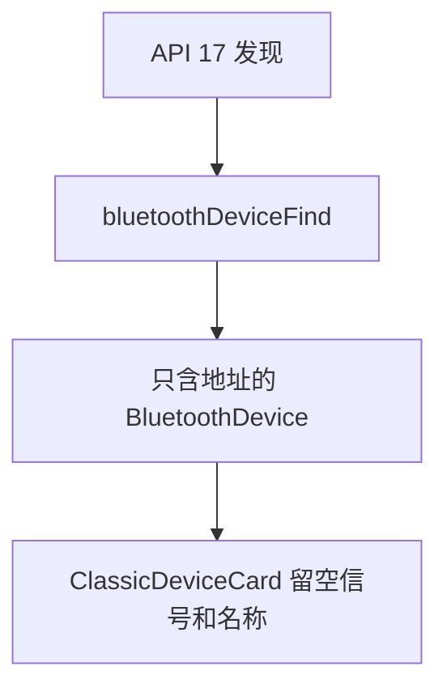
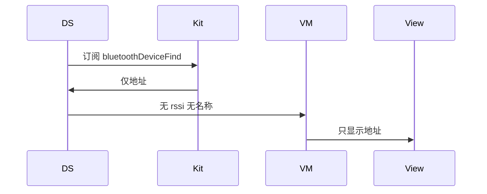
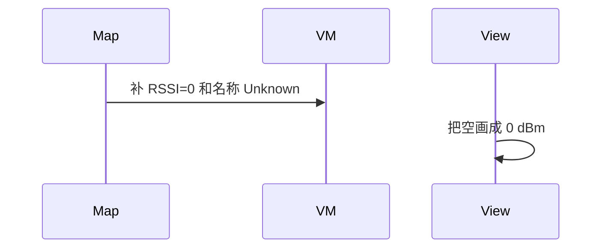

# BT-010 API 17 及以前只有地址

## 1. 条目与非目标

**判定：** 支持

**Given** API 17 及以前

**When** 收到 `bluetoothDeviceFind`

**Then** 列表只保证地址；不显示编造的 RSSI 或名称

**证据：** `传统蓝牙查找设备指南`。行为以已接受的研究笔记和清单为准，本文件不重开行业调查。

**本条输入：** API 17 及以前的 `bluetoothDeviceFind` 地址列表。

**本条输出：** 列表项只有虚拟地址。RSSI 与名称为空，不显示 0 或占位名称。

**本条失败：** 为了卡片整齐填上假 RSSI 或假名称。

**本条所有者：** `ClassicBluetoothDataSource` 在 API 17 及以前订阅 `bluetoothDeviceFind`。`BluetoothDeviceMapper` 只填地址。`ClassicDeviceCard` 允许空字段。

**非目标：**

- 不在应用层补一次 BLE 扫描来拿名称。
- 不把本路径的结果标成 API 18 发现。
- 不新增 `common/yobluetooth` 以外的蓝牙栈，不增加包装层或版本兼容层。版本判断留在本条调用点。

## 2. 模块边界与分层

本组是经典发现。依赖方向是 `product/phone` → `features/bluetooth` → `common/yobluetooth`。权限、生命周期和系统设置走 `common/platform` 与 `common/debug_core`。字节与 `Result` 走 `common/core`。日志门面走 `common/yolog`。收藏、会话记录和导出走 `common/storage`。`common/youi_kit` 只提供通用控件，不解释蓝牙状态。

**调用点：** 事件名的选择写在 `ClassicBluetoothDataSource`。API 18+ 不走本条。

| 包 | 类型 | 职责 |
| --- | --- | --- |
| common/yobluetooth | ClassicBluetoothDataSource | 订阅 bluetoothDeviceFind |
| common/yobluetooth | BluetoothDeviceMapper | 只映射地址 |
| features/bluetooth | ClassicDeviceCard | 空 RSSI 与空名称 |

**设计前：** 卡片若把缺省数字显示成 0，会把旧 API 的地址事件说成有信号。

**设计后：** 旧事件的领域设备没有 RSSI 和名称。展示层区分空与 0。

## 3. 架构图

本组总图在 [`BT-009.md`](BT-009.md)。下图只覆盖本条。

## 4. 序列图

### 成功路径

### 错误路径

## 5. 数据模型

领域模型放在 `common/yobluetooth`，持久化模型放在 `common/storage`，平台传输对象只出现在数据源调用点，跨层用 `common/core` 的 `Result` 与 `ResultError`。错误只带类别和结构化字段，不把界面句子塞进邻层错误。

| 模型 | 所在层 | 字段 | 来源 |
| --- | --- | --- | --- |
| PlatformDiscoveryPayload | 数据源 | deviceId | bluetoothDeviceFind |
| BluetoothDevice | 领域 | 地址必填，rssi 与 name 可空 | 映射 |

## 6. 层间接口

| 从 | 到 | 接口 | 成功 | 失败 |
| --- | --- | --- | --- | --- |
| ClassicBluetoothDataSource | connection | on bluetoothDeviceFind | 地址数组 | 不合成 DiscoveryResult |
| SppMainViewModel | ClassicDeviceCard | 可空展示 | 只保证地址 | 不填假值 |

下层不持有页面类型。结果用 `Result` 或已有观察者回传。`common/yobluetooth` 的 `Index.ets` 继续只导出用例、领域模型和必要门面，不把数据源具体类变成第二套公开栈。

## 7. 权限与生命周期

权限要求与 API 18 发现相同，仍是 `ACCESS_BLUETOOTH`。

旧事件同样成对取消订阅。发现结束后不再保留半截名称缓存。

## 8. 日志

- `BtLogTag.SCAN` 记录 event=bluetoothDeviceFind 与 count，不写 rssi。
- 领域标签加在已有 `BtLogTag`，不在 `common/yolog` 的 `YoLogTag` 里再开一套蓝牙标签。
- 日志走 `YoLog`，不在页面里直接写 hilog。

## 9. 反模式

- 为旧系统缓存上一次 API 18 的名称再贴回去。
- 两条事件同时订阅导致重复设备。
- 用新的蓝牙 HAR、适配器或 `ApiCompat` 把本条版本差异包起来。版本判断只留在上面写明的调用点。
- 页面或 `common/youi_kit` 直接调用 `ohos.bluetooth.*`。
