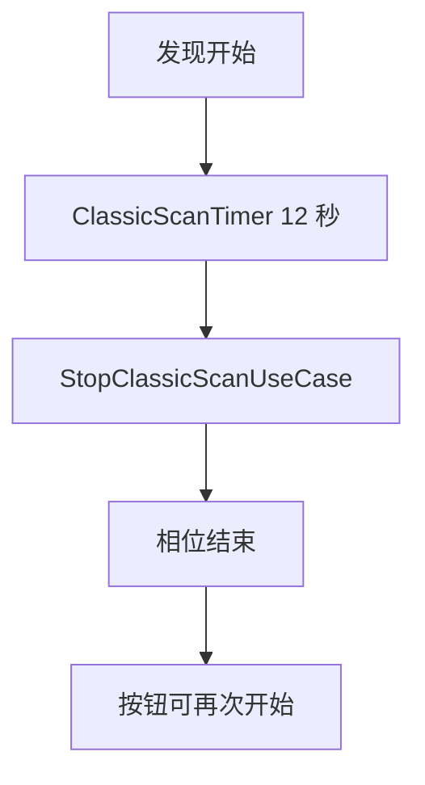
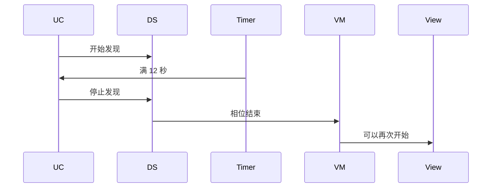
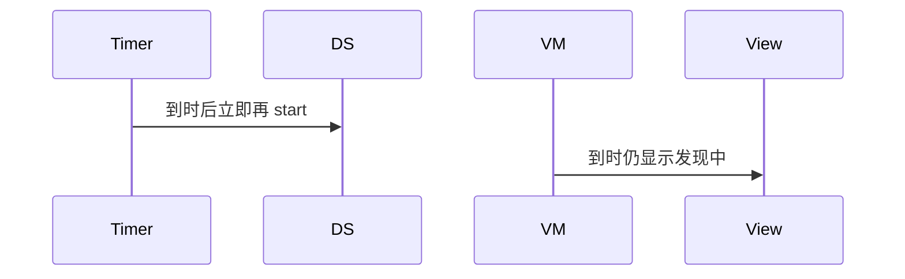

# BT-011 一次发现约 12 秒后结束

## 1. 条目与非目标

**判定：** 支持

**Given** 发现已开始且用户未手动停止

**When** 经过该次发现

**Then** 发现状态结束；可再次开始。文档写明过程大约持续 12s

**证据：** `connection.startBluetoothDiscovery 说明`。行为以已接受的研究笔记和清单为准，本文件不重开行业调查。

**本条输入：** 已经开始的一次经典发现，用户没有点停止。

**本条输出：** 约 12 秒后 `ClassicScanPhase` 结束，按钮恢复为开始。

**本条失败：** 到时后仍保持发现中，或应用再启动第二次来凑时长。

**本条所有者：** 时长常量在 `BluetoothConstants.CLASSIC_DISCOVERY_TIMEOUT_MS` 与 `ClassicScanCapability.INQUIRY_DURATION_SEC`。相位由 `ClassicScanTimer` 和发现停止回调共同结束。页面状态在 `SppMainViewModel`。

**非目标：**

- 不把 12 秒改成可配置的平台扫描窗口。
- 不到时自动立刻再开一轮。
- 不新增 `common/yobluetooth` 以外的蓝牙栈，不增加包装层或版本兼容层。版本判断留在本条调用点。

## 2. 模块边界与分层

本组是经典发现。依赖方向是 `product/phone` → `features/bluetooth` → `common/yobluetooth`。权限、生命周期和系统设置走 `common/platform` 与 `common/debug_core`。字节与 `Result` 走 `common/core`。日志门面走 `common/yolog`。收藏、会话记录和导出走 `common/storage`。`common/youi_kit` 只提供通用控件，不解释蓝牙状态。

**调用点：** 12 秒是平台说明，常量在 `BluetoothConstants`。数据源不循环调用 `startBluetoothDiscovery`。

| 包 | 类型 | 职责 |
| --- | --- | --- |
| common/yobluetooth | ClassicScanTimer | 按 12 秒结束本地相位 |
| common/yobluetooth | ClassicBluetoothDataSource | 收到发现结束并停止 |
| common/yobluetooth | StopClassicScanUseCase | 保证停止完成 |
| features/bluetooth | SppMainViewModel | 按钮回到开始 |

**设计前：** 定时器与平台结束若各写一次相位，可能停不干净或提前再开。

**设计后：** 一次发现只有一个结束点。结束后允许下一次 `StartClassicScanUseCase`，由用户发起。

## 3. 架构图

本组总图在 [`BT-009.md`](BT-009.md)。下图只覆盖本条。

## 4. 序列图

### 成功路径

### 错误路径

## 5. 数据模型

领域模型放在 `common/yobluetooth`，持久化模型放在 `common/storage`，平台传输对象只出现在数据源调用点，跨层用 `common/core` 的 `Result` 与 `ResultError`。错误只带类别和结构化字段，不把界面句子塞进邻层错误。

| 模型 | 所在层 | 字段 | 来源 |
| --- | --- | --- | --- |
| ClassicScanPhase | 领域 | discovering 然后 idle | 定时器与停止回调 |
| CLASSIC_DISCOVERY_TIMEOUT_MS | BluetoothConstants | 12000 | 平台约 12 秒 |

## 6. 层间接口

| 从 | 到 | 接口 | 成功 | 失败 |
| --- | --- | --- | --- | --- |
| StartClassicScanUseCase | ClassicScanTimer | arm | 到期回调 | 用户已停止则作废 |
| ClassicScanTimer | StopClassicScanUseCase | stop | 相位 idle | 停止失败则显示错误 |

下层不持有页面类型。结果用 `Result` 或已有观察者回传。`common/yobluetooth` 的 `Index.ets` 继续只导出用例、领域模型和必要门面，不把数据源具体类变成第二套公开栈。

## 7. 权限与生命周期

本条不重新申请权限。

定时器跟随这一次发现。页面销毁时取消定时器并停止发现，避免后台继续发现。

## 8. 日志

- `BtLogTag.SCAN` 记录 discoveryStart 与 discoveryEnd，带 elapsedMs。
- 领域标签加在已有 `BtLogTag`，不在 `common/yolog` 的 `YoLogTag` 里再开一套蓝牙标签。
- 日志走 `YoLog`，不在页面里直接写 hilog。

## 9. 反模式

- 用多次 12 秒发现拼接成长扫描。
- 只改按钮文字不调用停止。
- 用新的蓝牙 HAR、适配器或 `ApiCompat` 把本条版本差异包起来。版本判断只留在上面写明的调用点。
- 页面或 `common/youi_kit` 直接调用 `ohos.bluetooth.*`。
