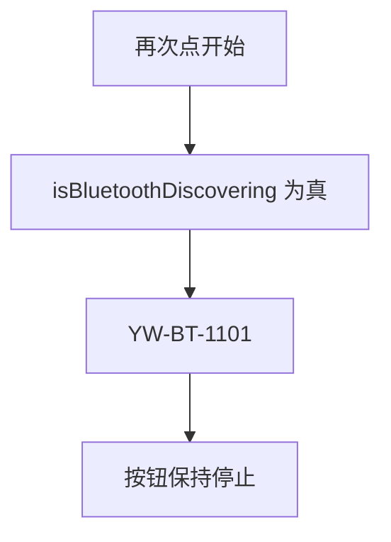
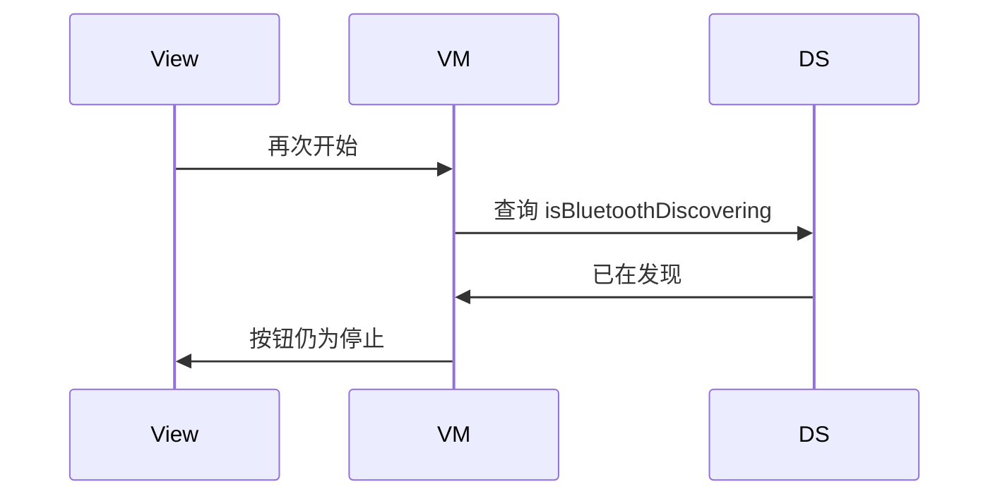
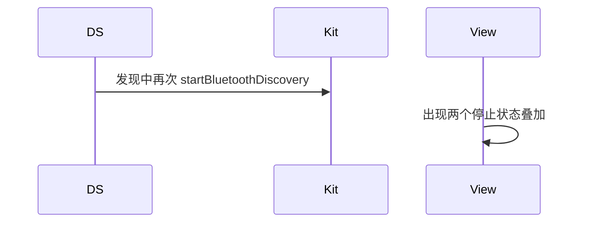

# BT-012 发现进行中不能再开始一次

## 1. 条目与非目标

**判定：** 支持

**Given** `isBluetoothDiscovering()` 为真

**When** 用户再次点开始

**Then** 不叠加第二次发现；按钮保持停止

**证据：** `connection.startBluetoothDiscovery 说明，请勿重复调用`。行为以已接受的研究笔记和清单为准，本文件不重开行业调查。

**本条输入：** `isBluetoothDiscovering()` 为真时的再次开始点击。

**本条输出：** 没有第二次 `startBluetoothDiscovery`。按钮保持停止。

**本条失败：** 数据源忽略平台正在发现，又发出一次开始。

**本条所有者：** `ClassicBluetoothDataSource` 在调用点查询 `isBluetoothDiscovering`。`StartClassicScanUseCase` 发现已在进行则返回 `YW-BT-1101`。`SppMainViewModel` 把按钮保持为停止。

**非目标：**

- 不排队一个等本次结束后自动开始的第二次。
- 不提供并行经典发现。
- 不新增 `common/yobluetooth` 以外的蓝牙栈，不增加包装层或版本兼容层。版本判断留在本条调用点。

## 2. 模块边界与分层

本组是经典发现。依赖方向是 `product/phone` → `features/bluetooth` → `common/yobluetooth`。权限、生命周期和系统设置走 `common/platform` 与 `common/debug_core`。字节与 `Result` 走 `common/core`。日志门面走 `common/yolog`。收藏、会话记录和导出走 `common/storage`。`common/youi_kit` 只提供通用控件，不解释蓝牙状态。

**调用点：** 查询写在 `ClassicBluetoothDataSource` 开始方法的第一跳。

| 包 | 类型 | 职责 |
| --- | --- | --- |
| common/yobluetooth | ClassicBluetoothDataSource | 读取 isBluetoothDiscovering |
| common/yobluetooth | StartClassicScanUseCase | 已发现则返回 SCAN_ALREADY_RUNNING |
| features/bluetooth | ClassicScanPanelView | 按钮保持停止 |

**设计前：** 只靠本地相位会和平台真实发现状态不一致。

**设计后：** 调用点以 `isBluetoothDiscovering()` 为准。本地相位为真或平台为真都拒绝第二次开始。

## 3. 架构图

本组总图在 [`BT-009.md`](BT-009.md)。下图只覆盖本条。

## 4. 序列图

### 成功路径

### 错误路径

## 5. 数据模型

领域模型放在 `common/yobluetooth`，持久化模型放在 `common/storage`，平台传输对象只出现在数据源调用点，跨层用 `common/core` 的 `Result` 与 `ResultError`。错误只带类别和结构化字段，不把界面句子塞进邻层错误。

| 模型 | 所在层 | 字段 | 来源 |
| --- | --- | --- | --- |
| ClassicScanPhase | 领域 | discovering | 与平台查询一致 |
| ResultError YW-BT-1101 | BluetoothErrorCodes | SCAN_ALREADY_RUNNING | 重复开始 |

## 6. 层间接口

| 从 | 到 | 接口 | 成功 | 失败 |
| --- | --- | --- | --- | --- |
| StartClassicScanUseCase | ClassicBluetoothDataSource | queryDiscovering | false 才 start | true 则失败 |
| SppMainViewModel | ClassicScanPanelView | 按钮 | 停止 | 不变成开始 |

下层不持有页面类型。结果用 `Result` 或已有观察者回传。`common/yobluetooth` 的 `Index.ets` 继续只导出用例、领域模型和必要门面，不把数据源具体类变成第二套公开栈。

## 7. 权限与生命周期

重复点击不再次弹权限框。

进行中的订阅保持原有一对，不为第二次点击再 `on`。

## 8. 日志

- `BtLogTag.SCAN` 记录 reject=alreadyDiscovering。
- 领域标签加在已有 `BtLogTag`，不在 `common/yolog` 的 `YoLogTag` 里再开一套蓝牙标签。
- 日志走 `YoLog`，不在页面里直接写 hilog。

## 9. 反模式

- 捕获重复调用异常后当作新一轮成功。
- 用本地假相位绕过平台查询。
- 用新的蓝牙 HAR、适配器或 `ApiCompat` 把本条版本差异包起来。版本判断只留在上面写明的调用点。
- 页面或 `common/youi_kit` 直接调用 `ohos.bluetooth.*`。
