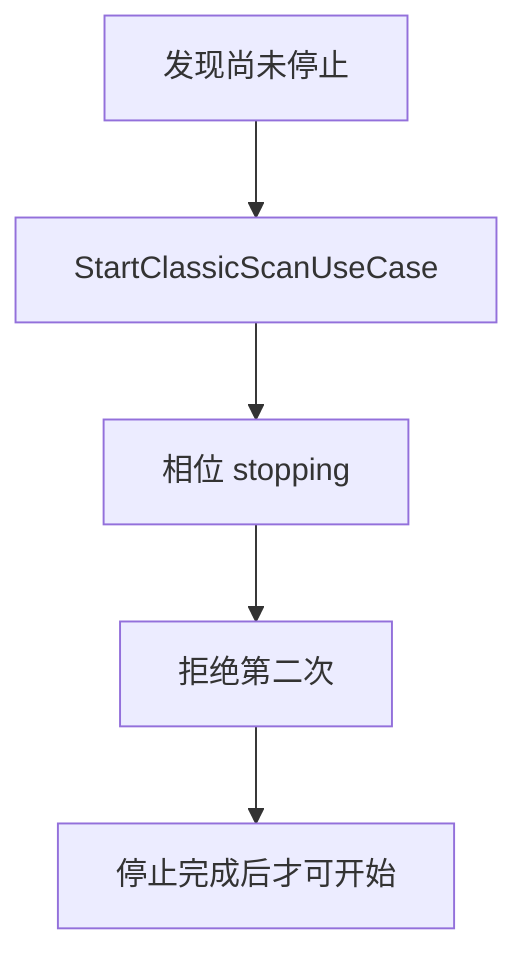
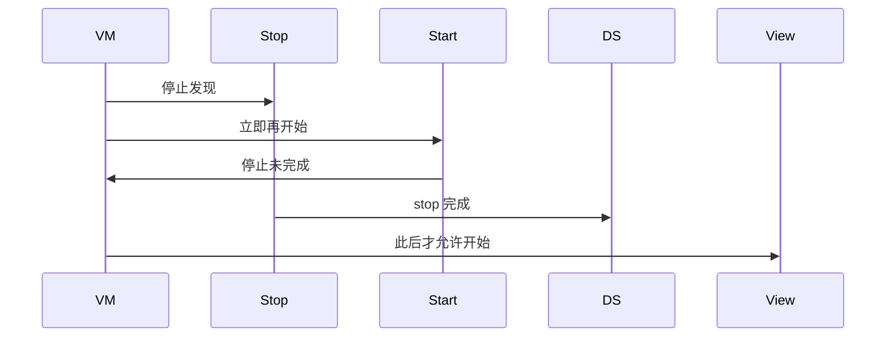
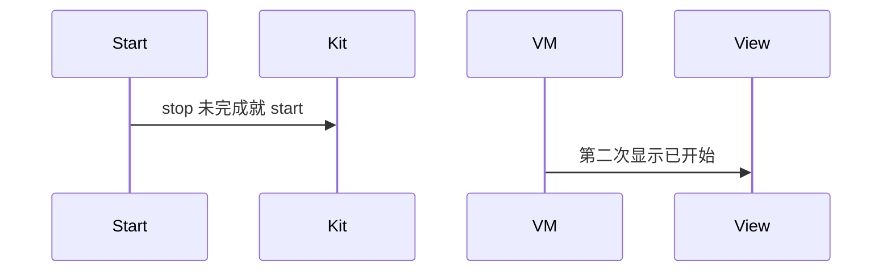

# BT-013 未停止不能开始下一次

## 1. 条目与非目标

**判定：** 支持

**Given** 上一次发现尚未停止

**When** 立即再次开始

**Then** 第二次不生效，直到停止完成

**证据：** `connection.startBluetoothDiscovery 说明`。行为以已接受的研究笔记和清单为准，本文件不重开行业调查。

**本条输入：** 停止尚未完成时的开始请求。

**本条输出：** 第二次开始不生效。停止完成后，用户可以再发起下一次。

**本条失败：** 停止 Promise 未完成就发出下一次 `startBluetoothDiscovery`。

**本条所有者：** `StopClassicScanUseCase` 持有停止完成。`StartClassicScanUseCase` 在停止未完成时返回失败。状态在 `ClassicScanPhase`。

**非目标：**

- 不把开始请求缓存到停止完成后再自动执行。
- 不与 BT-012 的进行中判断合成两次成功。
- 不新增 `common/yobluetooth` 以外的蓝牙栈，不增加包装层或版本兼容层。版本判断留在本条调用点。

## 2. 模块边界与分层

本组是经典发现。依赖方向是 `product/phone` → `features/bluetooth` → `common/yobluetooth`。权限、生命周期和系统设置走 `common/platform` 与 `common/debug_core`。字节与 `Result` 走 `common/core`。日志门面走 `common/yolog`。收藏、会话记录和导出走 `common/storage`。`common/youi_kit` 只提供通用控件，不解释蓝牙状态。

**调用点：** `ClassicBluetoothDataSource.stopDiscovery` 完成之前，开始方法返回，不调用 Kit 的 start。

| 包 | 类型 | 职责 |
| --- | --- | --- |
| common/yobluetooth | StopClassicScanUseCase | 等待停止完成 |
| common/yobluetooth | StartClassicScanUseCase | 停止未完成则拒绝 |
| common/yobluetooth | ClassicBluetoothDataSource | 停止完成前不 start |
| features/bluetooth | SppMainViewModel | 保持不可开始 |

**设计前：** 停止与开始若无同一相位，快速连点会叠两次发现。

**设计后：** 相位含 stopping。离开 stopping 之前，开始用例直接失败。完成后才允许新的开始。

## 3. 架构图

本组总图在 [`BT-009.md`](BT-009.md)。下图只覆盖本条。

## 4. 序列图

### 成功路径

### 错误路径

## 5. 数据模型

领域模型放在 `common/yobluetooth`，持久化模型放在 `common/storage`，平台传输对象只出现在数据源调用点，跨层用 `common/core` 的 `Result` 与 `ResultError`。错误只带类别和结构化字段，不把界面句子塞进邻层错误。

| 模型 | 所在层 | 字段 | 来源 |
| --- | --- | --- | --- |
| ClassicScanPhase | 领域 | stopping | 停止完成前 |
| ResultError YW-BT-1101 | 领域 | 重复或未停止 | 开始被拒 |

## 6. 层间接口

| 从 | 到 | 接口 | 成功 | 失败 |
| --- | --- | --- | --- | --- |
| StartClassicScanUseCase | StopClassicScanUseCase | 停止是否完成 | 完成后可开始 | 未完成则失败 |
| ClassicBluetoothDataSource | connection | stopBluetoothDiscovery | 完成 | 完成前禁止 start |

下层不持有页面类型。结果用 `Result` 或已有观察者回传。`common/yobluetooth` 的 `Index.ets` 继续只导出用例、领域模型和必要门面，不把数据源具体类变成第二套公开栈。

## 7. 权限与生命周期

本条不涉及新权限。

停止完成时取消发现订阅。未完成前不注册下一轮订阅。

## 8. 日志

- `BtLogTag.SCAN` 记录 phase=stopping 与被拒绝的 start。
- 领域标签加在已有 `BtLogTag`，不在 `common/yolog` 的 `YoLogTag` 里再开一套蓝牙标签。
- 日志走 `YoLog`，不在页面里直接写 hilog。

## 9. 反模式

- 停止失败后仍把相位改成空闲并立刻开始。
- 用延时猜测停止已经完成。
- 用新的蓝牙 HAR、适配器或 `ApiCompat` 把本条版本差异包起来。版本判断只留在上面写明的调用点。
- 页面或 `common/youi_kit` 直接调用 `ohos.bluetooth.*`。
