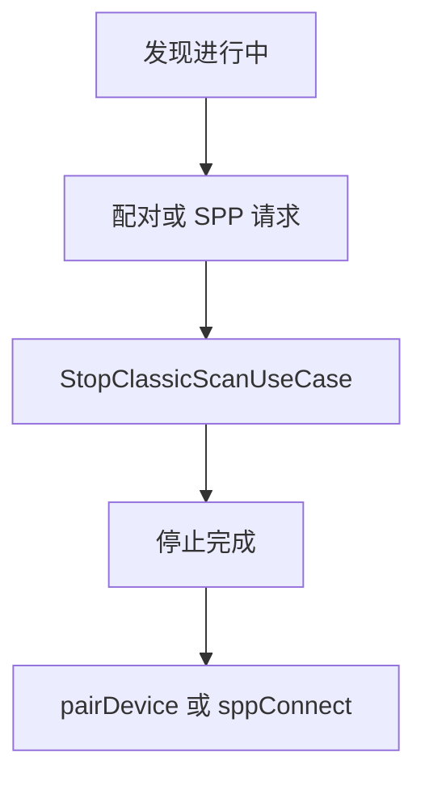
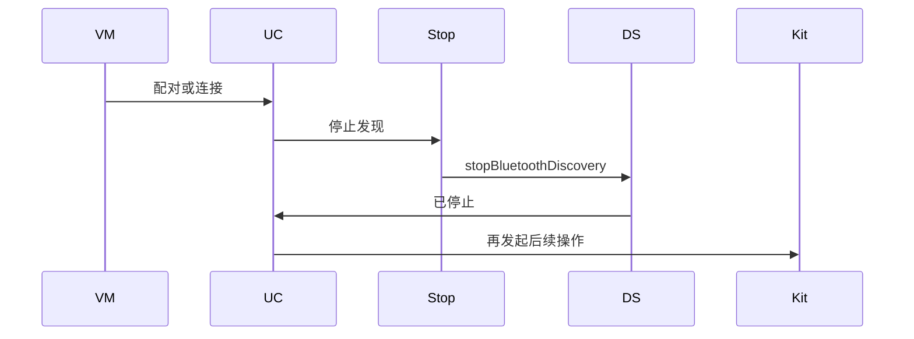
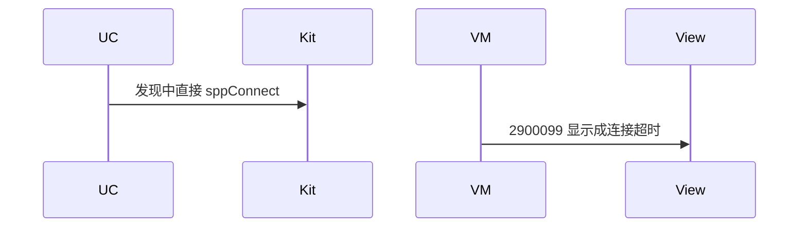

# BT-014 连接前停止发现

## 1. 条目与非目标

**判定：** 支持

**Given** 经典发现进行中

**When** 用户对某设备发起配对或 SPP 连接

**Then** 先停止发现，再发起后续操作

**证据：** `传统蓝牙查找设备指南；错误码子原因「业务扫描期间不允许发起连接」`。行为以已接受的研究笔记和清单为准，本文件不重开行业调查。

**本条输入：** 经典发现进行中，用户对一台设备点配对或 SPP。

**本条输出：** 发现先结束，然后才调用 `pairDevice` 或 `sppConnect`。

**本条失败：** 发现未停就连接，或把 2900099 的扫描中禁止连接显示成超时。

**本条所有者：** `PairBluetoothDeviceUseCase` 与 `ConnectSppUseCase` 先调用 `StopClassicScanUseCase`。停止在 `ClassicBluetoothDataSource`。连接在 `SppPlatformGateway`。

**非目标：**

- 不停止无关的 BLE 扫描来代替经典发现停止；BLE 扫描中的连接由 BT-093 负责。
- 不在失败后自动重试连接。
- 不新增 `common/yobluetooth` 以外的蓝牙栈，不增加包装层或版本兼容层。版本判断留在本条调用点。

## 2. 模块边界与分层

本组是经典发现。依赖方向是 `product/phone` → `features/bluetooth` → `common/yobluetooth`。权限、生命周期和系统设置走 `common/platform` 与 `common/debug_core`。字节与 `Result` 走 `common/core`。日志门面走 `common/yolog`。收藏、会话记录和导出走 `common/storage`。`common/youi_kit` 只提供通用控件，不解释蓝牙状态。

**调用点：** 停止调用在 `ClassicBluetoothDataSource`。本条不新增连接栈。

| 包 | 类型 | 职责 |
| --- | --- | --- |
| features/bluetooth | SppMainViewModel | 把配对或连接意图交给用例 |
| common/yobluetooth | StopClassicScanUseCase | 先停止发现 |
| common/yobluetooth | PairBluetoothDeviceUseCase | 停止完成后配对 |
| common/yobluetooth | ConnectSppUseCase | 停止完成后才 sppConnect |

**设计前：** 连接用例若只检查 SPP 相位，会在发现仍进行时打到平台。

**设计后：** 配对和 SPP 连接共享同一前置：经典发现停止完成。平台若仍返回扫描中禁止连接，领域错误保持该原因。

## 3. 架构图

本组总图在 [`BT-009.md`](BT-009.md)。下图只覆盖本条。

## 4. 序列图

### 成功路径

### 错误路径

## 5. 数据模型

领域模型放在 `common/yobluetooth`，持久化模型放在 `common/storage`，平台传输对象只出现在数据源调用点，跨层用 `common/core` 的 `Result` 与 `ResultError`。错误只带类别和结构化字段，不把界面句子塞进邻层错误。

| 模型 | 所在层 | 字段 | 来源 |
| --- | --- | --- | --- |
| ClassicScanPhase | 领域 | 先到 idle | 停止完成 |
| ResultError | 领域 | 平台子原因 | 扫描期间不允许连接 |

## 6. 层间接口

| 从 | 到 | 接口 | 成功 | 失败 |
| --- | --- | --- | --- | --- |
| ConnectSppUseCase | StopClassicScanUseCase | execute | 停止完成 | 停止失败则不连接 |
| PairBluetoothDeviceUseCase | StopClassicScanUseCase | execute | 停止完成 | 不调用 pairDevice |
| SppPlatformGateway | socket | sppConnect | 仅停止之后 | 扫描中被拒 |

下层不持有页面类型。结果用 `Result` 或已有观察者回传。`common/yobluetooth` 的 `Index.ets` 继续只导出用例、领域模型和必要门面，不把数据源具体类变成第二套公开栈。

## 7. 权限与生命周期

停止发现不需要新权限。

停止时 `off` 发现事件。连接订阅在连接用例里另行成对注册。

## 8. 日志

- `BtLogTag.SCAN` 记录 stopBefore=pair 或 spp。
- 若平台拒绝，记录子原因而不是 timeout。
- 领域标签加在已有 `BtLogTag`，不在 `common/yolog` 的 `YoLogTag` 里再开一套蓝牙标签。
- 日志走 `YoLog`，不在页面里直接写 hilog。

## 9. 反模式

- 停扫描用延时而不是停止完成。
- 配对与 SPP 各写一套不一致的停止条件。
- 用新的蓝牙 HAR、适配器或 `ApiCompat` 把本条版本差异包起来。版本判断只留在上面写明的调用点。
- 页面或 `common/youi_kit` 直接调用 `ohos.bluetooth.*`。
