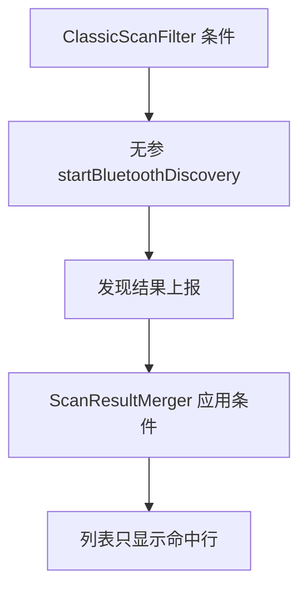
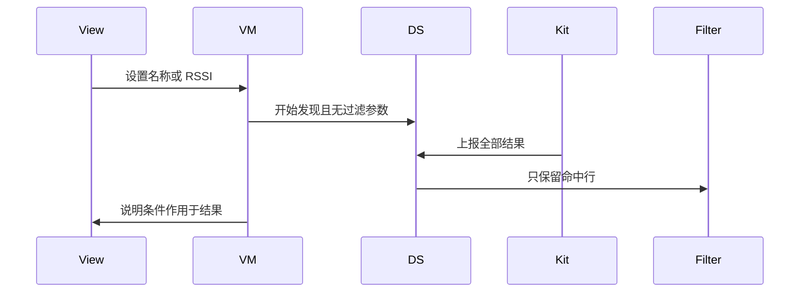
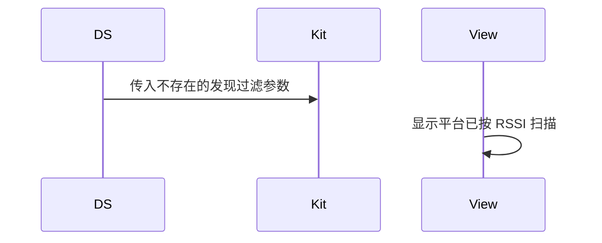

# BT-015 经典发现没有平台过滤参数

## 1. 条目与非目标

**判定：** 支持

**Given** 用户设置名称或 RSSI 条件

**When** 开始经典发现

**Then** 条件只作用于已上报结果；调用本身没有过滤参数

**证据：** `FAQ「如何通过已连接的 BLE 蓝牙设备的虚拟 MAC 地址建立经典蓝牙连接」：经典扫描无法配置过滤参数`。行为以已接受的研究笔记和清单为准，本文件不重开行业调查。

**本条输入：** 用户在经典过滤面板填写的名称或 RSSI，以及开始发现动作。

**本条输出：** `startBluetoothDiscovery` 不带过滤参数。`ClassicScanFilter` 只丢弃已上报、不符合条件的行。

**本条失败：** 界面暗示平台已按条件扫描，或调用被包上一套不存在的过滤参数。

**本条所有者：** 无过滤的开始调用在 `ClassicBluetoothDataSource`。条件模型是已有 `ClassicScanFilter`。过滤发生在 `ScanResultMerger` 之后的列表可见性，所有者是 `common/yobluetooth`。`ClassicScanFilterPanelView` 只编辑条件。

代码已接通清单里的结果：`startBluetoothDiscovery` 不带过滤参数，名称和 RSSI 只滤已上报结果。射频仍是待真机，本条不记真机通过。

**非目标：**

- 不新增平台发现过滤 API。
- 不用 BLE `ScanFilter` 去滤经典发现。
- 不新增 `common/yobluetooth` 以外的蓝牙栈，不增加包装层或版本兼容层。版本判断留在本条调用点。

## 2. 模块边界与分层

本组是经典发现。依赖方向是 `product/phone` → `features/bluetooth` → `common/yobluetooth`。权限、生命周期和系统设置走 `common/platform` 与 `common/debug_core`。字节与 `Result` 走 `common/core`。日志门面走 `common/yolog`。收藏、会话记录和导出走 `common/storage`。`common/youi_kit` 只提供通用控件，不解释蓝牙状态。

**调用点：** `ClassicBluetoothDataSource` 调用 `startBluetoothDiscovery()`，不构造过滤对象。

| 包 | 类型 | 职责 |
| --- | --- | --- |
| features/bluetooth | ClassicScanFilterPanelView | 编辑名称和 RSSI 条件 |
| common/yobluetooth | ClassicScanFilter | 领域条件，不是平台参数 |
| common/yobluetooth | ClassicBluetoothDataSource | start 无过滤参数 |
| common/yobluetooth | ScanResultMerger | 对已上报结果应用条件 |
| features/bluetooth | SppDeviceListView | 只显示滤后的行 |

**设计前：** 过滤面板容易让人以为条件会传给 `startBluetoothDiscovery`。

**设计后：** 数据源签名没有过滤参数。条件只减少已上报行。面板说明这是结果过滤。

## 3. 架构图

本组总图在 [`BT-009.md`](BT-009.md)。下图只覆盖本条。

## 4. 序列图

### 成功路径

成功路径是清单里的限制已经由现有代码成立。射频仍是待真机。

### 错误路径

错误路径是把平台没有的能力做成成功。这条路径不进入目标分层。

## 5. 数据模型

领域模型放在 `common/yobluetooth`，持久化模型放在 `common/storage`，平台传输对象只出现在数据源调用点，跨层用 `common/core` 的 `Result` 与 `ResultError`。错误只带类别和结构化字段，不把界面句子塞进邻层错误。

| 模型 | 所在层 | 字段 | 来源 |
| --- | --- | --- | --- |
| ClassicScanFilter | 领域 | 名称与 RSSI 门槛 | 用户输入 |
| PlatformDiscoveryPayload | 数据源 | 无过滤字段 | 平台上报 |

## 6. 层间接口

| 从 | 到 | 接口 | 成功 | 失败 |
| --- | --- | --- | --- | --- |
| StartClassicScanUseCase | ClassicBluetoothDataSource | startDiscovery | 无过滤参数 | 不接受 ScanFilter |
| ScanResultMerger | SppMainViewModel | 可见行 | 条件命中 | 未命中不出现 |
| ClassicScanFilterPanelView | ClassicScanFilter | 编辑 | 只改领域条件 | 不改 Kit 参数 |

下层不持有页面类型。结果用 `Result` 或已有观察者回传。`common/yobluetooth` 的 `Index.ets` 继续只导出用例、领域模型和必要门面，不把数据源具体类变成第二套公开栈。

## 7. 权限与生命周期

过滤不改变权限。

条件保存在页面状态。发现结束条件仍在，下一次开始依然无平台参数。

## 8. 日志

- `BtLogTag.SCAN` 记录上报条数与滤后条数，标明 filter=post。
- 领域标签加在已有 `BtLogTag`，不在 `common/yolog` 的 `YoLogTag` 里再开一套蓝牙标签。
- 日志走 `YoLog`，不在页面里直接写 hilog。

## 9. 反模式

- 发明 `startBluetoothDiscovery(filter)`。
- 把未上报设备当成被平台滤掉。
- 用 BLE 扫描结果填充经典列表。
- 用新的蓝牙 HAR、适配器或 `ApiCompat` 把本条版本差异包起来。版本判断只留在上面写明的调用点。
- 页面或 `common/youi_kit` 直接调用 `ohos.bluetooth.*`。
