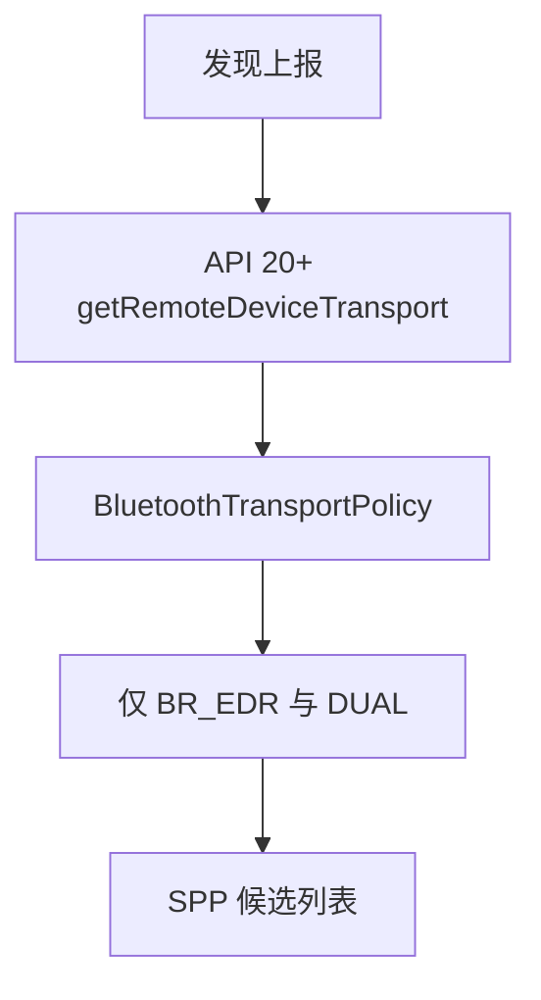
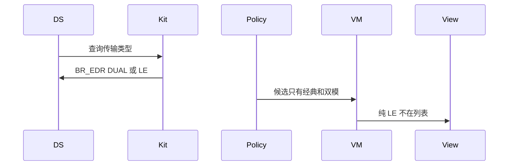
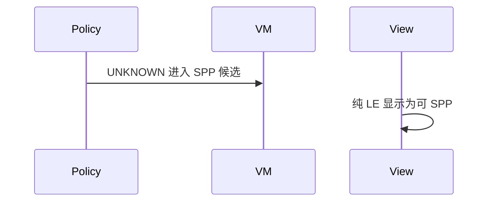

# BT-016 经典发现结果按传输类型分流

## 1. 条目与非目标

**判定：** 支持

**Given** 同一次发现里既有经典设备也有 BLE 设备

**When** 查看 SPP 候选列表

**Then** 仅经典或双模进入 SPP 候选；纯 LE 不出现在该列表

**证据：** `startBluetoothDiscovery 说明可发现传统与 BLE 设备`。行为以已接受的研究笔记和清单为准，本文件不重开行业调查。

**本条输入：** 同一次经典发现上报的混合设备，以及 API 20+ 的传输类型查询。

**本条输出：** SPP 候选只含 `BR_EDR` 与 `DUAL`。纯 `LE` 不在该列表。

**本条失败：** 纯 LE 出现在 SPP 候选，或未知传输被当成经典。

**本条所有者：** 传输查询在 `ClassicBluetoothDataSource.getRemoteDeviceTransport`，API 20+ 才调用。准入用 `BluetoothTransportPolicy`。列表在 `SppMainViewModel`。

**非目标：**

- 不把未知传输放进 SPP 候选凑数。
- 不在本条建立经典到 GATT 的桥。
- 不新增 `common/yobluetooth` 以外的蓝牙栈，不增加包装层或版本兼容层。版本判断留在本条调用点。

## 2. 模块边界与分层

本组是经典发现。依赖方向是 `product/phone` → `features/bluetooth` → `common/yobluetooth`。权限、生命周期和系统设置走 `common/platform` 与 `common/debug_core`。字节与 `Result` 走 `common/core`。日志门面走 `common/yolog`。收藏、会话记录和导出走 `common/storage`。`common/youi_kit` 只提供通用控件，不解释蓝牙状态。

**调用点：** `getRemoteDeviceTransport` 的 API 20 判断在 `ClassicBluetoothDataSource`。

| 包 | 类型 | 职责 |
| --- | --- | --- |
| common/yobluetooth | ClassicBluetoothDataSource | API 20+ 查询传输类型 |
| common/yobluetooth | BluetoothTransportPolicy | 只准入 BR_EDR 与 DUAL |
| common/yobluetooth | DeviceRegistry | 按轨保存 |
| features/bluetooth | SppDeviceListView | 只渲染 SPP 候选 |

**设计前：** `admitClassicDiscovery` 允许发现来源的 `UNKNOWN` 进入经典轨，纯 LE 可能混进 SPP 候选。

**设计后：** SPP 候选只收 `BR_EDR` 与 `DUAL`。API 20 以下无法查询时，该行标为未判定且不进入候选。旧的 UNKNOWN 准入从这条链路删除。

## 3. 架构图

本组总图在 [`BT-009.md`](BT-009.md)。下图只覆盖本条。

## 4. 序列图

### 成功路径

### 错误路径

## 5. 数据模型

领域模型放在 `common/yobluetooth`，持久化模型放在 `common/storage`，平台传输对象只出现在数据源调用点，跨层用 `common/core` 的 `Result` 与 `ResultError`。错误只带类别和结构化字段，不把界面句子塞进邻层错误。

| 模型 | 所在层 | 字段 | 来源 |
| --- | --- | --- | --- |
| BluetoothTransportType | 领域 | BR_EDR LE DUAL UNKNOWN | 平台码映射 |
| BluetoothListRail | 领域 | CLASSIC_SCAN | SPP 候选轨 |

## 6. 层间接口

| 从 | 到 | 接口 | 成功 | 失败 |
| --- | --- | --- | --- | --- |
| ClassicBluetoothDataSource | connection | getRemoteDeviceTransport | API 20+ 类型 | 更低版本不编造 |
| BluetoothTransportPolicy | Spp 列表 | isClassicCandidate | BR_EDR 或 DUAL | LE 与 UNKNOWN 排除 |

下层不持有页面类型。结果用 `Result` 或已有观察者回传。`common/yobluetooth` 的 `Index.ets` 继续只导出用例、领域模型和必要门面，不把数据源具体类变成第二套公开栈。

## 7. 权限与生命周期

传输查询使用同一 `ACCESS_BLUETOOTH`。

分流不增加订阅。发现订阅仍由开始和停止成对管理。

## 8. 日志

- `BtLogTag.SCAN` 记录 transport 与 admitted=0 或 1。
- 领域标签加在已有 `BtLogTag`，不在 `common/yolog` 的 `YoLogTag` 里再开一套蓝牙标签。
- 日志走 `YoLog`，不在页面里直接写 hilog。

## 9. 反模式

- 用设备类型 CoD 代替传输类型。
- 保留 UNKNOWN 进入候选的第二套规则。
- 用新的蓝牙 HAR、适配器或 `ApiCompat` 把本条版本差异包起来。版本判断只留在上面写明的调用点。
- 页面或 `common/youi_kit` 直接调用 `ohos.bluetooth.*`。
