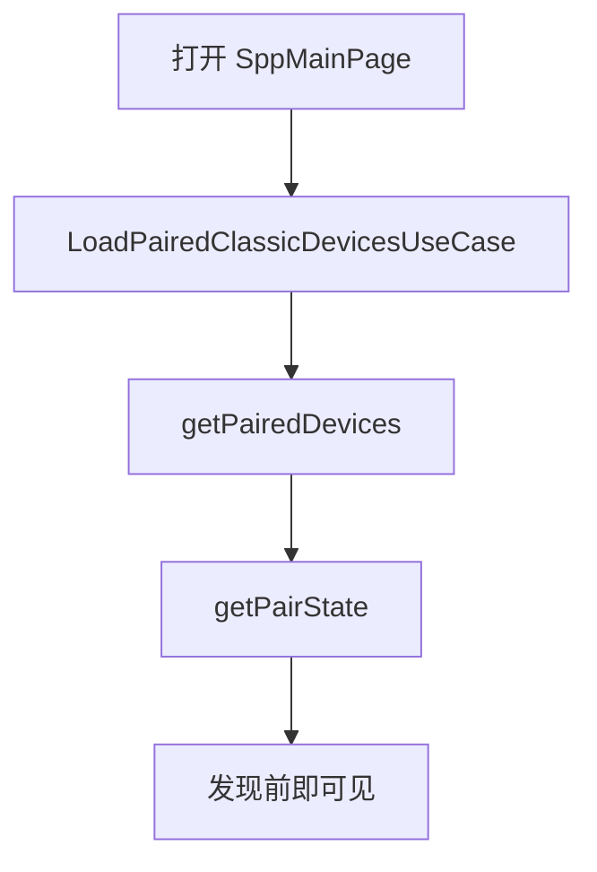
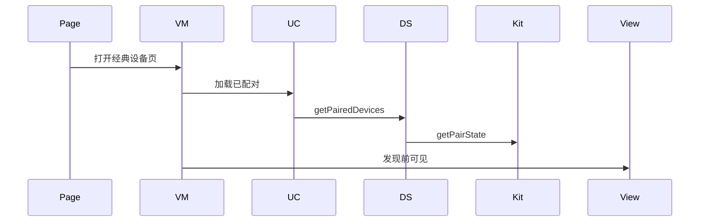
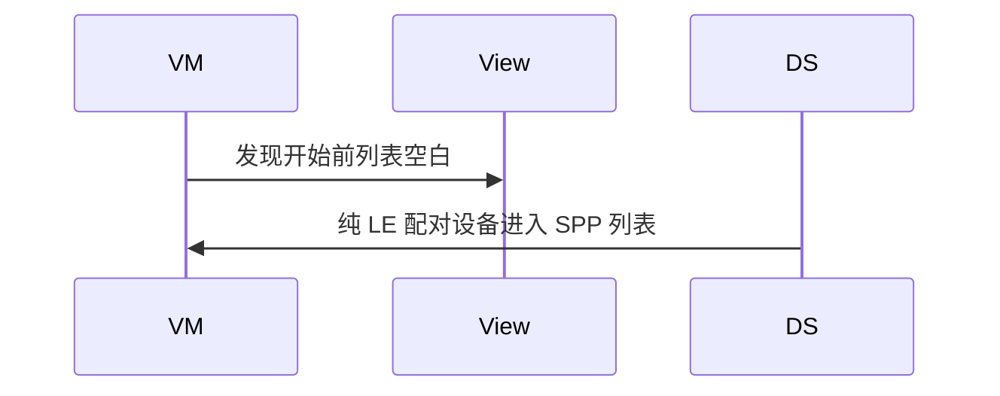

# BT-017 已配对设备可在发现前列出

## 1. 条目与非目标

**判定：** 支持

**Given** 系统里已有配对设备

**When** 打开经典设备页且尚未发现

**Then** `getPairedDevices` 的结果可见，并带 `getPairState`

**证据：** `传统蓝牙查找设备指南`。行为以已接受的研究笔记和清单为准，本文件不重开行业调查。

**本条输入：** 打开经典设备页，发现尚未开始。

**本条输出：** 列表显示 `getPairedDevices` 的经典或双模设备，以及 `getPairState`。

**本条失败：** 必须先发现才能看到已配对设备，或已配对纯 LE 进入 SPP 列表。

**本条所有者：** `LoadPairedClassicDevicesUseCase` 读 `ClassicBluetoothDataSource`。配对态经 `BluetoothDeviceMapper`。展示在 `SppMainViewModel`。

**非目标：**

- 不把已配对列表当成发现正在进行。
- 不在本条发起配对。
- 不新增 `common/yobluetooth` 以外的蓝牙栈，不增加包装层或版本兼容层。版本判断留在本条调用点。

## 2. 模块边界与分层

本组是经典发现。依赖方向是 `product/phone` → `features/bluetooth` → `common/yobluetooth`。权限、生命周期和系统设置走 `common/platform` 与 `common/debug_core`。字节与 `Result` 走 `common/core`。日志门面走 `common/yolog`。收藏、会话记录和导出走 `common/storage`。`common/youi_kit` 只提供通用控件，不解释蓝牙状态。

**调用点：** `getPairedDevices` 与 `getPairState` 在 `ClassicBluetoothDataSource`。

| 包 | 类型 | 职责 |
| --- | --- | --- |
| product/phone | SppMainPage | 进入页面 |
| features/bluetooth | SppMainViewModel | 先加载已配对 |
| common/yobluetooth | LoadPairedClassicDevicesUseCase | 读取并过滤 |
| common/yobluetooth | ClassicBluetoothDataSource | getPairedDevices 与 getPairState |

**设计前：** 页面若等发现回调才有行，已配对设备在发现前不可见。

**设计后：** 进入页面即加载已配对经典候选。纯 LE 配对设备不进入该列表。发现可以随后另起。

## 3. 架构图

本组总图在 [`BT-009.md`](BT-009.md)。下图只覆盖本条。

## 4. 序列图

### 成功路径

### 错误路径

## 5. 数据模型

领域模型放在 `common/yobluetooth`，持久化模型放在 `common/storage`，平台传输对象只出现在数据源调用点，跨层用 `common/core` 的 `Result` 与 `ResultError`。错误只带类别和结构化字段，不把界面句子塞进邻层错误。

| 模型 | 所在层 | 字段 | 来源 |
| --- | --- | --- | --- |
| PairingState | 领域 | 由 BondState 映射 | getPairState |
| BluetoothDevice | 领域 | classicDeviceId 与 pairState | 已配对快照 |

## 6. 层间接口

| 从 | 到 | 接口 | 成功 | 失败 |
| --- | --- | --- | --- | --- |
| SppMainViewModel | LoadPairedClassicDevicesUseCase | execute | 可见列表 | 读取失败可见 |
| ClassicBluetoothDataSource | connection | getPairedDevices | 设备数组 | 不依赖发现 |
| BluetoothTransportPolicy | 列表 | admitClassicPaired | 经典或双模 | 纯 LE 排除 |

下层不持有页面类型。结果用 `Result` 或已有观察者回传。`common/yobluetooth` 的 `Index.ets` 继续只导出用例、领域模型和必要门面，不把数据源具体类变成第二套公开栈。

## 7. 权限与生命周期

读取已配对仍要 `ACCESS_BLUETOOTH`。未授予则走 BT-001，不显示空成功。

该读取不是持续扫描。页面每次出现可刷新，不因此保持发现订阅。

## 8. 日志

- `BtLogTag.SCAN` 记录 pairedCount，与 discovery 日志分开。
- 领域标签加在已有 `BtLogTag`，不在 `common/yolog` 的 `YoLogTag` 里再开一套蓝牙标签。
- 日志走 `YoLog`，不在页面里直接写 hilog。

## 9. 反模式

- 用发现结果覆盖配对状态。
- 进入页面就自动开始 12 秒发现。
- 用新的蓝牙 HAR、适配器或 `ApiCompat` 把本条版本差异包起来。版本判断只留在上面写明的调用点。
- 页面或 `common/youi_kit` 直接调用 `ohos.bluetooth.*`。
