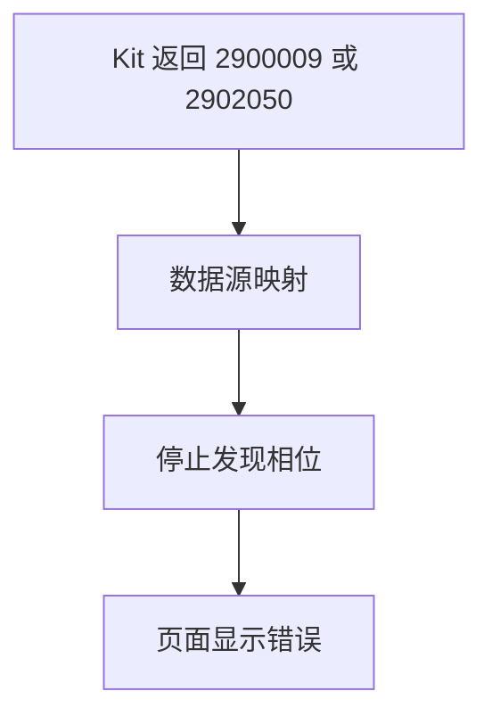
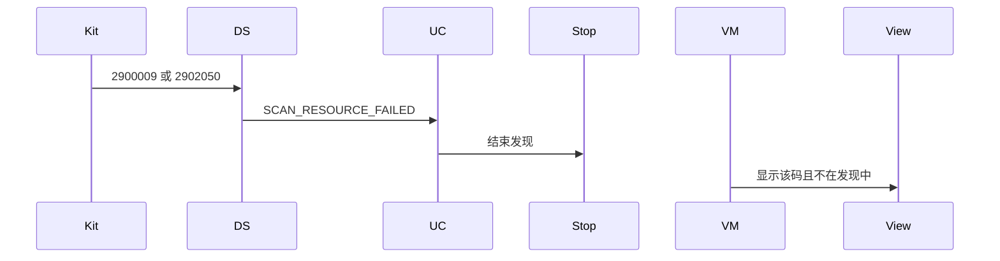
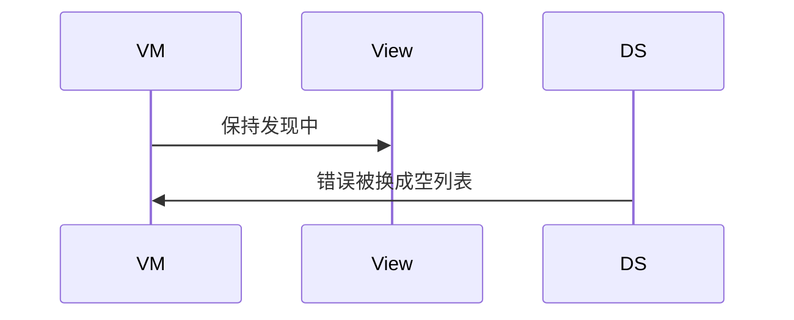

# BT-018 硬件资源不足时结束发现

## 1. 条目与非目标

**判定：** 支持

**Given** 扫描因硬件资源失败

**When** 接口返回 2900009 或扫描失败 2902050

**Then** 发现状态结束并显示该错误，不保持「发现中」

**证据：** `蓝牙服务子系统错误码`。行为以已接受的研究笔记和清单为准，本文件不重开行业调查。

**本条输入：** 发现或扫描返回 2900009 或 2902050。

**本条输出：** `ClassicScanPhase` 结束。页面显示对应平台码，按钮不再是发现中。

**本条失败：** 错误后相位仍为 discovering。

**本条所有者：** 平台码在 `ClassicBluetoothDataSource` 识别，映射到 `YW-BT-1102`。`StopClassicScanUseCase` 收口相位。`SppMainViewModel` 显示错误。

**非目标：**

- 不自动立刻重试。
- 不把资源错误写成附近没有设备。
- 不新增 `common/yobluetooth` 以外的蓝牙栈，不增加包装层或版本兼容层。版本判断留在本条调用点。

## 2. 模块边界与分层

本组是经典发现。依赖方向是 `product/phone` → `features/bluetooth` → `common/yobluetooth`。权限、生命周期和系统设置走 `common/platform` 与 `common/debug_core`。字节与 `Result` 走 `common/core`。日志门面走 `common/yolog`。收藏、会话记录和导出走 `common/storage`。`common/youi_kit` 只提供通用控件，不解释蓝牙状态。

**调用点：** 错误码识别在 `ClassicBluetoothDataSource` 的失败回调。

| 包 | 类型 | 职责 |
| --- | --- | --- |
| common/yobluetooth | ClassicBluetoothDataSource | 识别 2900009 与 2902050 |
| common/yobluetooth | BluetoothErrorCodes | SCAN_RESOURCE_FAILED |
| common/yobluetooth | StopClassicScanUseCase | 结束相位 |
| features/bluetooth | SppMainViewModel | 显示平台码 |

**设计前：** 失败回调若只打日志，界面会停在发现中。

**设计后：** 任一资源错误都结束发现并展示平台码。订阅取消。

## 3. 架构图

本组总图在 [`BT-009.md`](BT-009.md)。下图只覆盖本条。

## 4. 序列图

### 成功路径

### 错误路径

## 5. 数据模型

领域模型放在 `common/yobluetooth`，持久化模型放在 `common/storage`，平台传输对象只出现在数据源调用点，跨层用 `common/core` 的 `Result` 与 `ResultError`。错误只带类别和结构化字段，不把界面句子塞进邻层错误。

| 模型 | 所在层 | 字段 | 来源 |
| --- | --- | --- | --- |
| ResultError YW-BT-1102 | 领域 | platformCode | 2900009 或 2902050 |
| ClassicScanPhase | 领域 | idle | 失败后 |

## 6. 层间接口

| 从 | 到 | 接口 | 成功 | 失败 |
| --- | --- | --- | --- | --- |
| ClassicBluetoothDataSource | StartClassicScanUseCase | 失败 Result | 不保持成功 | 带平台码 |
| StartClassicScanUseCase | StopClassicScanUseCase | 收口 | 相位结束 | 不再发现中 |

下层不持有页面类型。结果用 `Result` 或已有观察者回传。`common/yobluetooth` 的 `Index.ets` 继续只导出用例、领域模型和必要门面，不把数据源具体类变成第二套公开栈。

## 7. 权限与生命周期

资源错误不重申请权限。

失败路径必须 `off` 发现事件并取消 12 秒定时器。

## 8. 日志

- `BtLogTag.SCAN` 记录 platformCode 与 phase=idle。
- 领域标签加在已有 `BtLogTag`，不在 `common/yolog` 的 `YoLogTag` 里再开一套蓝牙标签。
- 日志走 `YoLog`，不在页面里直接写 hilog。

## 9. 反模式

- 收到 2900009 后立即再 start。
- 2902050 显示成操作频繁。
- 用新的蓝牙 HAR、适配器或 `ApiCompat` 把本条版本差异包起来。版本判断只留在上面写明的调用点。
- 页面或 `common/youi_kit` 直接调用 `ohos.bluetooth.*`。
