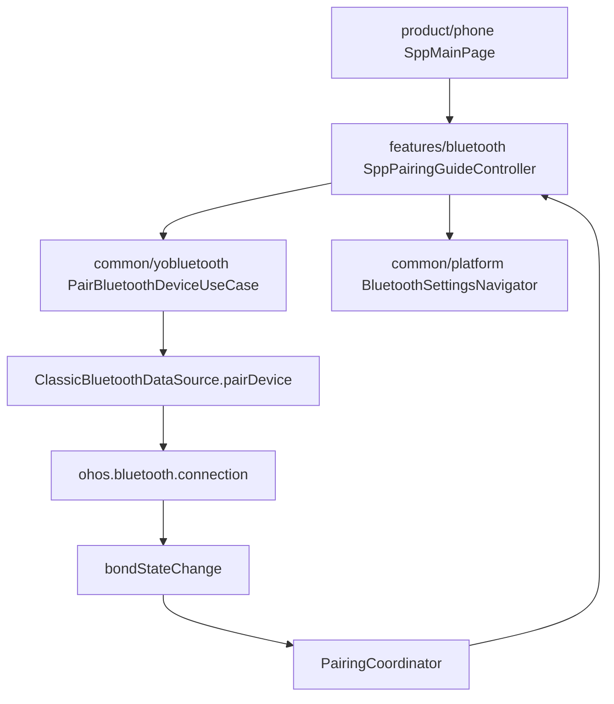
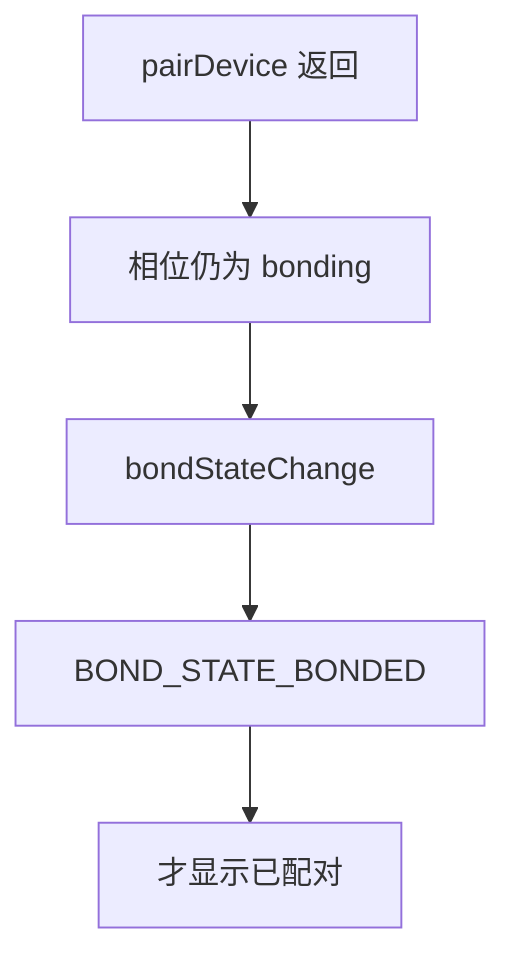
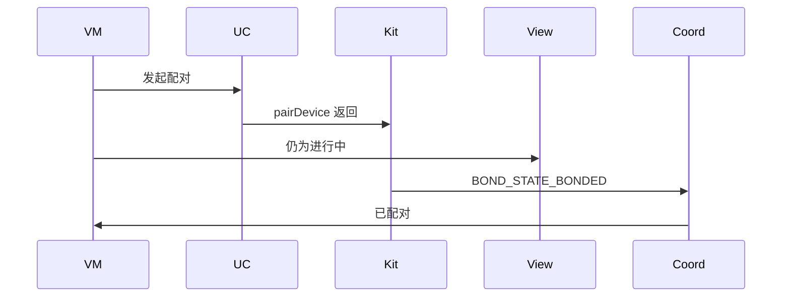
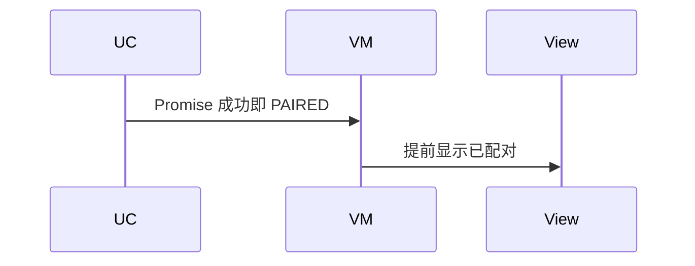

# BT-019 配对完成以配对状态事件为准

## 1. 条目与非目标

**判定：** 支持

**Given** 对未配对设备调用 `pairDevice`

**When** Promise 成功返回，但尚未收到 `BOND_STATE_BONDED`

**Then** 界面仍为配对进行中，不显示已配对

**证据：** `connection.pairDevice；bondStateChange；BondState`。行为以已接受的研究笔记和清单为准，本文件不重开行业调查。

**本条输入：** `pairDevice` 已返回，`bondStateChange` 尚未到 `BOND_STATE_BONDED`。

**本条输出：** `PairingState` 保持进行中。已配对标记要等事件。

**本条失败：** Promise 成功就被画成已配对。

**本条所有者：** `PairBluetoothDeviceUseCase` 发起配对。`PairingCoordinator` 消费 `bondStateChange`。`ObservePairingEventsUseCase` 通知 `SppPairingGuideController`。

**非目标：**

- 不把配对进行中写成 SPP 已连接。
- 不在 Promise 返回时写收藏为已配对。
- 不新增 `common/yobluetooth` 以外的蓝牙栈，不增加包装层或版本兼容层。版本判断留在本条调用点。

## 2. 模块边界与分层

本组是配对。依赖方向是 `product/phone` → `features/bluetooth` → `common/yobluetooth`。权限、生命周期和系统设置走 `common/platform` 与 `common/debug_core`。字节与 `Result` 走 `common/core`。日志门面走 `common/yolog`。收藏、会话记录和导出走 `common/storage`。`common/youi_kit` 只提供通用控件，不解释蓝牙状态。

**调用点：** `pairDevice` 与 `bondStateChange` 都在 `ClassicBluetoothDataSource`。

| 包 | 类型 | 职责 |
| --- | --- | --- |
| common/yobluetooth | PairBluetoothDeviceUseCase | 调用 pairDevice |
| common/yobluetooth | ClassicBluetoothDataSource | 订阅 bondStateChange |
| common/yobluetooth | PairingCoordinator | 只在 BONDED 完成 |
| features/bluetooth | SppPairingGuideController | 进行中直到事件 |

**设计前：** 用例若把 pairDevice 的成功 Result 当成已配对，会早于系统状态。

**设计后：** Promise 只表示请求已提交。`PairingState.PAIRED` 只来自 `BOND_STATE_BONDED`。

## 3. 架构图

本组总图放在本文件。配对里其余条目各自再画本条链路，链接不能代替本条的输入、输出、失败和所有者。

本条链路：

## 4. 序列图

### 成功路径

### 错误路径

## 5. 数据模型

领域模型放在 `common/yobluetooth`，持久化模型放在 `common/storage`，平台传输对象只出现在数据源调用点，跨层用 `common/core` 的 `Result` 与 `ResultError`。错误只带类别和结构化字段，不把界面句子塞进邻层错误。

| 模型 | 所在层 | 字段 | 来源 |
| --- | --- | --- | --- |
| PairingState | 领域 | bonding 与 paired | BondState 映射 |
| PairingEvent | 领域 | deviceId 与 state | bondStateChange |

## 6. 层间接口

| 从 | 到 | 接口 | 成功 | 失败 |
| --- | --- | --- | --- | --- |
| PairBluetoothDeviceUseCase | ClassicBluetoothDataSource | pairDevice | 请求已提交 | 调用失败 |
| ObservePairingEventsUseCase | PairingCoordinator | 事件 | BONDED 才完成 | 其他状态不标已配对 |
| SppPairingGuideController | PairingGuideDialog | 展示 | 进行中 | 不写已配对 |

下层不持有页面类型。结果用 `Result` 或已有观察者回传。`common/yobluetooth` 的 `Index.ets` 继续只导出用例、领域模型和必要门面，不把数据源具体类变成第二套公开栈。

## 7. 权限与生命周期

配对使用 `ACCESS_BLUETOOTH`。不申请 `MANAGE_BLUETOOTH`。

配对订阅在观察用例开始时 `on`，完成、失败或页面离开时 `off`。

## 8. 日志

- `BtLogTag.CONN` 记录 pairSubmitted 与 bondState，不在提交时写 bonded。
- 领域标签加在已有 `BtLogTag`，不在 `common/yolog` 的 `YoLogTag` 里再开一套蓝牙标签。
- 日志走 `YoLog`，不在页面里直接写 hilog。

## 9. 反模式

- 用延时把进行中改成已配对。
- SPP 连接成功反写配对状态。
- 用新的蓝牙 HAR、适配器或 `ApiCompat` 把本条版本差异包起来。版本判断只留在上面写明的调用点。
- 页面或 `common/youi_kit` 直接调用 `ohos.bluetooth.*`。
