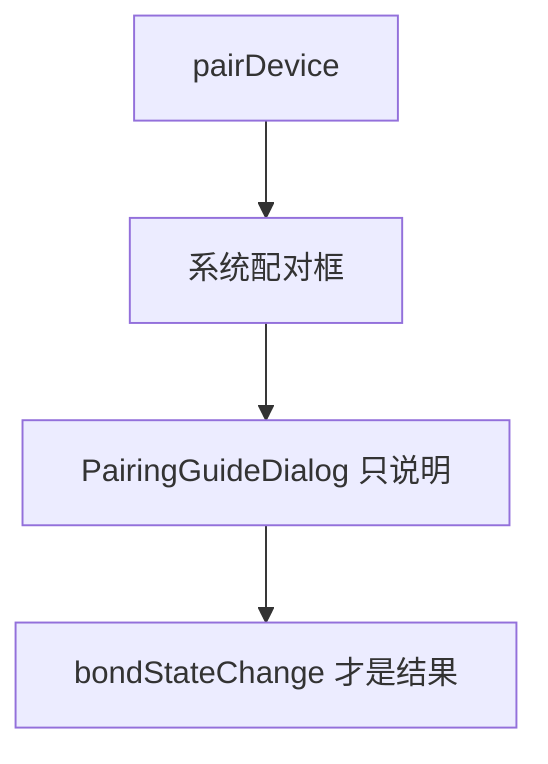
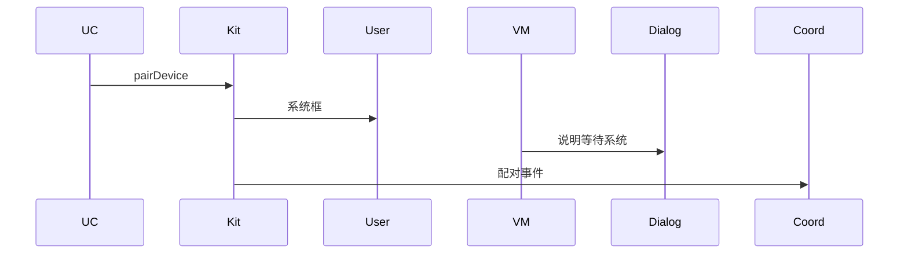
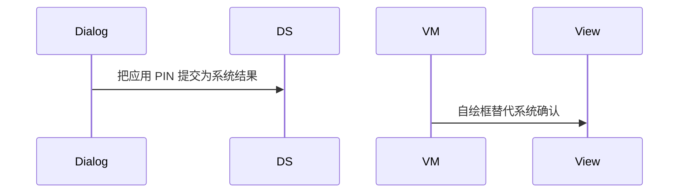

# BT-020 配对使用系统对话框

## 1. 条目与非目标

**判定：** 支持

**Given** 发起配对

**When** 系统需要用户确认密钥或 PIN

**Then** 出现系统配对框；应用内没有自绘的 PIN 输入被当作系统结果

**证据：** `传统蓝牙「配对与连接设备」指南`。行为以已接受的研究笔记和清单为准，本文件不重开行业调查。

**本条输入：** 已发起配对，系统要求确认密钥或 PIN。

**本条输出：** 用户看到系统配对框。应用对话框只说明正在等待系统，不提交 PIN。

**本条失败：** 应用内输入的 PIN 被当成系统配对结果。

**本条所有者：** 系统框由平台在 `pairDevice` 之后弹出。`features/bluetooth` 的 `PairingGuideDialog` 只做说明，由 `SppPairingGuideController` 驱动。`PairingCoordinator` 不收集 PIN。

**非目标：**

- 不调用 `setDevicePinCode` 把应用输入当成默认配对通道。
- 不自绘替代系统确认框。
- 不新增 `common/yobluetooth` 以外的蓝牙栈，不增加包装层或版本兼容层。版本判断留在本条调用点。

## 2. 模块边界与分层

本组是配对。依赖方向是 `product/phone` → `features/bluetooth` → `common/yobluetooth`。权限、生命周期和系统设置走 `common/platform` 与 `common/debug_core`。字节与 `Result` 走 `common/core`。日志门面走 `common/yolog`。收藏、会话记录和导出走 `common/storage`。`common/youi_kit` 只提供通用控件，不解释蓝牙状态。

**调用点：** `ClassicBluetoothDataSource` 不调用应用侧 PIN 设置来完成本条。

| 包 | 类型 | 职责 |
| --- | --- | --- |
| common/yobluetooth | ClassicBluetoothDataSource | pairDevice 后等待系统 |
| features/bluetooth | PairingGuideDialog | 说明等待系统框 |
| features/bluetooth | SppPairingGuideController | 不提交 PIN |
| common/youi_kit | 通用对话框壳 | 若复用，也不增加 PIN 字段 |

**设计前：** 引导对话框若带 PIN 输入，会被误当成系统结果。

**设计后：** 引导对话框没有 PIN 提交接口。配对结果只来自 `bondStateChange`。

## 3. 架构图

本组总图在 [`BT-019.md`](BT-019.md)。下图只覆盖本条。

## 4. 序列图

### 成功路径

### 错误路径

## 5. 数据模型

领域模型放在 `common/yobluetooth`，持久化模型放在 `common/storage`，平台传输对象只出现在数据源调用点，跨层用 `common/core` 的 `Result` 与 `ResultError`。错误只带类别和结构化字段，不把界面句子塞进邻层错误。

| 模型 | 所在层 | 字段 | 来源 |
| --- | --- | --- | --- |
| PairingGuideDialogParams | features/bluetooth | 设备名与等待态 | 不含 pin 字段 |
| PairingEvent | 领域 | 状态 | 系统事件 |

## 6. 层间接口

| 从 | 到 | 接口 | 成功 | 失败 |
| --- | --- | --- | --- | --- |
| SppPairingGuideController | PairingGuideDialog | 展示参数 | 无 PIN 出口 | 不回写 Kit |
| PairingCoordinator | ClassicBluetoothDataSource | 只观察 | 事件 | 不发送 PIN |

下层不持有页面类型。结果用 `Result` 或已有观察者回传。`common/yobluetooth` 的 `Index.ets` 继续只导出用例、领域模型和必要门面，不把数据源具体类变成第二套公开栈。

## 7. 权限与生命周期

系统框不属于应用权限弹窗。应用不因此申请 `MANAGE_BLUETOOTH`。

引导对话框随配对相位关闭。系统框的生命周期不属于应用页面。

## 8. 日志

- `BtLogTag.CONN` 记录 waitingForSystemDialog=1。不记录用户在系统框输入的密钥。
- 领域标签加在已有 `BtLogTag`，不在 `common/yolog` 的 `YoLogTag` 里再开一套蓝牙标签。
- 日志走 `YoLog`，不在页面里直接写 hilog。

## 9. 反模式

- 在 `youi_kit` 做蓝牙 PIN 组件。
- 把引导对话框的确认按钮映射成配对成功。
- 用新的蓝牙 HAR、适配器或 `ApiCompat` 把本条版本差异包起来。版本判断只留在上面写明的调用点。
- 页面或 `common/youi_kit` 直接调用 `ohos.bluetooth.*`。
