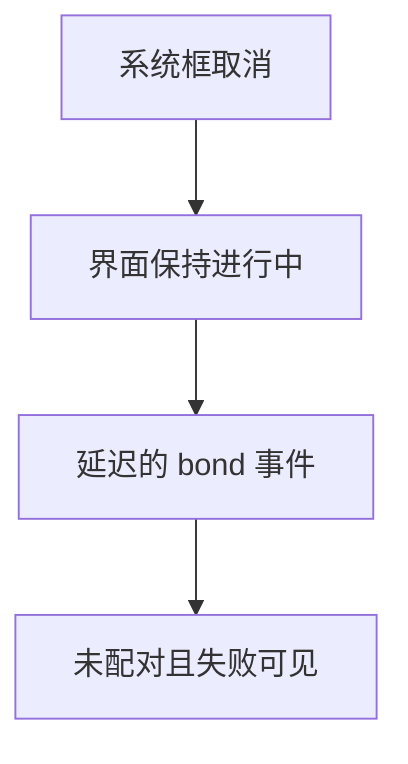
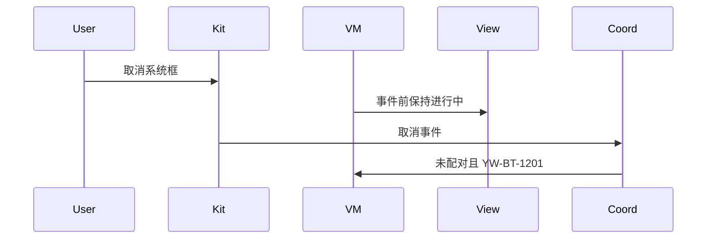
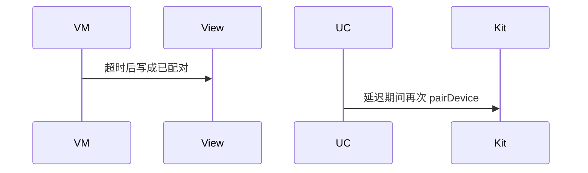

# BT-021 用户取消配对可见

## 1. 条目与非目标

**判定：** 支持

**Given** 系统配对框已出现

**When** 用户取消

**Then** 设备不是已配对；失败可见。取消 PIN 的回调可能延迟，界面在事件到达前保持进行中

**证据：** `FAQ「蓝牙 on('bondStateChange') 监听取消输入 PIN 码回调有延迟」`。行为以已接受的研究笔记和清单为准，本文件不重开行业调查。

**本条输入：** 系统配对框已出现，用户取消。

**本条输出：** 事件到达前保持进行中。事件表明取消后，设备不是已配对，失败可见，领域码 `YW-BT-1201`。

**本条失败：** 取消后立刻标已配对，或在事件到达前就标失败并拆掉等待。

**本条所有者：** 等待与完成都在 `PairingCoordinator`。取消码在 `BluetoothErrorCodes.PAIRING_CANCELLED`。展示在 `SppPairingGuideController`。

**非目标：**

- 不用定时器提前宣布取消。
- 不把延迟当成应用卡死而重入 pairDevice。
- 不新增 `common/yobluetooth` 以外的蓝牙栈，不增加包装层或版本兼容层。版本判断留在本条调用点。

## 2. 模块边界与分层

本组是配对。依赖方向是 `product/phone` → `features/bluetooth` → `common/yobluetooth`。权限、生命周期和系统设置走 `common/platform` 与 `common/debug_core`。字节与 `Result` 走 `common/core`。日志门面走 `common/yolog`。收藏、会话记录和导出走 `common/storage`。`common/youi_kit` 只提供通用控件，不解释蓝牙状态。

**调用点：** 事件仍由 `ClassicBluetoothDataSource` 订阅，不增加超时兼容层。

| 包 | 类型 | 职责 |
| --- | --- | --- |
| common/yobluetooth | PairingCoordinator | 事件前保持 bonding |
| common/yobluetooth | ClassicBluetoothDataSource | 接收延迟的 bond 事件 |
| features/bluetooth | SppPairingGuideController | 事件到达后显示失败 |

**设计前：** 取消没有即时回调时，页面可能超时后改成已配对或失败。

**设计后：** 相位停在进行中，直到 bond 事件。取消事件写入未配对和 `PAIRING_CANCELLED`。

## 3. 架构图

本组总图在 [`BT-019.md`](BT-019.md)。下图只覆盖本条。

## 4. 序列图

### 成功路径

### 错误路径

## 5. 数据模型

领域模型放在 `common/yobluetooth`，持久化模型放在 `common/storage`，平台传输对象只出现在数据源调用点，跨层用 `common/core` 的 `Result` 与 `ResultError`。错误只带类别和结构化字段，不把界面句子塞进邻层错误。

| 模型 | 所在层 | 字段 | 来源 |
| --- | --- | --- | --- |
| PairingState | 领域 | bonding 然后 unpaired | 事件 |
| ResultError YW-BT-1201 | 领域 | PAIRING_CANCELLED | 取消事件 |

## 6. 层间接口

| 从 | 到 | 接口 | 成功 | 失败 |
| --- | --- | --- | --- | --- |
| PairingCoordinator | ObservePairingEventsUseCase | 状态 | 事件前 bonding | 取消后失败 |
| SppPairingGuideController | 对话框 | 展示 | 进行中或失败 | 不显示已配对 |

下层不持有页面类型。结果用 `Result` 或已有观察者回传。`common/yobluetooth` 的 `Index.ets` 继续只导出用例、领域模型和必要门面，不把数据源具体类变成第二套公开栈。

## 7. 权限与生命周期

取消不改变权限。

等待期间订阅保持。事件到达或用户离开页面时 `off`。离开不等同于配对成功。

## 8. 日志

- `BtLogTag.CONN` 记录 bondDelayed 与最终 state。
- 领域标签加在已有 `BtLogTag`，不在 `common/yolog` 的 `YoLogTag` 里再开一套蓝牙标签。
- 日志走 `YoLog`，不在页面里直接写 hilog。

## 9. 反模式

- 为取消延迟加固定 sleep。
- 把取消显示成连接超时。
- 用新的蓝牙 HAR、适配器或 `ApiCompat` 把本条版本差异包起来。版本判断只留在上面写明的调用点。
- 页面或 `common/youi_kit` 直接调用 `ohos.bluetooth.*`。
