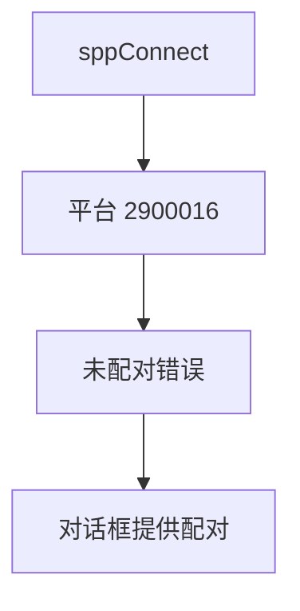
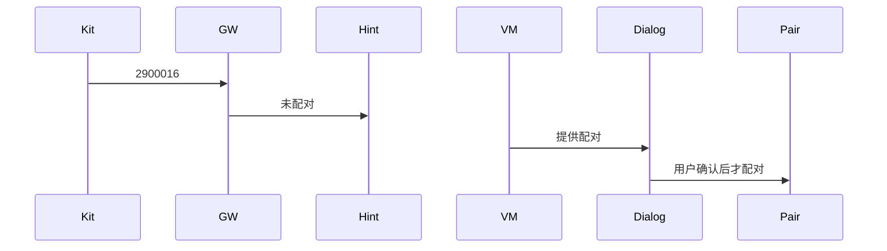
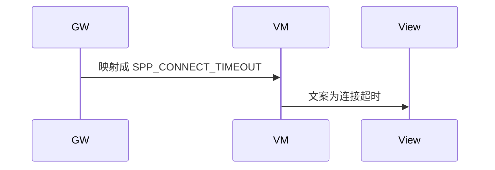

# BT-022 未配对不能当成 SPP 超时

## 1. 条目与非目标

**判定：** 支持

**Given** 设备未配对

**When** SPP 连接返回 2900016

**Then** 文案为未配对，并提供发起配对，而不是「连接超时」

**证据：** `错误码 2900016`。行为以已接受的研究笔记和清单为准，本文件不重开行业调查。

**本条输入：** 未配对设备的 `sppConnect` 返回 2900016。

**本条输出：** 失败类别是未配对。界面提供配对入口，不显示连接超时。

**本条失败：** 2900016 被收成 `SPP_CONNECT_TIMEOUT` 或通用连接失败。

**本条所有者：** `SppPlatformGateway` 识别 2900016。`SppConnectFailureHints` 给出配对动作。`SppConnectDialogController` 展示。配对仍走 `PairBluetoothDeviceUseCase`。

**非目标：**

- 不在本条自动开始配对。
- 不把 2900016 重试成超时成功。
- 不新增 `common/yobluetooth` 以外的蓝牙栈，不增加包装层或版本兼容层。版本判断留在本条调用点。

## 2. 模块边界与分层

本组是配对。依赖方向是 `product/phone` → `features/bluetooth` → `common/yobluetooth`。权限、生命周期和系统设置走 `common/platform` 与 `common/debug_core`。字节与 `Result` 走 `common/core`。日志门面走 `common/yolog`。收藏、会话记录和导出走 `common/storage`。`common/youi_kit` 只提供通用控件，不解释蓝牙状态。

**调用点：** 平台码判断在 `SppPlatformGateway` 的连接失败处。

| 包 | 类型 | 职责 |
| --- | --- | --- |
| common/yobluetooth | SppPlatformGateway | 映射 2900016 |
| common/yobluetooth | SppConnectFailureHints | 动作是发起配对 |
| features/bluetooth | SppConnectDialogController | 展示未配对 |
| common/yobluetooth | PairBluetoothDeviceUseCase | 用户确认后才配对 |

**设计前：** 连接失败提示容易统一写成超时。

**设计后：** 2900016 单独映射。对话框提供配对，不改超时文案。

## 3. 架构图

本组总图在 [`BT-019.md`](BT-019.md)。下图只覆盖本条。

## 4. 序列图

### 成功路径

### 错误路径

## 5. 数据模型

领域模型放在 `common/yobluetooth`，持久化模型放在 `common/storage`，平台传输对象只出现在数据源调用点，跨层用 `common/core` 的 `Result` 与 `ResultError`。错误只带类别和结构化字段，不把界面句子塞进邻层错误。

| 模型 | 所在层 | 字段 | 来源 |
| --- | --- | --- | --- |
| ResultError | 领域 | platformCode=2900016 | 不是 1318 超时 |
| SppConnectFailureHints | 领域服务 | next=pair | 未配对 |

## 6. 层间接口

| 从 | 到 | 接口 | 成功 | 失败 |
| --- | --- | --- | --- | --- |
| SppPlatformGateway | ConnectSppUseCase | 失败 | 未配对类别 | 不返回超时 |
| SppConnectDialogController | PairBluetoothDeviceUseCase | 用户动作 | 随后配对 | 失败本身不自动配对 |

下层不持有页面类型。结果用 `Result` 或已有观察者回传。`common/yobluetooth` 的 `Index.ets` 继续只导出用例、领域模型和必要门面，不把数据源具体类变成第二套公开栈。

## 7. 权限与生命周期

配对动作复用 `ACCESS_BLUETOOTH`。

连接失败后释放未完成的 SPP 槽位，不留半连接。

## 8. 日志

- `BtLogTag.SPP` 记录 platformCode=2900016 hint=pair。
- 领域标签加在已有 `BtLogTag`，不在 `common/yolog` 的 `YoLogTag` 里再开一套蓝牙标签。
- 日志走 `YoLog`，不在页面里直接写 hilog。

## 9. 反模式

- 所有连接失败都用 `YW-BT-1318`。
- 未配对仍进入已连接相位。
- 用新的蓝牙 HAR、适配器或 `ApiCompat` 把本条版本差异包起来。版本判断只留在上面写明的调用点。
- 页面或 `common/youi_kit` 直接调用 `ohos.bluetooth.*`。
