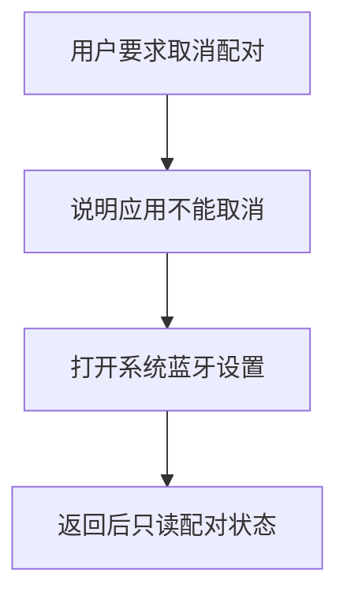
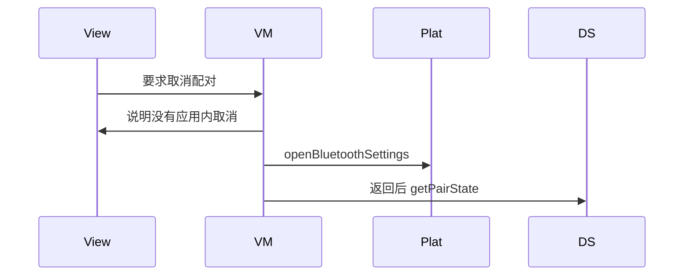
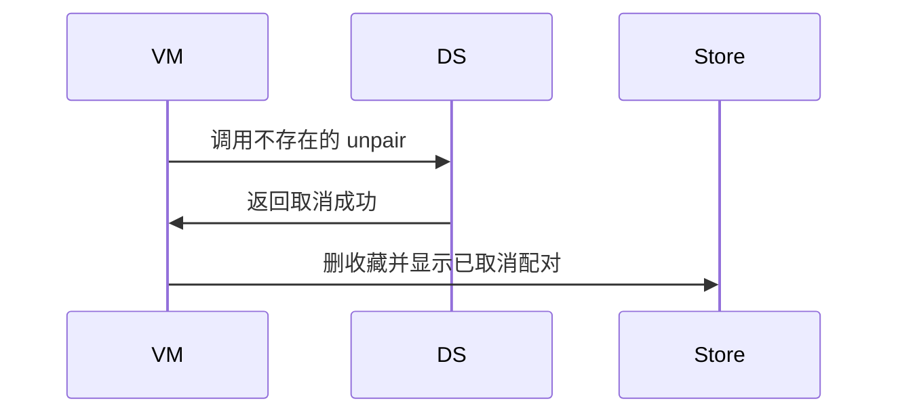

# BT-023 应用不能取消配对

## 1. 条目与非目标

**判定：** 缺口

**Given** 设备已配对

**When** 用户在应用内要求取消配对

**Then** 不存在成功的取消配对调用；提供打开系统蓝牙设置

**证据：** `最佳实践「如何通过代码调用取消配对」；FAQ 同结论`。行为以已接受的研究笔记和清单为准，本文件不重开行业调查。

**本条输入：** 已配对设备上的取消配对请求。

**本条输出：** 没有取消配对调用。界面提供 `BluetoothSettingsNavigator.openBluetoothSettings`。配对状态保持已配对，直到系统设置里的变化反映到 `getPairState`。

**本条失败：** 应用内出现取消配对成功，或调用一个不存在的 unpair。

**本条所有者：** 跳转归 `common/platform` 的 `BluetoothSettingsNavigator`。`features/bluetooth` 的页面状态只提供该动作。`common/yobluetooth` 不增加取消配对方法。

本条按缺口设计。完成态只包含清单允许看见的结果，不包含把缺口做成已成功的路径。

**非目标：**

- 不把打开设置写成已经取消配对。
- 不删除本地收藏来假装系统已取消配对。
- 不新增 `common/yobluetooth` 以外的蓝牙栈，不增加包装层或版本兼容层。版本判断留在本条调用点。

## 2. 模块边界与分层

本组是配对。依赖方向是 `product/phone` → `features/bluetooth` → `common/yobluetooth`。权限、生命周期和系统设置走 `common/platform` 与 `common/debug_core`。字节与 `Result` 走 `common/core`。日志门面走 `common/yolog`。收藏、会话记录和导出走 `common/storage`。`common/youi_kit` 只提供通用控件，不解释蓝牙状态。

**调用点：** 不存在取消配对调用点。设置跳转在 `BluetoothSettingsNavigator`。

| 包 | 类型 | 职责 |
| --- | --- | --- |
| features/bluetooth | SppMainViewModel | 展示不能在应用内取消 |
| common/platform | BluetoothSettingsNavigator | 打开系统蓝牙设置 |
| product/phone | SppMainPage | 提供上下文给导航 |
| common/yobluetooth | ClassicBluetoothDataSource | 只读 getPairState |

**设计前：** 设备卡片若提供取消配对按钮，会期待一个不存在的成功调用。

**设计后：** 动作只有打开系统设置。返回应用后重新读取 `getPairState`，不以打开设置为成功。

## 3. 架构图

本组总图在 [`BT-019.md`](BT-019.md)。下图只覆盖本条。

## 4. 序列图

### 成功路径

缺口条目的成功路径是用户看见限制。缺失能力没有被画成已经成功。

### 错误路径

错误路径把缺口做成了成功。这条路径不进入目标分层。

## 5. 数据模型

领域模型放在 `common/yobluetooth`，持久化模型放在 `common/storage`，平台传输对象只出现在数据源调用点，跨层用 `common/core` 的 `Result` 与 `ResultError`。错误只带类别和结构化字段，不把界面句子塞进邻层错误。

| 模型 | 所在层 | 字段 | 来源 |
| --- | --- | --- | --- |
| PairingState | 领域 | 仍为 paired 直到系统事件 | getPairState |
| 导航结果 | common/platform | 是否打开设置 | 不等于取消成功 |

## 6. 层间接口

| 从 | 到 | 接口 | 成功 | 失败 |
| --- | --- | --- | --- | --- |
| SppMainViewModel | BluetoothSettingsNavigator | openBluetoothSettings | 打开设置 | 打开失败可见 |
| SppMainViewModel | ClassicBluetoothDataSource | unpair | 无此接口 | 禁止添加 |
| 页面 | TargetRepository | 删除收藏 | 不代表系统取消配对 | 本条不调用 |

下层不持有页面类型。结果用 `Result` 或已有观察者回传。`common/yobluetooth` 的 `Index.ets` 继续只导出用例、领域模型和必要门面，不把数据源具体类变成第二套公开栈。

## 7. 权限与生命周期

不申请额外权限来换取取消配对。

打开设置期间页面进入后台。回来后只刷新配对状态，不假定成功。

## 8. 日志

- `BtLogTag.CONN` 记录 action=openBluetoothSettings。不记录 unpairSuccess。
- 领域标签加在已有 `BtLogTag`，不在 `common/yolog` 的 `YoLogTag` 里再开一套蓝牙标签。
- 日志走 `YoLog`，不在页面里直接写 hilog。

## 9. 反模式

- 新增 `unpairDevice` 数据源方法。
- 打开设置后本地改成未配对。
- 用取消连接代替取消配对并显示成功。
- 用新的蓝牙 HAR、适配器或 `ApiCompat` 把本条版本差异包起来。版本判断只留在上面写明的调用点。
- 页面或 `common/youi_kit` 直接调用 `ohos.bluetooth.*`。
