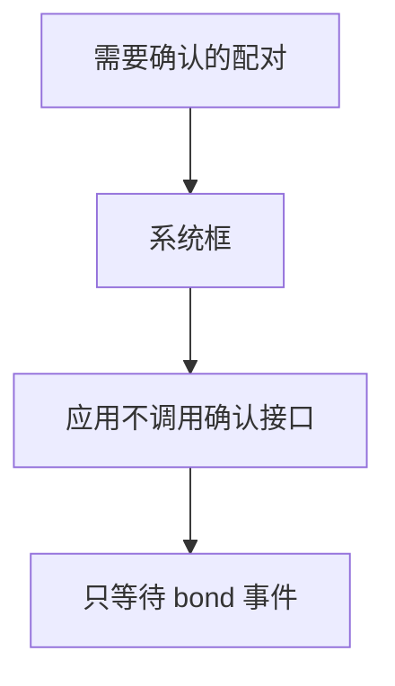
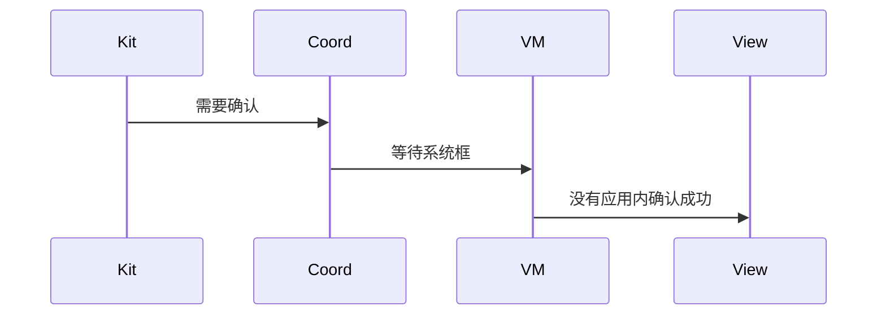
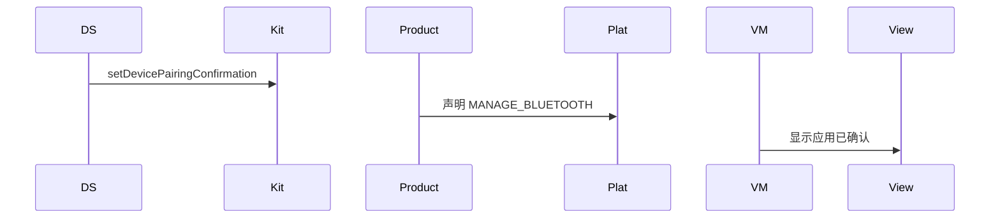

# BT-024 普通应用不调用系统级配对确认

## 1. 条目与非目标

**判定：** 支持

**Given** 应用不是系统应用

**When** 收到需要确认的配对

**Then** 不调用 `setDevicePairingConfirmation`。该接口还要 `MANAGE_BLUETOOTH`

**证据：** `ohos.bluetooth.connection 中该接口的权限说明`。行为以已接受的研究笔记和清单为准，本文件不重开行业调查。

**本条输入：** 普通应用收到需要确认的配对。

**本条输出：** 不调用 `setDevicePairingConfirmation`。确认留在系统框。应用不声明 `MANAGE_BLUETOOTH`。

**本条失败：** 普通应用调用该接口并显示已确认。

**本条所有者：** `ClassicBluetoothDataSource` 不暴露确认方法。`PairingCoordinator` 只观察。`product/phone` 的清单不加入 `MANAGE_BLUETOOTH`。

代码已接通清单里的结果：不调用 `setDevicePairingConfirmation`，也不声明 `MANAGE_BLUETOOTH`。射频仍是待真机，本条不记真机通过。

**非目标：**

- 不把应用做成系统应用。
- 不自绘确认按钮去调用该接口。
- 不新增 `common/yobluetooth` 以外的蓝牙栈，不增加包装层或版本兼容层。版本判断留在本条调用点。

## 2. 模块边界与分层

本组是配对。依赖方向是 `product/phone` → `features/bluetooth` → `common/yobluetooth`。权限、生命周期和系统设置走 `common/platform` 与 `common/debug_core`。字节与 `Result` 走 `common/core`。日志门面走 `common/yolog`。收藏、会话记录和导出走 `common/storage`。`common/youi_kit` 只提供通用控件，不解释蓝牙状态。

**调用点：** 没有 `setDevicePairingConfirmation` 调用点。

| 包 | 类型 | 职责 |
| --- | --- | --- |
| common/yobluetooth | PairingCoordinator | 只观察 bond 事件 |
| common/yobluetooth | ClassicBluetoothDataSource | 不封装确认接口 |
| product/phone | module.json5 | 不声明 MANAGE_BLUETOOTH |
| features/bluetooth | PairingGuideDialog | 不提供确认成功按钮 |

**设计前：** 若数据源把系统确认接口一并包出，普通应用会走到无权限调用。

**设计后：** 确认接口不在仓库调用链上。需要确认时仍是系统框，见 BT-020。

## 3. 架构图

本组总图在 [`BT-019.md`](BT-019.md)。下图只覆盖本条。

## 4. 序列图

### 成功路径

成功路径是清单里的限制已经由现有代码成立。射频仍是待真机。

### 错误路径

错误路径是把平台没有的能力做成成功。这条路径不进入目标分层。

## 5. 数据模型

领域模型放在 `common/yobluetooth`，持久化模型放在 `common/storage`，平台传输对象只出现在数据源调用点，跨层用 `common/core` 的 `Result` 与 `ResultError`。错误只带类别和结构化字段，不把界面句子塞进邻层错误。

| 模型 | 所在层 | 字段 | 来源 |
| --- | --- | --- | --- |
| PairingEvent | 领域 | 无 confirmedByApp 字段 | 只映射 BondState |

## 6. 层间接口

| 从 | 到 | 接口 | 成功 | 失败 |
| --- | --- | --- | --- | --- |
| ClassicBluetoothDataSource | connection | setDevicePairingConfirmation | 不存在于目标接口 | 禁止调用 |
| PairingGuideDialog | 数据源 | 确认 | 无此方法 | 不能返回成功 |

下层不持有页面类型。结果用 `Result` 或已有观察者回传。`common/yobluetooth` 的 `Index.ets` 继续只导出用例、领域模型和必要门面，不把数据源具体类变成第二套公开栈。

## 7. 权限与生命周期

不新增 `ohos.permission.MANAGE_BLUETOOTH`。现有权限仍是 `ACCESS_BLUETOOTH`。

确认过程没有应用内订阅以外的系统确认回调要注册。

## 8. 日志

- 不记录 pairingConfirmedByApp。
- 领域标签加在已有 `BtLogTag`，不在 `common/yolog` 的 `YoLogTag` 里再开一套蓝牙标签。
- 日志走 `YoLog`，不在页面里直接写 hilog。

## 9. 反模式

- 用反射或动态导入调用确认接口。
- 捕获权限错误后仍显示已确认。
- 用新的蓝牙 HAR、适配器或 `ApiCompat` 把本条版本差异包起来。版本判断只留在上面写明的调用点。
- 页面或 `common/youi_kit` 直接调用 `ohos.bluetooth.*`。
