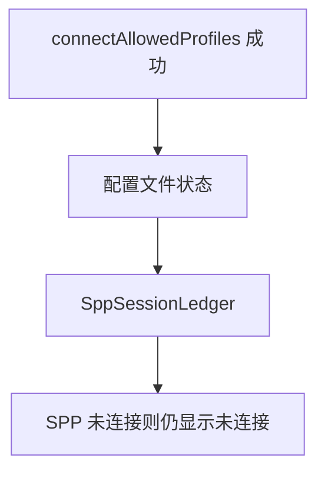
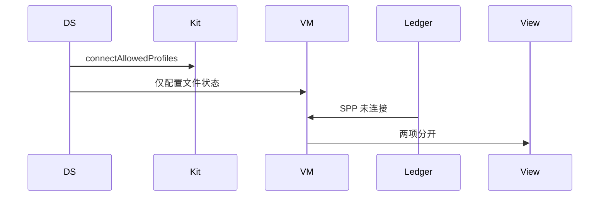
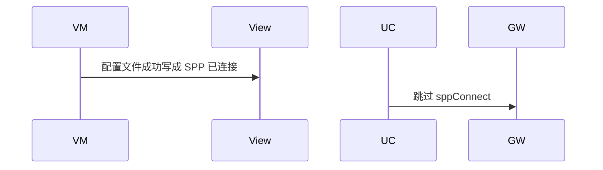

# BT-025 配置文件连接不等于 SPP 已连接

## 1. 条目与非目标

**判定：** 支持

**Given** `connectAllowedProfiles` 已成功

**When** 查看 A2DP、HFP、HID、PAN 与 SPP

**Then** 配置文件状态单独显示；SPP 仍须 `socket.sppConnect` 成功才算连接

**证据：** `配对与连接设备指南`。行为以已接受的研究笔记和清单为准，本文件不重开行业调查。

**本条输入：** `connectAllowedProfiles` 成功后的设备，以及 SPP 会话相位。

**本条输出：** 配置文件状态单独可见。SPP 列表或终端只有在 `sppConnect` 成功后才是已连接。

**本条失败：** 配置文件成功被写成 SPP 已连接。

**本条所有者：** 配置文件能力在 `ClassicProfileCapability` 与 `PlatformConnectedClassicSource`。SPP 真相在 `SppSessionLedger` 与 `SppTransportSession`。展示分列在 `SppMainViewModel`。

**非目标：**

- 不做 A2DP 播放或 HID 注入。
- 不让 `connectAllowedProfiles` 创建 SPP 套接字。
- 不新增 `common/yobluetooth` 以外的蓝牙栈，不增加包装层或版本兼容层。版本判断留在本条调用点。

## 2. 模块边界与分层

本组是配对。依赖方向是 `product/phone` → `features/bluetooth` → `common/yobluetooth`。权限、生命周期和系统设置走 `common/platform` 与 `common/debug_core`。字节与 `Result` 走 `common/core`。日志门面走 `common/yolog`。收藏、会话记录和导出走 `common/storage`。`common/youi_kit` 只提供通用控件，不解释蓝牙状态。

**调用点：** 配置文件调用与 `sppConnect` 分别在各自数据源，不合并成一个 connect。

| 包 | 类型 | 职责 |
| --- | --- | --- |
| common/yobluetooth | PlatformConnectedClassicSource | 读取配置文件连接 |
| common/yobluetooth | ClassicProfileCapability | 解释配置文件，不代表 SPP |
| common/yobluetooth | SppSessionLedger | SPP 是否已连接 |
| features/bluetooth | SppMainViewModel | 分列展示 |

**设计前：** 已连接经典设备快照容易和 SPP 会话合成一个已连接。

**设计后：** 两类状态字段分开。只有账本相位为已连接才显示 SPP 已连接。

## 3. 架构图

本组总图在 [`BT-019.md`](BT-019.md)。下图只覆盖本条。

## 4. 序列图

### 成功路径

### 错误路径

## 5. 数据模型

领域模型放在 `common/yobluetooth`，持久化模型放在 `common/storage`，平台传输对象只出现在数据源调用点，跨层用 `common/core` 的 `Result` 与 `ResultError`。错误只带类别和结构化字段，不把界面句子塞进邻层错误。

| 模型 | 所在层 | 字段 | 来源 |
| --- | --- | --- | --- |
| ClassicConnectedSnapshot | 领域 | profile 状态 | 不是 SPP |
| SppLedgerPhase | 领域 | connected 与否 | 套接字会话 |

## 6. 层间接口

| 从 | 到 | 接口 | 成功 | 失败 |
| --- | --- | --- | --- | --- |
| PlatformConnectedClassicSource | SppSessionLedger | 无直接写成连接 | 两边独立 | 禁止互写 |
| ConnectSppUseCase | SppPlatformGateway | sppConnect | SPP 已连接 | 配置文件成功不算 |

下层不持有页面类型。结果用 `Result` 或已有观察者回传。`common/yobluetooth` 的 `Index.ets` 继续只导出用例、领域模型和必要门面，不把数据源具体类变成第二套公开栈。

## 7. 权限与生命周期

本条不新增配置文件权限。SPP 仍用 `ACCESS_BLUETOOTH`。

配置文件观察与 SPP 套接字订阅分开注册、分开取消。

## 8. 日志

- `BtLogTag.CONN` 记录 profile。`BtLogTag.SPP` 才记录 sppConnected。
- 领域标签加在已有 `BtLogTag`，不在 `common/yolog` 的 `YoLogTag` 里再开一套蓝牙标签。
- 日志走 `YoLog`，不在页面里直接写 hilog。

## 9. 反模式

- `connectAllowedProfiles` 成功后插入一条假的 SPP 账本。
- 用 A2DP 状态点亮终端发送按钮。
- 用新的蓝牙 HAR、适配器或 `ApiCompat` 把本条版本差异包起来。版本判断只留在上面写明的调用点。
- 页面或 `common/youi_kit` 直接调用 `ohos.bluetooth.*`。
