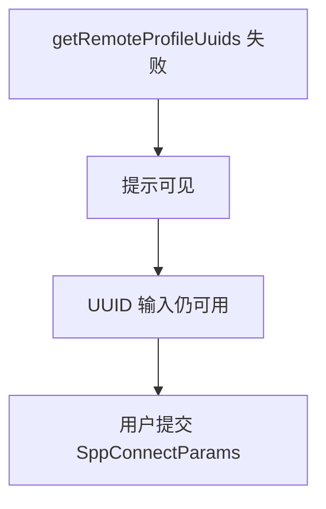
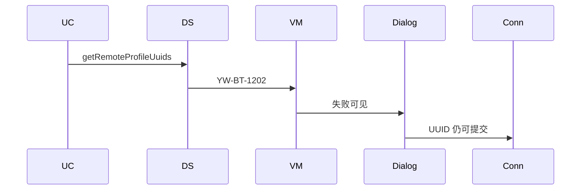
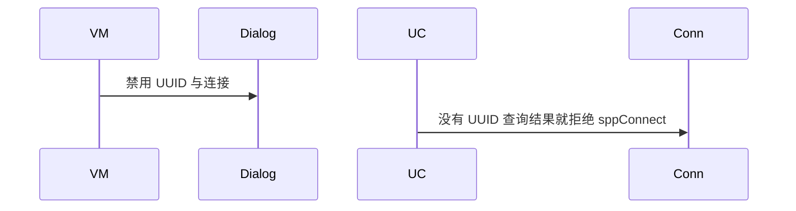

# BT-026 远端 UUID 查询失败不阻止手工 SPP UUID

## 1. 条目与非目标

**判定：** 支持

**Given** `getRemoteProfileUuids` 失败

**When** 用户仍选择标准或自定义 UUID 发起 SPP

**Then** 失败提示可见，SPP UUID 输入仍可用

**证据：** `配对与连接设备指南；UUID 查询是连接配置文件前的建议步骤`。行为以已接受的研究笔记和清单为准，本文件不重开行业调查。

**本条输入：** `getRemoteProfileUuids` 失败，用户仍选择 UUID。

**本条输出：** 失败提示可见。`SppConnectParams.uuid` 仍可提交标准或自定义值。

**本条失败：** UUID 查询失败就禁用 SPP 连接。

**本条所有者：** 查询在 `LoadRemoteProfileUuidsUseCase`。失败码 `YW-BT-1202`。连接参数在 `SppConnectDialogController`，不依赖查询成功。

**非目标：**

- 不把查询失败当成 UUID 不存在。
- 不自动改写用户输入的 UUID。
- 不新增 `common/yobluetooth` 以外的蓝牙栈，不增加包装层或版本兼容层。版本判断留在本条调用点。

## 2. 模块边界与分层

本组是配对。依赖方向是 `product/phone` → `features/bluetooth` → `common/yobluetooth`。权限、生命周期和系统设置走 `common/platform` 与 `common/debug_core`。字节与 `Result` 走 `common/core`。日志门面走 `common/yolog`。收藏、会话记录和导出走 `common/storage`。`common/youi_kit` 只提供通用控件，不解释蓝牙状态。

**调用点：** 查询调用在 `ClassicBluetoothDataSource`。它的失败不进入 `SppPlatformGateway` 的前置条件。

| 包 | 类型 | 职责 |
| --- | --- | --- |
| common/yobluetooth | LoadRemoteProfileUuidsUseCase | 查询可失败 |
| common/yobluetooth | ClassicBluetoothDataSource | getRemoteProfileUuids |
| features/bluetooth | SppConnectDialogController | 保持 UUID 可编辑 |
| common/yobluetooth | SppUuidPreset | 提供标准串口默认值 |

**设计前：** 查询失败若中断连接对话框，手工 UUID 无法使用。

**设计后：** 失败只出现在配置文件 UUID 区域。SPP UUID 字段保持可提交。

## 3. 架构图

本组总图在 [`BT-019.md`](BT-019.md)。下图只覆盖本条。

## 4. 序列图

### 成功路径

### 错误路径

## 5. 数据模型

领域模型放在 `common/yobluetooth`，持久化模型放在 `common/storage`，平台传输对象只出现在数据源调用点，跨层用 `common/core` 的 `Result` 与 `ResultError`。错误只带类别和结构化字段，不把界面句子塞进邻层错误。

| 模型 | 所在层 | 字段 | 来源 |
| --- | --- | --- | --- |
| ResultError YW-BT-1202 | 领域 | PROFILE_UUID_FAILED | 查询 |
| SppConnectParams | 领域 | uuid | 用户或预设 |

## 6. 层间接口

| 从 | 到 | 接口 | 成功 | 失败 |
| --- | --- | --- | --- | --- |
| LoadRemoteProfileUuidsUseCase | SppConnectDialogController | 结果 | 失败只提示 | 不关闭输入 |
| SppConnectDialogController | ConnectSppUseCase | SppConnectParams | 带用户 UUID | 不要求查询成功 |

下层不持有页面类型。结果用 `Result` 或已有观察者回传。`common/yobluetooth` 的 `Index.ets` 继续只导出用例、领域模型和必要门面，不把数据源具体类变成第二套公开栈。

## 7. 权限与生命周期

查询与连接同一权限。

查询是一次读取，不保持额外订阅。

## 8. 日志

- `BtLogTag.CONN` 记录 profileUuidFailed=1，同时 sppUuidEditable=1。
- 领域标签加在已有 `BtLogTag`，不在 `common/yolog` 的 `YoLogTag` 里再开一套蓝牙标签。
- 日志走 `YoLog`，不在页面里直接写 hilog。

## 9. 反模式

- 查询失败时清空标准 UUID 默认值。
- 用本地 SDP 猜测代替失败提示。
- 用新的蓝牙 HAR、适配器或 `ApiCompat` 把本条版本差异包起来。版本判断只留在上面写明的调用点。
- 页面或 `common/youi_kit` 直接调用 `ohos.bluetooth.*`。
