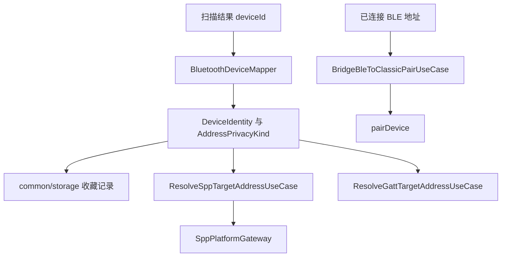
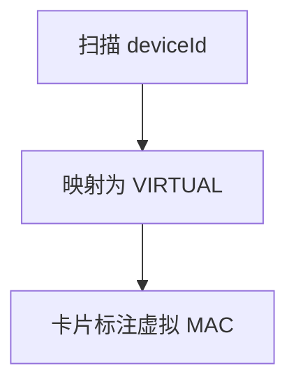
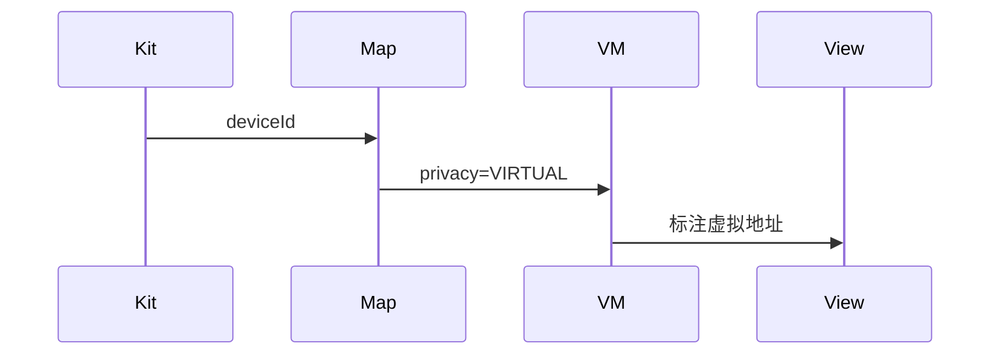
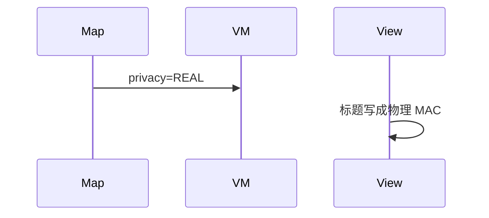

# BT-027 扫描地址标注为虚拟地址

## 1. 条目与非目标

**判定：** 支持

**Given** 扫描时过滤条件没有填写真实 MAC

**When** 展示 `deviceId`

**Then** 地址以虚拟 MAC 呈现，不标成物理 MAC

**证据：** `蓝牙服务开发概述；ScanResult.deviceId；DiscoveryResult.deviceId`。行为以已接受的研究笔记和清单为准，本文件不重开行业调查。

**本条输入：** 经典或 BLE 扫描得到的 `deviceId`，过滤条件没有真实 MAC。

**本条输出：** 展示为虚拟地址。`AddressPrivacyKind` 为 `VIRTUAL`。

**本条失败：** 把 `deviceId` 标成物理 MAC。

**本条所有者：** 映射在 `BluetoothDeviceMapper` 与 `BleAdvertisingPlatformMapper`。枚举是 `AddressPrivacyKind`。展示在对应列表卡片。

**非目标：**

- 不向用户索取或展示物理 MAC。
- 不因为地址像 MAC 就改成 REAL。
- 不新增 `common/yobluetooth` 以外的蓝牙栈，不增加包装层或版本兼容层。版本判断留在本条调用点。

## 2. 模块边界与分层

本组是地址与双模。依赖方向是 `product/phone` → `features/bluetooth` → `common/yobluetooth`。权限、生命周期和系统设置走 `common/platform` 与 `common/debug_core`。字节与 `Result` 走 `common/core`。日志门面走 `common/yolog`。收藏、会话记录和导出走 `common/storage`。`common/youi_kit` 只提供通用控件，不解释蓝牙状态。

**调用点：** 数据源不做物理地址转换。没有真实 MAC 接口被调用。

| 包 | 类型 | 职责 |
| --- | --- | --- |
| common/yobluetooth | 扫描数据源 | 接收平台 deviceId |
| common/yobluetooth | BluetoothDeviceMapper | 标记 VIRTUAL |
| features/bluetooth | 设备卡片 | 文案为虚拟地址 |

**设计前：** `resolvePersistentMac` 会把像 MAC 的字符串当成持久地址，展示可能因此标错。

**设计后：** 扫描展示路径固定 `VIRTUAL`。像 MAC 的格式不改变隐私类别。

## 3. 架构图

本组总图放在本文件。地址与双模里其余条目各自再画本条链路，链接不能代替本条的输入、输出、失败和所有者。

本条链路：

## 4. 序列图

### 成功路径

### 错误路径

## 5. 数据模型

领域模型放在 `common/yobluetooth`，持久化模型放在 `common/storage`，平台传输对象只出现在数据源调用点，跨层用 `common/core` 的 `Result` 与 `ResultError`。错误只带类别和结构化字段，不把界面句子塞进邻层错误。

| 模型 | 所在层 | 字段 | 来源 |
| --- | --- | --- | --- |
| AddressPrivacyKind | 领域 | VIRTUAL | 扫描默认 |
| BluetoothDevice | 领域 | deviceId 与 privacy | 映射 |

## 6. 层间接口

| 从 | 到 | 接口 | 成功 | 失败 |
| --- | --- | --- | --- | --- |
| BluetoothDeviceMapper | ViewModel | 设备 | privacy=VIRTUAL | 不输出 REAL |
| BleScanPlatformMapper | BleAdvertisingPacket | deviceId | 虚拟 | 不标物理 |

下层不持有页面类型。结果用 `Result` 或已有观察者回传。`common/yobluetooth` 的 `Index.ets` 继续只导出用例、领域模型和必要门面，不把数据源具体类变成第二套公开栈。

## 7. 权限与生命周期

展示虚拟地址不需要 `GET_BLUETOOTH_PEERS_MAC`。本条不申请该权限。

地址类别随扫描结果，不写入持久化物理地址。

## 8. 日志

- 扫描日志可记地址类别 VIRTUAL，不升级为物理地址。
- 领域标签加在已有 `BtLogTag`，不在 `common/yolog` 的 `YoLogTag` 里再开一套蓝牙标签。
- 日志走 `YoLog`，不在页面里直接写 hilog。

## 9. 反模式

- 用正则把 deviceId 改成物理 MAC。
- 过滤框提示用户填写真实 MAC 才能扫描。
- 用新的蓝牙 HAR、适配器或 `ApiCompat` 把本条版本差异包起来。版本判断只留在上面写明的调用点。
- 页面或 `common/youi_kit` 直接调用 `ohos.bluetooth.*`。
