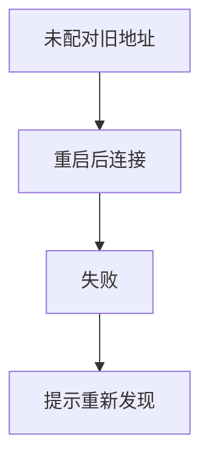
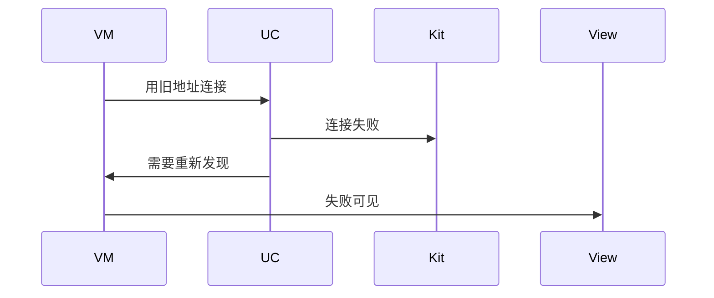
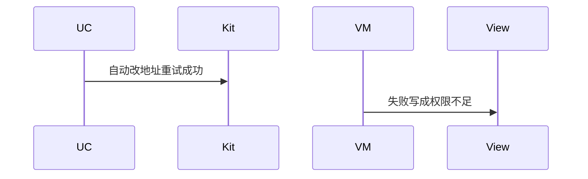

# BT-028 未配对设备重启蓝牙后旧地址失效

## 1. 条目与非目标

**判定：** 支持

**Given** 未配对且未持久化，已保存扫描地址

**When** 对端或本机重启蓝牙后再用旧地址连接

**Then** 连接失败原因可见，并提示需要重新发现

**证据：** `FAQ「如何实现 BLE 蓝牙快速回连」`。行为以已接受的研究笔记和清单为准，本文件不重开行业调查。

**本条输入：** 未配对设备的旧扫描地址，蓝牙重启后的连接请求。

**本条输出：** 连接失败可见，提示重新发现。不自动改用另一个地址。

**本条失败：** 失败被重试到成功，或提示成权限不足。

**本条所有者：** 地址稳定性由 `DeviceIdentity` 的 `EPHEMERAL_RANDOM` 或 `CURRENT_SESSION` 表达。连接失败提示在 GATT 或 SPP 用例。重新发现回到对应扫描用例。

**非目标：**

- 不在失败后调用免配对固化。
- 不把旧地址写进已配对列表。
- 不新增 `common/yobluetooth` 以外的蓝牙栈，不增加包装层或版本兼容层。版本判断留在本条调用点。

## 2. 模块边界与分层

本组是地址与双模。依赖方向是 `product/phone` → `features/bluetooth` → `common/yobluetooth`。权限、生命周期和系统设置走 `common/platform` 与 `common/debug_core`。字节与 `Result` 走 `common/core`。日志门面走 `common/yolog`。收藏、会话记录和导出走 `common/storage`。`common/youi_kit` 只提供通用控件，不解释蓝牙状态。

**调用点：** 连接仍走现有 GATT 或 SPP 数据源。本条不新增地址修复接口。

| 包 | 类型 | 职责 |
| --- | --- | --- |
| common/yobluetooth | BluetoothIdentityDataSource | 未配对标为临时地址 |
| common/yobluetooth | 连接用例 | 旧地址失败则返回需重新发现 |
| features/bluetooth | 对应 ViewModel | 展示失败与重新发现 |

**设计前：** 最近连接若把未配对地址当成稳定回连目标，重启后会无说明地失败。

**设计后：** 未配对地址的回连失败明确要求重新发现。页面提供发现入口，不循环旧地址。

## 3. 架构图

本组总图在 [`BT-027.md`](BT-027.md)。下图只覆盖本条。

## 4. 序列图

### 成功路径

### 错误路径

## 5. 数据模型

领域模型放在 `common/yobluetooth`，持久化模型放在 `common/storage`，平台传输对象只出现在数据源调用点，跨层用 `common/core` 的 `Result` 与 `ResultError`。错误只带类别和结构化字段，不把界面句子塞进邻层错误。

| 模型 | 所在层 | 字段 | 来源 |
| --- | --- | --- | --- |
| IdentityStability | 领域 | EPHEMERAL_RANDOM | 未配对未固化 |
| BluetoothRecentConnection | 领域 | 地址与稳定性 | 不是回连保证 |

## 6. 层间接口

| 从 | 到 | 接口 | 成功 | 失败 |
| --- | --- | --- | --- | --- |
| 连接用例 | ViewModel | 失败 | 原因=重新发现 | 不返回成功 |
| ViewModel | 扫描用例 | 用户重新发现 | 新地址 | 不自动开始 |

下层不持有页面类型。结果用 `Result` 或已有观察者回传。`common/yobluetooth` 的 `Index.ets` 继续只导出用例、领域模型和必要门面，不把数据源具体类变成第二套公开栈。

## 7. 权限与生命周期

不因为回连失败去申请持久化 MAC 权限。

失败后释放本次连接对象。不保留旧客户端继续试。

## 8. 日志

- `BtLogTag.CONN` 记录 staleAddress=1 action=rediscover。
- 领域标签加在已有 `BtLogTag`，不在 `common/yolog` 的 `YoLogTag` 里再开一套蓝牙标签。
- 日志走 `YoLog`，不在页面里直接写 hilog。

## 9. 反模式

- 重启后静默再扫并把第一个设备当成原设备。
- 无限重试旧地址。
- 用新的蓝牙 HAR、适配器或 `ApiCompat` 把本条版本差异包起来。版本判断只留在上面写明的调用点。
- 页面或 `common/youi_kit` 直接调用 `ohos.bluetooth.*`。
