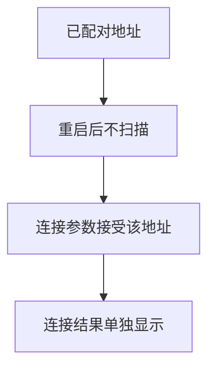
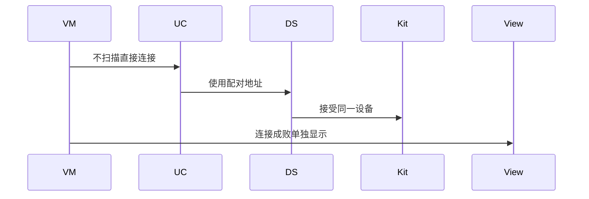
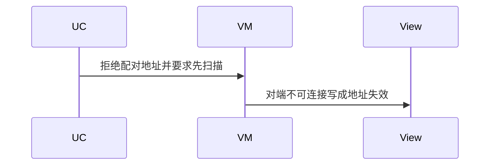

# BT-029 配对后虚拟地址保持可用

## 1. 条目与非目标

**判定：** 支持

**Given** 配对已完成

**When** 重启蓝牙后不扫描，用配对地址连接

**Then** 地址仍被接受为同一设备。连接是否成功还取决于对端可连接

**证据：** `FAQ「如何实现 BLE 蓝牙快速回连」方案一`。行为以已接受的研究笔记和清单为准，本文件不重开行业调查。

**本条输入：** 已配对设备的虚拟地址，重启蓝牙后不扫描直接连接。

**本条输出：** 地址作为同一设备被接受。连接结果单独成功或失败，失败不表示地址已被丢弃。

**本条失败：** 重启后要求必须先扫描才承认配对地址，或对端不可连接被说成地址失效。

**本条所有者：** 已配对地址来自 `LoadPairedClassicDevicesUseCase` 或 BLE 已配对读取。身份稳定性是 `PAIRED_STABLE`。连接仍由 SPP 或 GATT 用例执行。

**非目标：**

- 不保证对端一定可连接。
- 不在本条做免配对固化。
- 不新增 `common/yobluetooth` 以外的蓝牙栈，不增加包装层或版本兼容层。版本判断留在本条调用点。

## 2. 模块边界与分层

本组是地址与双模。依赖方向是 `product/phone` → `features/bluetooth` → `common/yobluetooth`。权限、生命周期和系统设置走 `common/platform` 与 `common/debug_core`。字节与 `Result` 走 `common/core`。日志门面走 `common/yolog`。收藏、会话记录和导出走 `common/storage`。`common/youi_kit` 只提供通用控件，不解释蓝牙状态。

**调用点：** 地址来自已有配对查询，不新增固化 API。

| 包 | 类型 | 职责 |
| --- | --- | --- |
| common/yobluetooth | LoadPaired 用例 | 重启后仍可读配对地址 |
| common/yobluetooth | DeviceIdentity | PAIRED_STABLE |
| common/yobluetooth | 连接用例 | 用该地址连接 |
| features/bluetooth | ViewModel | 区分地址接受与连接结果 |

**设计前：** 回连逻辑可能强制先扫描，把配对地址的可用性藏掉。

**设计后：** 配对地址可直接进入连接参数。连接失败保留地址，并显示对端或链路原因。

## 3. 架构图

本组总图在 [`BT-027.md`](BT-027.md)。下图只覆盖本条。

## 4. 序列图

### 成功路径

### 错误路径

## 5. 数据模型

领域模型放在 `common/yobluetooth`，持久化模型放在 `common/storage`，平台传输对象只出现在数据源调用点，跨层用 `common/core` 的 `Result` 与 `ResultError`。错误只带类别和结构化字段，不把界面句子塞进邻层错误。

| 模型 | 所在层 | 字段 | 来源 |
| --- | --- | --- | --- |
| IdentityStability.PAIRED_STABLE | 领域 | 配对后 | BondState |
| SppConnectParams 或 GattConnectParams | 领域 | 配对地址 | 用户回连 |

## 6. 层间接口

| 从 | 到 | 接口 | 成功 | 失败 |
| --- | --- | --- | --- | --- |
| ViewModel | 连接用例 | 配对地址 | 地址被接受 | 连接失败另报 |
| 连接用例 | 扫描用例 | 强制先扫描 | 本条不要求 | 不得因此拒绝地址 |

下层不持有页面类型。结果用 `Result` 或已有观察者回传。`common/yobluetooth` 的 `Index.ets` 继续只导出用例、领域模型和必要门面，不把数据源具体类变成第二套公开栈。

## 7. 权限与生命周期

使用已有配对记录，不申请持久化 MAC 权限。

不因此开启扫描。连接订阅只在连接尝试期间存在。

## 8. 日志

- `BtLogTag.CONN` 记录 addressSource=paired。连接失败另记平台码。
- 领域标签加在已有 `BtLogTag`，不在 `common/yolog` 的 `YoLogTag` 里再开一套蓝牙标签。
- 日志走 `YoLog`，不在页面里直接写 hilog。

## 9. 反模式

- 配对地址回连前自动经典发现。
- 一次连接失败就删除配对展示。
- 用新的蓝牙 HAR、适配器或 `ApiCompat` 把本条版本差异包起来。版本判断只留在上面写明的调用点。
- 页面或 `common/youi_kit` 直接调用 `ohos.bluetooth.*`。
