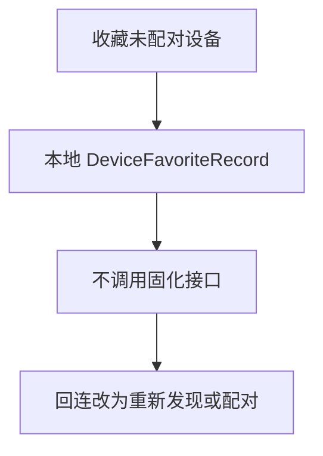
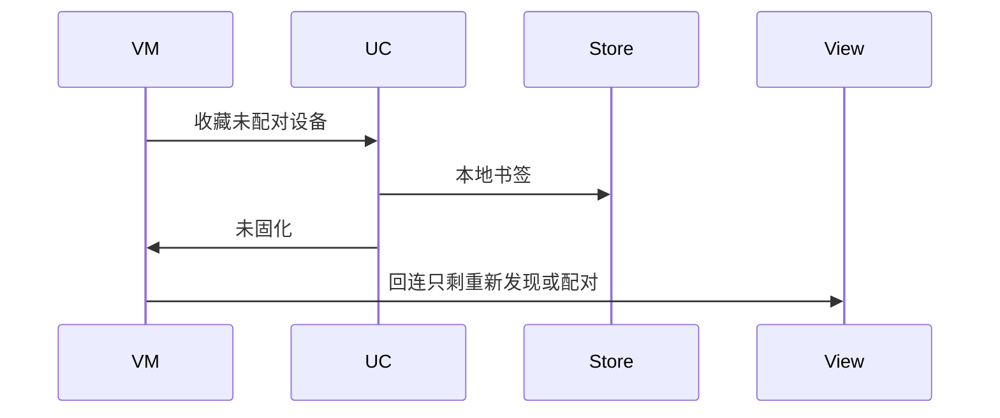
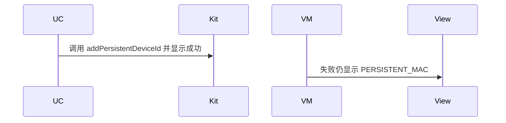

# BT-030 无 ACL 权限时不做免配对固化

## 1. 条目与非目标

**判定：** 待证

**Given** 未授予 `PERSISTENT_BLUETOOTH_PEERS_MAC` 或 ACL 未过

**When** 用户收藏一台未配对设备

**Then** 不把 `addPersistentDeviceId` 的失败显示成已固化；回连路径改为重新发现或配对

**证据：** `access.addPersistentDeviceId 权限；FAQ 注明该权限受限，一般建议配对`。行为以已接受的研究笔记和清单为准，本文件不重开行业调查。

**本条输入：** 未配对设备的收藏动作，且没有可用的 ACL 证据。

**本条输出：** 收藏只作为本地书签。不显示已固化。回连入口是重新发现或配对。

**本条失败：** 调用失败或未调用却显示 `PERSISTENT_MAC` 已生效。

**本条所有者：** 本地书签写入 `common/storage` 的 `DeviceFavoriteRecord`，经 `SaveBluetoothFavoriteUseCase`。`BluetoothIdentityDataSource` 不得把该书签标成 `PERSISTENT_MAC`。平台固化调用在本条不进入设计。

本条停在设备证据。不发明接口，也不把文档符号写成目标设备已经可用。

**非目标：**

- 不设计 `addPersistentDeviceId` 的成功路径。
- 不发明替代的免配对固化 API。
- 不因清单里声明了权限就当作 ACL 已通过。
- 不新增 `common/yobluetooth` 以外的蓝牙栈，不增加包装层或版本兼容层。版本判断留在本条调用点。

## 2. 模块边界与分层

本组是地址与双模。依赖方向是 `product/phone` → `features/bluetooth` → `common/yobluetooth`。权限、生命周期和系统设置走 `common/platform` 与 `common/debug_core`。字节与 `Result` 走 `common/core`。日志门面走 `common/yolog`。收藏、会话记录和导出走 `common/storage`。`common/youi_kit` 只提供通用控件，不解释蓝牙状态。

**调用点：** 本条没有 `addPersistentDeviceId` 调用点。不在数据源预留会返回成功的包装。

| 包 | 类型 | 职责 |
| --- | --- | --- |
| features/bluetooth | 设备页状态 | 收藏未配对设备 |
| common/yobluetooth | SaveBluetoothFavoriteUseCase | 只写本地书签 |
| common/storage | TargetRepository | 保存 DeviceFavoriteRecord |
| common/yobluetooth | DeviceIdentity | 稳定性保持临时，不是 PERSISTENT_MAC |
| features/bluetooth | 回连入口 | 只提供重新发现或配对 |

**设计前：** 模块声明了 `PERSISTENT_BLUETOOTH_PEERS_MAC`，收藏容易被写成平台已固化。

**设计后：** 在设备证据证明 ACL 可用之前，收藏不调用固化接口。失败也不能显示成已固化。回连走重新发现或配对。

## 3. 架构图

本组总图在 [`BT-027.md`](BT-027.md)。下图只覆盖本条。

## 4. 序列图

### 成功路径

待证条目的成功路径是保持未证实：不发起该调用，也不显示已经生效。

### 错误路径

错误路径是在没有设备证据时发明结果，或把失败显示成已生效。

## 5. 数据模型

领域模型放在 `common/yobluetooth`，持久化模型放在 `common/storage`，平台传输对象只出现在数据源调用点，跨层用 `common/core` 的 `Result` 与 `ResultError`。错误只带类别和结构化字段，不把界面句子塞进邻层错误。

| 模型 | 所在层 | 字段 | 来源 |
| --- | --- | --- | --- |
| DeviceFavoriteRecord | common/storage | 地址与模块 | 本地书签 |
| IdentityStability | 领域 | 不是 PERSISTENT_MAC | 无设备证据 |
| PermissionScenario.BLUETOOTH_PERSISTENT_MAC | debug_core | 本条不当作已批准 | 声明不等于 ACL |

## 6. 层间接口

| 从 | 到 | 接口 | 成功 | 失败 |
| --- | --- | --- | --- | --- |
| SaveBluetoothFavoriteUseCase | TargetRepository | 保存收藏 | 本地记录 | 不写平台固化 |
| SaveBluetoothFavoriteUseCase | access | addPersistentDeviceId | 不调用 | 禁止显示成功 |
| 回连 | 扫描或配对用例 | 重新发现或配对 | 用户另走已支持路径 | 不走固化地址 |

下层不持有页面类型。结果用 `Result` 或已有观察者回传。`common/yobluetooth` 的 `Index.ets` 继续只导出用例、领域模型和必要门面，不把数据源具体类变成第二套公开栈。

## 7. 权限与生命周期

`module.json5` 的声明保留为事实，但本条不发起该权限来制造成功。未授予或 ACL 未过时不显示已固化。

书签无蓝牙订阅。它不延长扫描，也不创建后台任务。

## 8. 日志

- `BtLogTag.CONN` 记录 favorite=local persistent=0。不记录 persistentSuccess。
- 领域标签加在已有 `BtLogTag`，不在 `common/yolog` 的 `YoLogTag` 里再开一套蓝牙标签。
- 日志走 `YoLog`，不在页面里直接写 hilog。

## 9. 反模式

- 捕获固化失败后把稳定性改成 PERSISTENT_MAC。
- 设计一个尚未证实的固化成功序列。
- 用配对状态冒充免配对固化。
- 用新的蓝牙 HAR、适配器或 `ApiCompat` 把本条版本差异包起来。版本判断只留在上面写明的调用点。
- 页面或 `common/youi_kit` 直接调用 `ohos.bluetooth.*`。
