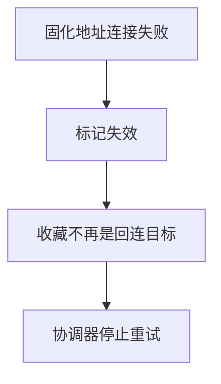
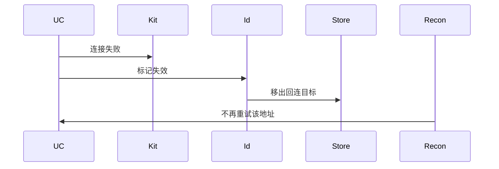
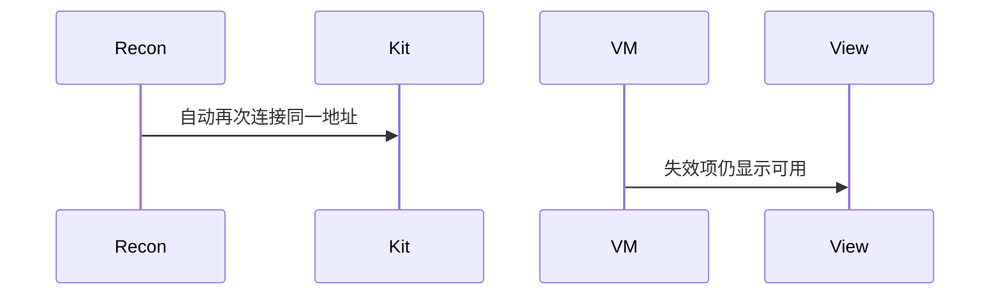

# BT-031 对端真实地址变化后丢弃固化项

## 1. 条目与非目标

**判定：** 支持

**Given** 虚拟地址已固化，对端真实地址已变

**When** 用固化地址连接失败

**Then** 该项标失效，不再自动重试同一地址

**证据：** `addPersistentDeviceId 说明`。行为以已接受的研究笔记和清单为准，本文件不重开行业调查。

**本条输入：** 一条已经存在的固化地址连接失败，且原因属于对端真实地址已变化。

**本条输出：** 该项标失效。自动回连不再使用它。

**本条失败：** 继续自动重试同一固化地址。

**本条所有者：** 若未来设备证据允许固化，失效标记仍放在 `DeviceIdentity` 与本地收藏。本条只定义失败后的丢弃。自动回连所有者是 `BleGattReconnectCoordinator` 或 `SppReconnectCoordinator`，必须跳过失效项。

**非目标：**

- 不在本条打开免配对固化成功路径。
- 不自动改绑到新扫描到的随机设备。
- 不新增 `common/yobluetooth` 以外的蓝牙栈，不增加包装层或版本兼容层。版本判断留在本条调用点。

## 2. 模块边界与分层

本组是地址与双模。依赖方向是 `product/phone` → `features/bluetooth` → `common/yobluetooth`。权限、生命周期和系统设置走 `common/platform` 与 `common/debug_core`。字节与 `Result` 走 `common/core`。日志门面走 `common/yolog`。收藏、会话记录和导出走 `common/storage`。`common/youi_kit` 只提供通用控件，不解释蓝牙状态。

**调用点：** 不新增固化 API。失效写入已有身份与收藏模型。

| 包 | 类型 | 职责 |
| --- | --- | --- |
| common/yobluetooth | 连接用例 | 固化地址失败 |
| common/yobluetooth | DeviceIdentity | 标记失效 |
| common/storage | 收藏记录 | 不再作为回连目标 |
| common/yobluetooth | 重连协调器 | 停止对该地址的自动重试 |

**设计前：** 重连协调器若只看地址字符串，会在真实地址变化后反复试同一项。

**设计后：** 失败按文档归为固化失效。协调器释放该目标，不再自动重试。

## 3. 架构图

本组总图在 [`BT-027.md`](BT-027.md)。下图只覆盖本条。

## 4. 序列图

### 成功路径

### 错误路径

## 5. 数据模型

领域模型放在 `common/yobluetooth`，持久化模型放在 `common/storage`，平台传输对象只出现在数据源调用点，跨层用 `common/core` 的 `Result` 与 `ResultError`。错误只带类别和结构化字段，不把界面句子塞进邻层错误。

| 模型 | 所在层 | 字段 | 来源 |
| --- | --- | --- | --- |
| DeviceIdentity | 领域 | 失效标记 | 连接失败 |
| DeviceFavoriteRecord | storage | 不可再回连 | 同一地址 |

## 6. 层间接口

| 从 | 到 | 接口 | 成功 | 失败 |
| --- | --- | --- | --- | --- |
| 连接用例 | 重连协调器 | 失败通知 | 停止该地址 | 不调度下一次 |
| 重连协调器 | 连接用例 | 再次 execute 同一地址 | 本条禁止 | 不得成功 |

下层不持有页面类型。结果用 `Result` 或已有观察者回传。`common/yobluetooth` 的 `Index.ets` 继续只导出用例、领域模型和必要门面，不把数据源具体类变成第二套公开栈。

## 7. 权限与生命周期

失效处理不申请新权限。

停止重试时取消该目标的等待。不影响其他会话。

## 8. 日志

- `BtLogTag.CONN` 记录 persistentStale=1 retry=0。
- 领域标签加在已有 `BtLogTag`，不在 `common/yolog` 的 `YoLogTag` 里再开一套蓝牙标签。
- 日志走 `YoLog`，不在页面里直接写 hilog。

## 9. 反模式

- 失败后立刻扫描并绑定信号最强的设备。
- 清掉失效标记再重试同一地址。
- 用新的蓝牙 HAR、适配器或 `ApiCompat` 把本条版本差异包起来。版本判断只留在上面写明的调用点。
- 页面或 `common/youi_kit` 直接调用 `ohos.bluetooth.*`。
