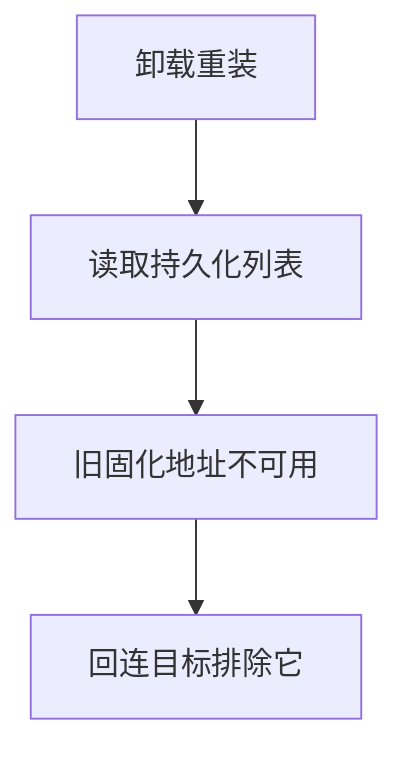
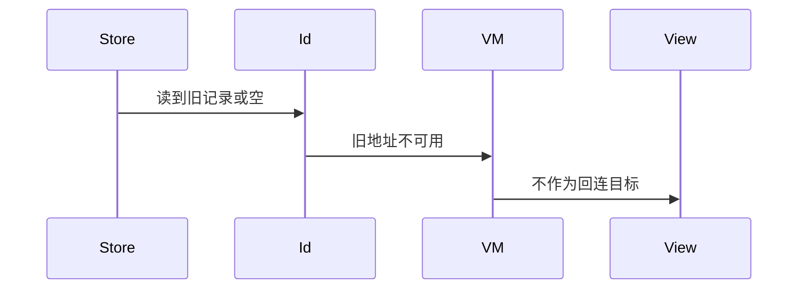
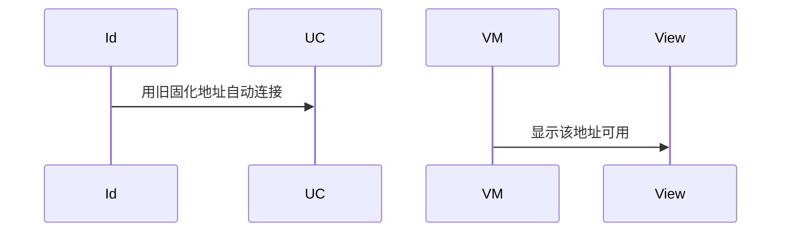

# BT-032 卸载重装后固化地址不可用

## 1. 条目与非目标

**判定：** 支持

**Given** 应用曾固化地址后被卸载重装

**When** 读取持久化列表

**Then** 旧地址不作为可用回连目标

**证据：** `addPersistentDeviceId 说明，卸载重装持久化失效`。行为以已接受的研究笔记和清单为准，本文件不重开行业调查。

**本条输入：** 卸载重装后的本地或平台持久化列表读取。

**本条输出：** 旧固化地址不作为可用回连目标。

**本条失败：** 重装后仍用旧地址自动连接。

**本条所有者：** 本地最近连接在 `common/storage` 的 preferences，由 `BluetoothIdentityDataSource.loadRecentFromStore` 读取。重装后的平台固化按文档已失效，回连目标过滤在该数据源。

**非目标：**

- 不尝试恢复卸载前的平台固化。
- 不把备份里的地址导入为可用目标。
- 不新增 `common/yobluetooth` 以外的蓝牙栈，不增加包装层或版本兼容层。版本判断留在本条调用点。

## 2. 模块边界与分层

本组是地址与双模。依赖方向是 `product/phone` → `features/bluetooth` → `common/yobluetooth`。权限、生命周期和系统设置走 `common/platform` 与 `common/debug_core`。字节与 `Result` 走 `common/core`。日志门面走 `common/yolog`。收藏、会话记录和导出走 `common/storage`。`common/youi_kit` 只提供通用控件，不解释蓝牙状态。

**调用点：** 不调用恢复固化的接口。读取点在 `BluetoothIdentityDataSource`。

| 包 | 类型 | 职责 |
| --- | --- | --- |
| common/storage | PreferencesStore | 重装后没有旧的可用固化 |
| common/yobluetooth | BluetoothIdentityDataSource | 不把旧地址放进回连目标 |
| features/bluetooth | 回连入口 | 不展示该地址为可用 |

**设计前：** 最近连接缓存若在重装后被恢复，会把失效固化当成可用。

**设计后：** 回连目标只接受当前安装生命周期内仍然有效的配对地址。旧固化地址不进入可用列表。

## 3. 架构图

本组总图在 [`BT-027.md`](BT-027.md)。下图只覆盖本条。

## 4. 序列图

### 成功路径

### 错误路径

## 5. 数据模型

领域模型放在 `common/yobluetooth`，持久化模型放在 `common/storage`，平台传输对象只出现在数据源调用点，跨层用 `common/core` 的 `Result` 与 `ResultError`。错误只带类别和结构化字段，不把界面句子塞进邻层错误。

| 模型 | 所在层 | 字段 | 来源 |
| --- | --- | --- | --- |
| BluetoothRecentConnection | 领域 | 不标记为可用固化 | 重装后 |
| DeviceFavoriteRecord | storage | 可保留为书签但不可回连 | 本地 |

## 6. 层间接口

| 从 | 到 | 接口 | 成功 | 失败 |
| --- | --- | --- | --- | --- |
| BluetoothIdentityDataSource | 重连协调器 | 可用目标 | 不含旧固化 | 不返回该地址 |
| 数据源 | access | 恢复固化 | 无此调用 | 禁止 |

下层不持有页面类型。结果用 `Result` 或已有观察者回传。`common/yobluetooth` 的 `Index.ets` 继续只导出用例、领域模型和必要门面，不把数据源具体类变成第二套公开栈。

## 7. 权限与生命周期

不重新申请持久化权限来复活旧地址。

应用首次启动不做固化迁移。

## 8. 日志

- `BtLogTag.CONN` 记录 droppedPersistentAfterReinstall。
- 领域标签加在已有 `BtLogTag`，不在 `common/yolog` 的 `YoLogTag` 里再开一套蓝牙标签。
- 日志走 `YoLog`，不在页面里直接写 hilog。

## 9. 反模式

- 从文件备份导入旧 deviceId 并自动连接。
- 把书签地址升级为固化地址。
- 用新的蓝牙 HAR、适配器或 `ApiCompat` 把本条版本差异包起来。版本判断只留在上面写明的调用点。
- 页面或 `common/youi_kit` 直接调用 `ohos.bluetooth.*`。
