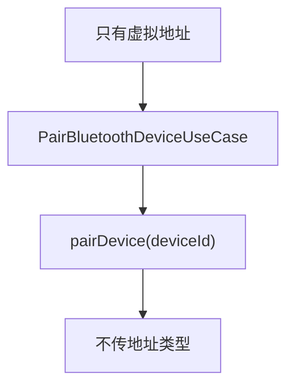
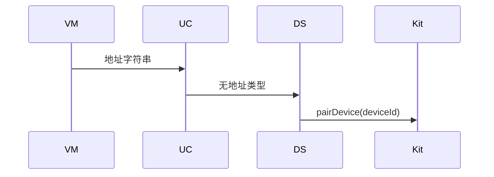
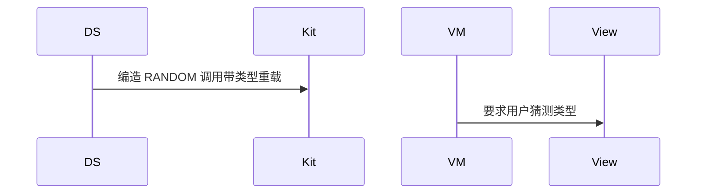

# BT-033 未知地址类型时用不带类型的配对

## 1. 条目与非目标

**判定：** 支持

**Given** 只有虚拟地址字符串，不知道 `BluetoothAddressType`

**When** 发起配对

**Then** 使用不带地址类型的 `pairDevice(deviceId)`

**证据：** `配对与连接设备指南`。行为以已接受的研究笔记和清单为准，本文件不重开行业调查。

**本条输入：** 只有虚拟地址字符串，没有地址类型。

**本条输出：** 调用 `pairDevice(deviceId)`。不传 `BluetoothAddress` 类型。

**本条失败：** 编造 PUBLIC 或 RANDOM 再配对。

**本条所有者：** `PairBluetoothDeviceUseCase` 把字符串交给 `ClassicBluetoothDataSource`。未知类型时数据源调用单参数 `pairDevice`。

**非目标：**

- 不在 API 21 的带类型重载上猜类型。
- 不要求用户选择地址类型。
- 不新增 `common/yobluetooth` 以外的蓝牙栈，不增加包装层或版本兼容层。版本判断留在本条调用点。

## 2. 模块边界与分层

本组是地址与双模。依赖方向是 `product/phone` → `features/bluetooth` → `common/yobluetooth`。权限、生命周期和系统设置走 `common/platform` 与 `common/debug_core`。字节与 `Result` 走 `common/core`。日志门面走 `common/yolog`。收藏、会话记录和导出走 `common/storage`。`common/youi_kit` 只提供通用控件，不解释蓝牙状态。

**调用点：** 重载选择写在 `ClassicBluetoothDataSource.pairDevice`。已知类型才允许走另一重载，那不是本条。

| 包 | 类型 | 职责 |
| --- | --- | --- |
| features/bluetooth | 配对入口 | 只提交地址字符串 |
| common/yobluetooth | PairBluetoothDeviceUseCase | 不补类型 |
| common/yobluetooth | ClassicBluetoothDataSource | pairDevice(deviceId) |

**设计前：** 带类型重载若被默认成 PUBLIC，会把未知地址配错。

**设计后：** 没有类型就不使用带类型重载。调用点保持单参数形式。

## 3. 架构图

本组总图在 [`BT-027.md`](BT-027.md)。下图只覆盖本条。

## 4. 序列图

### 成功路径

### 错误路径

## 5. 数据模型

领域模型放在 `common/yobluetooth`，持久化模型放在 `common/storage`，平台传输对象只出现在数据源调用点，跨层用 `common/core` 的 `Result` 与 `ResultError`。错误只带类别和结构化字段，不把界面句子塞进邻层错误。

| 模型 | 所在层 | 字段 | 来源 |
| --- | --- | --- | --- |
| BluetoothRawAddrKind | 领域 | UNKNOWN 时不外传 | 不映射成平台类型 |
| 配对请求 | 数据源 | deviceId 字符串 | 单参数 |

## 6. 层间接口

| 从 | 到 | 接口 | 成功 | 失败 |
| --- | --- | --- | --- | --- |
| PairBluetoothDeviceUseCase | ClassicBluetoothDataSource | pair(deviceId) | 单参数 | 无类型则不调用双参数 |
| 数据源 | connection | pairDevice | deviceId | 不传 BluetoothAddressType |

下层不持有页面类型。结果用 `Result` 或已有观察者回传。`common/yobluetooth` 的 `Index.ets` 继续只导出用例、领域模型和必要门面，不把数据源具体类变成第二套公开栈。

## 7. 权限与生命周期

配对权限不变。

配对订阅与 BT-019 相同。

## 8. 日志

- `BtLogTag.CONN` 记录 pairForm=deviceIdOnly。
- 领域标签加在已有 `BtLogTag`，不在 `common/yolog` 的 `YoLogTag` 里再开一套蓝牙标签。
- 日志走 `YoLog`，不在页面里直接写 hilog。

## 9. 反模式

- 默认 `PUBLIC`。
- 用地址首字节猜测随机地址。
- 用新的蓝牙 HAR、适配器或 `ApiCompat` 把本条版本差异包起来。版本判断只留在上面写明的调用点。
- 页面或 `common/youi_kit` 直接调用 `ohos.bluetooth.*`。
