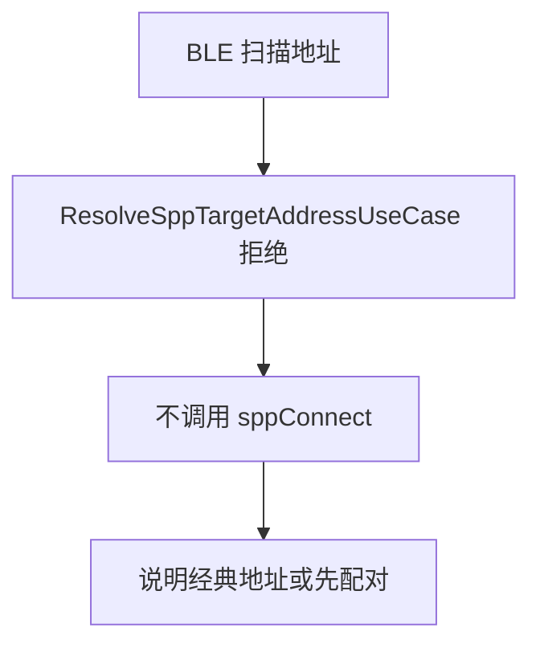
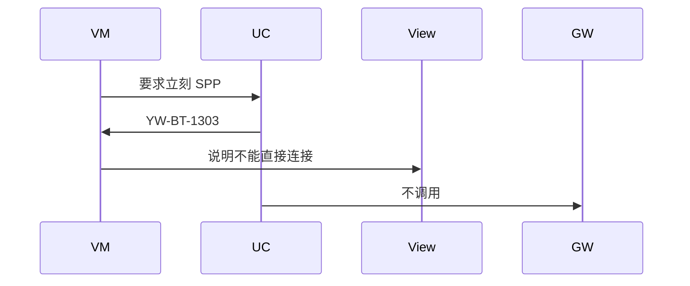
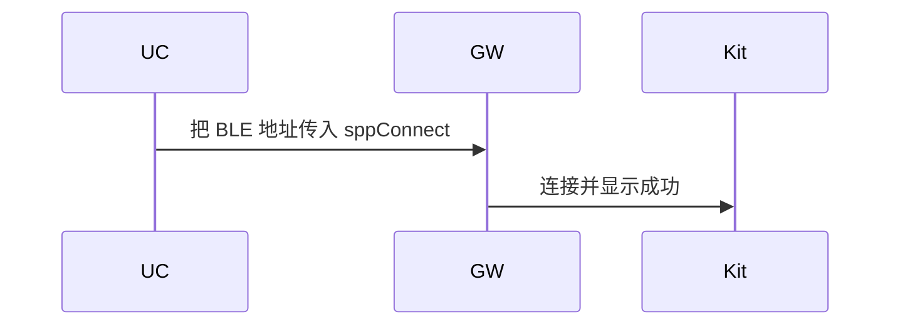

# BT-034 BLE 扫描地址不能直接用于 SPP

## 1. 条目与非目标

**判定：** 支持

**Given** 只有 BLE 扫描得到的地址

**When** 用户要求立刻 SPP

**Then** 不把该地址传给 `sppConnect`；说明需要经典地址或先按 FAQ 做 BLE 地址配对

**证据：** `FAQ「ble.startBLEScan 扫描出来的地址可以放到 socket.sppConnect 吗」答案为不可以`。行为以已接受的研究笔记和清单为准，本文件不重开行业调查。

**本条输入：** 仅有 BLE 扫描地址时的 SPP 请求。

**本条输出：** `sppConnect` 不被调用。说明需要经典地址，或先走已连接 BLE 地址的配对。错误码使用已有 `SPP_BLE_ADDRESS_REJECTED`。

**本条失败：** BLE 地址进入 `SppPlatformGateway`。

**本条所有者：** 拒绝在 `ResolveSppTargetAddressUseCase`。`SppConnectDialogController` 展示说明。配对桥是另一条已支持用例，不在本条自动执行。

代码已接通清单里的结果：BLE 地址在 `ResolveSppTargetAddressUseCase` 被拒绝，说明由 `SppConnectFailureHints` 给出。射频仍是待真机，本条不记真机通过。

**非目标：**

- 不自动调用 `pairDevice` 来把拒绝变成成功。
- 不把 BLE 地址填进 `classicDeviceId`。
- 不新增 `common/yobluetooth` 以外的蓝牙栈，不增加包装层或版本兼容层。版本判断留在本条调用点。

## 2. 模块边界与分层

本组是地址与双模。依赖方向是 `product/phone` → `features/bluetooth` → `common/yobluetooth`。权限、生命周期和系统设置走 `common/platform` 与 `common/debug_core`。字节与 `Result` 走 `common/core`。日志门面走 `common/yolog`。收藏、会话记录和导出走 `common/storage`。`common/youi_kit` 只提供通用控件，不解释蓝牙状态。

**调用点：** `SppPlatformGateway.sppConnect` 不是本条调用点。

| 包 | 类型 | 职责 |
| --- | --- | --- |
| features/bluetooth | SppConnectDialogController | 说明不能直接 SPP |
| common/yobluetooth | ResolveSppTargetAddressUseCase | 拒绝 BLE 地址 |
| common/yobluetooth | BluetoothErrorCodes | YW-BT-1303 |
| common/yobluetooth | SppPlatformGateway | 本条不到达 |

**设计前：** 地址字符串若直接进入 `executeFromAddress` 的 UNKNOWN 分支，可能被当成经典地址。

**设计后：** 来源是 BLE 扫描时直接拒绝。网关不收到该地址。说明指向经典地址或 BT-036 的配对，而不是成功连接。

## 3. 架构图

本组总图在 [`BT-027.md`](BT-027.md)。下图只覆盖本条。

## 4. 序列图

### 成功路径

成功路径是清单里的限制已经由现有代码成立。射频仍是待真机。

### 错误路径

错误路径是把平台没有的能力做成成功。这条路径不进入目标分层。

## 5. 数据模型

领域模型放在 `common/yobluetooth`，持久化模型放在 `common/storage`，平台传输对象只出现在数据源调用点，跨层用 `common/core` 的 `Result` 与 `ResultError`。错误只带类别和结构化字段，不把界面句子塞进邻层错误。

| 模型 | 所在层 | 字段 | 来源 |
| --- | --- | --- | --- |
| BluetoothDevice.bleDeviceId | 领域 | 只有 BLE 地址 | 扫描 |
| ResultError YW-BT-1303 | 领域 | SPP_BLE_ADDRESS_REJECTED | 拒绝 |

## 6. 层间接口

| 从 | 到 | 接口 | 成功 | 失败 |
| --- | --- | --- | --- | --- |
| SppConnectDialogController | ResolveSppTargetAddressUseCase | 解析 | 无经典地址 | 拒绝 |
| ResolveSppTargetAddressUseCase | SppPlatformGateway | sppConnect | 不调用 | 禁止把 BLE 地址传入 |
| 对话框 | BridgeBleToClassicPairUseCase | 自动执行 | 本条不调用 | 只作说明 |

下层不持有页面类型。结果用 `Result` 或已有观察者回传。`common/yobluetooth` 的 `Index.ets` 继续只导出用例、领域模型和必要门面，不把数据源具体类变成第二套公开栈。

## 7. 权限与生命周期

拒绝路径不新增权限。

不创建 SPP 账本槽位。

## 8. 日志

- `BtLogTag.SPP` 记录 reject=bleAddress。
- 领域标签加在已有 `BtLogTag`，不在 `common/yolog` 的 `YoLogTag` 里再开一套蓝牙标签。
- 日志走 `YoLog`，不在页面里直接写 hilog。

## 9. 反模式

- 把 `bleDeviceId` 复制到 `classicDeviceId` 再连接。
- 捕获连接失败后改显示已连接。
- 用新的蓝牙 HAR、适配器或 `ApiCompat` 把本条版本差异包起来。版本判断只留在上面写明的调用点。
- 页面或 `common/youi_kit` 直接调用 `ohos.bluetooth.*`。
