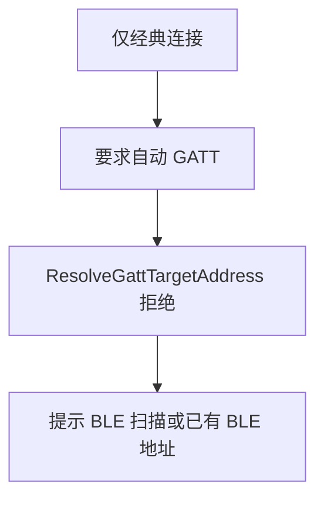
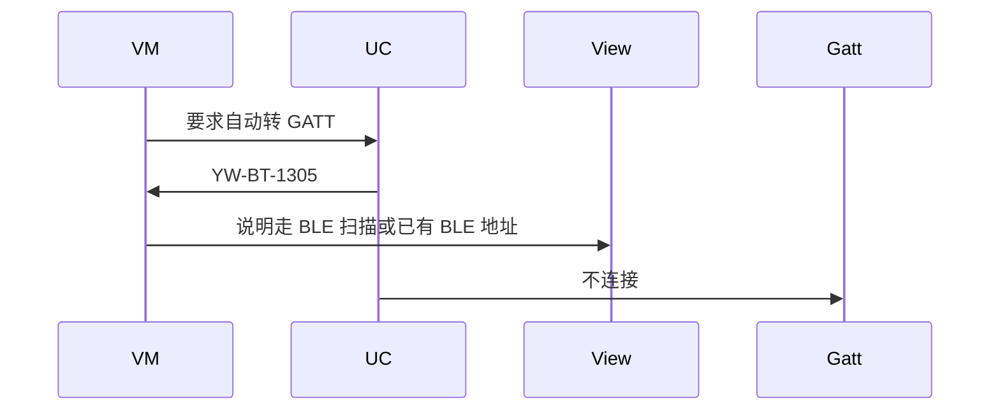
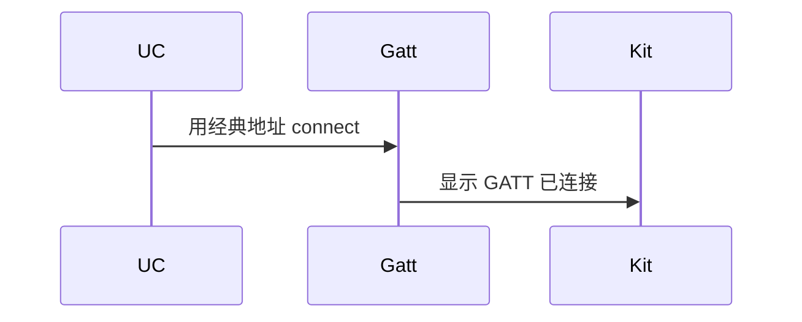

# BT-035 不提供先经典再 BLE 的自动桥

## 1. 条目与非目标

**判定：** 支持

**Given** 仅有经典连接

**When** 用户要求自动转成 GATT

**Then** 不出现成功的自动桥接；若要 GATT，走 BLE 扫描或已有 BLE 地址

**证据：** `同一 FAQ：目前不支持先经典再 BLE`。行为以已接受的研究笔记和清单为准，本文件不重开行业调查。

**本条输入：** 只有经典连接或经典地址，用户要求自动变成 GATT。

**本条输出：** 没有自动桥成功。`ResolveGattTargetAddressUseCase` 对纯经典返回 `GATT_CLASSIC_ADDRESS_REJECTED`。GATT 需要 BLE 扫描或已有 BLE 地址。

**本条失败：** 用经典地址创建 GATT 并显示已连接。

**本条所有者：** 拒绝在已有 `ResolveGattTargetAddressUseCase`。`ConnectGattUseCase` 不到达。页面说明在 BLE 或经典页状态。不新增反向桥用例。

代码已接通清单里的结果：没有经典到 GATT 的自动桥，纯经典地址返回 `GATT_CLASSIC_ADDRESS_REJECTED`。射频仍是待真机，本条不记真机通过。

**非目标：**

- 不新增 `BridgeClassicToBleUseCase`。
- 不把 BT-036 的 BLE 到经典配对反过来用。
- 不新增 `common/yobluetooth` 以外的蓝牙栈，不增加包装层或版本兼容层。版本判断留在本条调用点。

## 2. 模块边界与分层

本组是地址与双模。依赖方向是 `product/phone` → `features/bluetooth` → `common/yobluetooth`。权限、生命周期和系统设置走 `common/platform` 与 `common/debug_core`。字节与 `Result` 走 `common/core`。日志门面走 `common/yolog`。收藏、会话记录和导出走 `common/storage`。`common/youi_kit` 只提供通用控件，不解释蓝牙状态。

**调用点：** `GattClientDataSource` 不接收经典地址。没有反向桥调用点。

| 包 | 类型 | 职责 |
| --- | --- | --- |
| features/bluetooth | 页面状态 | 说明没有自动桥 |
| common/yobluetooth | ResolveGattTargetAddressUseCase | 纯经典失败 |
| common/yobluetooth | ConnectGattUseCase | 没有 BLE 地址则不连接 |
| common/yobluetooth | StartBleScanUseCase | 只在用户改走 BLE 扫描时 |

**设计前：** 双模链接若允许从经典地址推导 BLE 地址，会形成文档否定的反向桥。

**设计后：** 没有经典到 BLE 的用例。纯经典设备不能进入 `GattClientDataSource.connect`。

## 3. 架构图

本组总图在 [`BT-027.md`](BT-027.md)。下图只覆盖本条。

## 4. 序列图

### 成功路径

成功路径是清单里的限制已经由现有代码成立。射频仍是待真机。

### 错误路径

错误路径是把平台没有的能力做成成功。这条路径不进入目标分层。

## 5. 数据模型

领域模型放在 `common/yobluetooth`，持久化模型放在 `common/storage`，平台传输对象只出现在数据源调用点，跨层用 `common/core` 的 `Result` 与 `ResultError`。错误只带类别和结构化字段，不把界面句子塞进邻层错误。

| 模型 | 所在层 | 字段 | 来源 |
| --- | --- | --- | --- |
| ResultError YW-BT-1305 | 领域 | GATT_CLASSIC_ADDRESS_REJECTED | 纯经典 |
| GattConnectParams | 领域 | 必须已有 bleDeviceId | 不从经典推导 |

## 6. 层间接口

| 从 | 到 | 接口 | 成功 | 失败 |
| --- | --- | --- | --- | --- |
| 页面 | ResolveGattTargetAddressUseCase | 解析 | 失败 | 无自动成功 |
| ResolveGattTargetAddressUseCase | ConnectGattUseCase | 连接 | 无 BLE 地址不调用 | 禁止经典地址 |
| 页面 | BridgeBleToClassicPairUseCase | 反向使用 | 不支持 | 不调用 |

下层不持有页面类型。结果用 `Result` 或已有观察者回传。`common/yobluetooth` 的 `Index.ets` 继续只导出用例、领域模型和必要门面，不把数据源具体类变成第二套公开栈。

## 7. 权限与生命周期

不新增权限来做桥。

拒绝时不创建 `GattClientDevice`。

## 8. 日志

- `BtLogTag.CONN` 记录 reject=classicToGatt。
- 领域标签加在已有 `BtLogTag`，不在 `common/yolog` 的 `YoLogTag` 里再开一套蓝牙标签。
- 日志走 `YoLog`，不在页面里直接写 hilog。

## 9. 反模式

- 按设备名在 BLE 扫描结果里自动连第一台。
- 把经典地址写入 `bleDeviceId`。
- 用新的蓝牙 HAR、适配器或 `ApiCompat` 把本条版本差异包起来。版本判断只留在上面写明的调用点。
- 页面或 `common/youi_kit` 直接调用 `ohos.bluetooth.*`。
