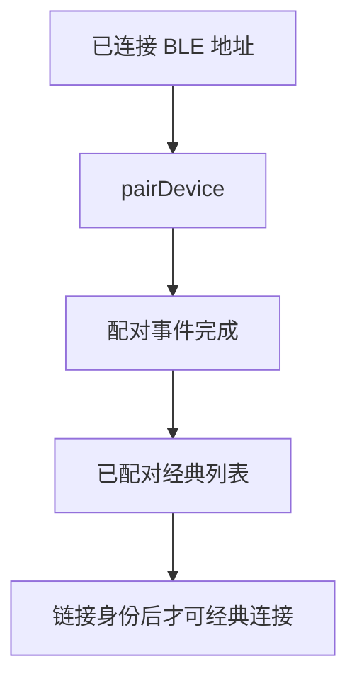
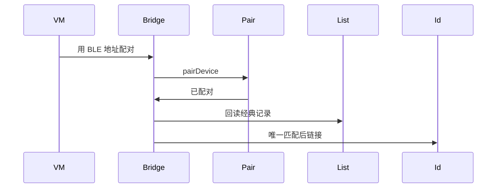
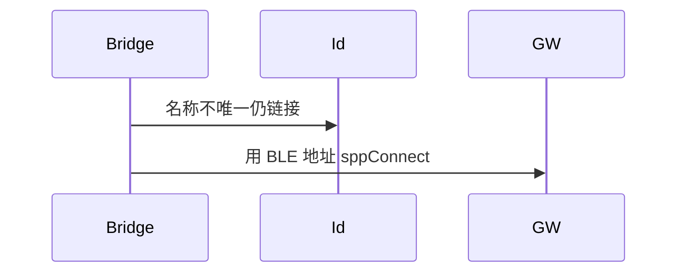

# BT-036 已连接 BLE 地址可以发起配对以得到经典记录

## 1. 条目与非目标

**判定：** 支持

**Given** BLE 已连接且已知其虚拟地址，对端为双模

**When** 用该地址 `pairDevice`

**Then** 配对成功后，已配对列表能用于后续经典连接

**证据：** `FAQ「如何通过已连接的 BLE 蓝牙设备的虚拟 MAC 地址建立经典蓝牙连接」`。行为以已接受的研究笔记和清单为准，本文件不重开行业调查。

**本条输入：** 已连接 BLE 的虚拟地址，用户发起配对。

**本条输出：** 配对成功后，已配对列表出现可用于经典连接的记录。身份由 `linkDualModeIdentity` 联系起来。

**本条失败：** 未配对成功就显示经典已可连接，或名称不唯一时乱配一台。

**本条所有者：** 已有 `BridgeBleToClassicPairUseCase`：先 `PairBluetoothDeviceUseCase`，再 `loadPairedClassicCandidates`，名称不唯一则 `DUAL_BRIDGE_NAME_MISMATCH`。链接在 `BluetoothIdentityDataSource`。

**非目标：**

- 不把 BLE 地址直接送进 `sppConnect`。
- 不在配对未完成时创建 SPP。
- 不新增 `common/yobluetooth` 以外的蓝牙栈，不增加包装层或版本兼容层。版本判断留在本条调用点。

## 2. 模块边界与分层

本组是地址与双模。依赖方向是 `product/phone` → `features/bluetooth` → `common/yobluetooth`。权限、生命周期和系统设置走 `common/platform` 与 `common/debug_core`。字节与 `Result` 走 `common/core`。日志门面走 `common/yolog`。收藏、会话记录和导出走 `common/storage`。`common/youi_kit` 只提供通用控件，不解释蓝牙状态。

**调用点：** `pairDevice` 在 `ClassicBluetoothDataSource`。本用例不调用 `sppConnect`。

| 包 | 类型 | 职责 |
| --- | --- | --- |
| common/yobluetooth | BridgeBleToClassicPairUseCase | 编排配对与回读 |
| common/yobluetooth | PairBluetoothDeviceUseCase | 对 BLE 地址 pairDevice |
| common/yobluetooth | LoadPairedClassicDevicesUseCase | 回读经典记录 |
| common/yobluetooth | BluetoothIdentityDataSource | 链接两个地址 |
| features/bluetooth | 页面状态 | 展示配对结果与是否可经典连接 |

**设计前：** 桥接若在配对 Promise 返回时就链接身份，会早于已配对列表。

**设计后：** 先等配对状态完成，再读已配对经典列表。唯一匹配才链接。随后经典连接使用经典地址，不使用 BLE 地址。

## 3. 架构图

本组总图在 [`BT-027.md`](BT-027.md)。下图只覆盖本条。

## 4. 序列图

### 成功路径

### 错误路径

## 5. 数据模型

领域模型放在 `common/yobluetooth`，持久化模型放在 `common/storage`，平台传输对象只出现在数据源调用点，跨层用 `common/core` 的 `Result` 与 `ResultError`。错误只带类别和结构化字段，不把界面句子塞进邻层错误。

| 模型 | 所在层 | 字段 | 来源 |
| --- | --- | --- | --- |
| DeviceIdentity | 领域 | classicDeviceId 与 bleDeviceId | 配对后链接 |
| ResultError YW-BT-1304 | 领域 | 名称不唯一 | 不链接 |

## 6. 层间接口

| 从 | 到 | 接口 | 成功 | 失败 |
| --- | --- | --- | --- | --- |
| BridgeBleToClassicPairUseCase | PairBluetoothDeviceUseCase | execute bleDeviceId | 配对完成 | 未完成则失败 |
| BridgeBleToClassicPairUseCase | BluetoothRepository | loadPairedClassicCandidates | 唯一经典记录 | 不唯一则 1304 |
| 后续 SPP | ResolveSppTargetAddressUseCase | 使用 classicDeviceId | 经典地址 | 不用 BLE 地址 |

下层不持有页面类型。结果用 `Result` 或已有观察者回传。`common/yobluetooth` 的 `Index.ets` 继续只导出用例、领域模型和必要门面，不把数据源具体类变成第二套公开栈。

## 7. 权限与生命周期

配对使用 `ACCESS_BLUETOOTH`。

配对订阅遵循 BT-019。链接发生在配对完成之后。

## 8. 日志

- `BtLogTag.CONN` 记录 bridge=bleToClassic paired=1。失败记录 1304。
- 领域标签加在已有 `BtLogTag`，不在 `common/yolog` 的 `YoLogTag` 里再开一套蓝牙标签。
- 日志走 `YoLog`，不在页面里直接写 hilog。

## 9. 反模式

- 跳过已配对列表，直接把 BLE 地址当经典地址。
- 多台同名时选第一台。
- 用新的蓝牙 HAR、适配器或 `ApiCompat` 把本条版本差异包起来。版本判断只留在上面写明的调用点。
- 页面或 `common/youi_kit` 直接调用 `ohos.bluetooth.*`。
