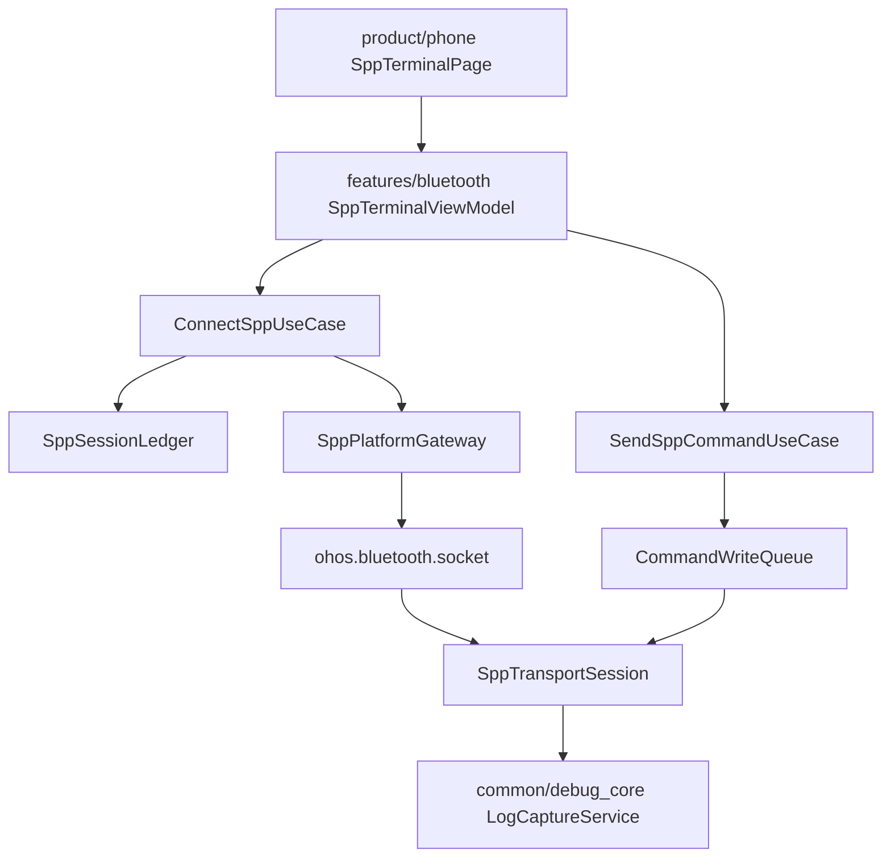
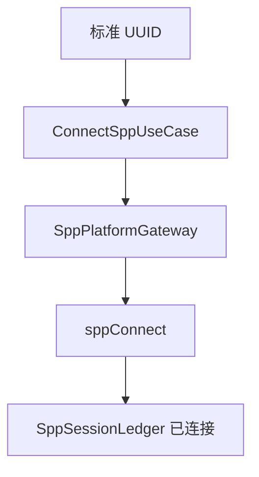
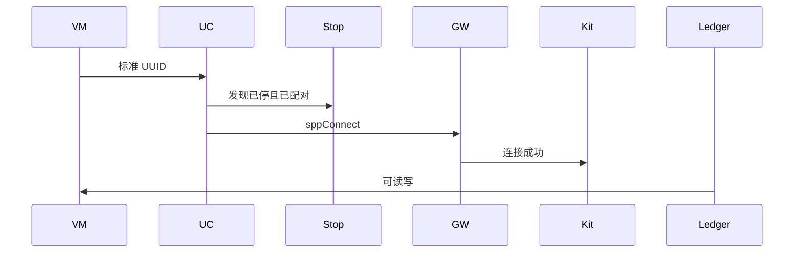
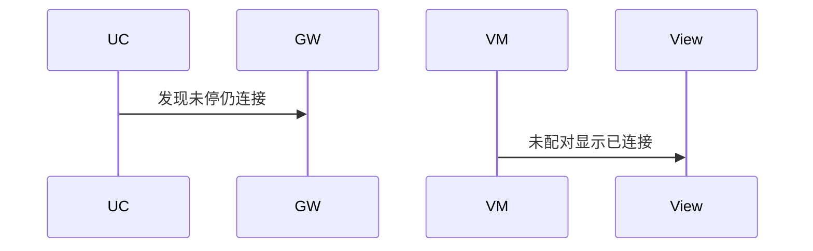

# BT-037 标准串口 UUID 可连接

## 1. 条目与非目标

**判定：** 支持

**Given** 对端注册 `00001101-0000-1000-8000-00805F9B34FB`，且已配对、发现已停

**When** 客户端 `sppConnect` 使用该 UUID

**Then** 进入已连接，可读写

**证据：** `ohos.bluetooth.socket 的 SppOptions.uuid；传统蓝牙连接和传输数据指南`。行为以已接受的研究笔记和清单为准，本文件不重开行业调查。

**本条输入：** 已配对、发现已停、UUID 为标准串口。

**本条输出：** `SppLedgerPhase` 为已连接。读写走 `SppTransportSession`。

**本条失败：** 未配对或发现未停仍显示已连接。

**本条所有者：** 默认 UUID 在 `BluetoothConstants.DEFAULT_SPP_UUID` 与 `SppUuidPreset`。连接由 `ConnectSppUseCase` 经 `SppPlatformGateway` 到套接字。账本是 `SppSessionLedger`。

**非目标：**

- 不把该 UUID 写成唯一可用值。
- 不在本条实现服务端。
- 不新增 `common/yobluetooth` 以外的蓝牙栈，不增加包装层或版本兼容层。版本判断留在本条调用点。

## 2. 模块边界与分层

本组是SPP 字节流。依赖方向是 `product/phone` → `features/bluetooth` → `common/yobluetooth`。权限、生命周期和系统设置走 `common/platform` 与 `common/debug_core`。字节与 `Result` 走 `common/core`。日志门面走 `common/yolog`。收藏、会话记录和导出走 `common/storage`。`common/youi_kit` 只提供通用控件，不解释蓝牙状态。

**调用点：** `SppPlatformGateway` 组装 `SppOptions.uuid`。不另建 RFCOMM 栈。

| 包 | 类型 | 职责 |
| --- | --- | --- |
| features/bluetooth | SppConnectDialogController | 默认填入标准 UUID |
| common/yobluetooth | ConnectSppUseCase | 先确认配对与发现已停 |
| common/yobluetooth | SppPlatformGateway | sppConnect |
| common/yobluetooth | SppSessionLedger | 进入已连接 |
| common/yobluetooth | SppTransportSession | 提供读写 |

**设计前：** 连接对话框与套接字参数若分离，标准 UUID 可能没有进 `SppOptions`。

**设计后：** 预设值进入 `SppConnectParams`。网关原样传给 `sppConnect`。成功后账本与传输会话一致。

## 3. 架构图

本组总图放在本文件。SPP 字节流里其余条目各自再画本条链路，链接不能代替本条的输入、输出、失败和所有者。

本条链路：

## 4. 序列图

### 成功路径

### 错误路径

## 5. 数据模型

领域模型放在 `common/yobluetooth`，持久化模型放在 `common/storage`，平台传输对象只出现在数据源调用点，跨层用 `common/core` 的 `Result` 与 `ResultError`。错误只带类别和结构化字段，不把界面句子塞进邻层错误。

| 模型 | 所在层 | 字段 | 来源 |
| --- | --- | --- | --- |
| SppConnectParams | 领域 | uuid=标准串口 | 预设 |
| SppUuidPreset | 领域 | 默认 UUID | BluetoothConstants |
| SppLedgerPhase | 领域 | connected | 连接成功 |

## 6. 层间接口

| 从 | 到 | 接口 | 成功 | 失败 |
| --- | --- | --- | --- | --- |
| SppConnectDialogController | ConnectSppUseCase | 参数 | 标准 UUID | 前置失败则不连接 |
| SppPlatformGateway | socket | sppConnect | 已连接 | 平台错误上抛 |
| SppTransportSession | 读写 | 字节 | 可读写 | 未连接不可写 |

下层不持有页面类型。结果用 `Result` 或已有观察者回传。`common/yobluetooth` 的 `Index.ets` 继续只导出用例、领域模型和必要门面，不把数据源具体类变成第二套公开栈。

## 7. 权限与生命周期

连接使用 `ACCESS_BLUETOOTH`。

连接成功后注册该套接字的读事件，断开时 `off` 并释放账本。

## 8. 日志

- `BtLogTag.SPP` 记录 uuidKind=standard connected=1。
- 领域标签加在已有 `BtLogTag`，不在 `common/yolog` 的 `YoLogTag` 里再开一套蓝牙标签。
- 日志走 `YoLog`，不在页面里直接写 hilog。

## 9. 反模式

- 连接成功前就打开终端发送。
- 用配置文件连接代替 sppConnect。
- 用新的蓝牙 HAR、适配器或 `ApiCompat` 把本条版本差异包起来。版本判断只留在上面写明的调用点。
- 页面或 `common/youi_kit` 直接调用 `ohos.bluetooth.*`。
