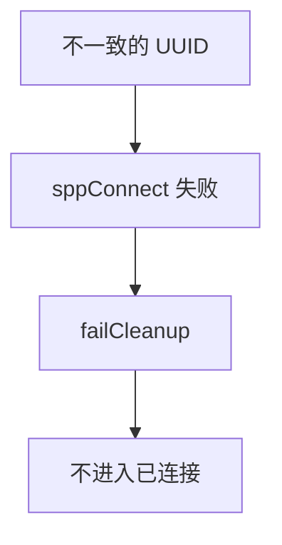
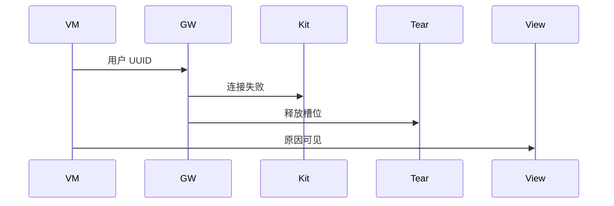
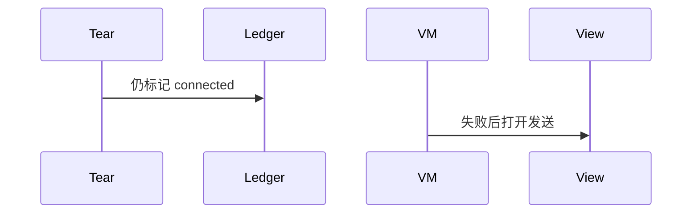

# BT-038 UUID 不一致时连接失败可见

## 1. 条目与非目标

**判定：** 支持

**Given** 客户端 UUID 与服务端注册值不同

**When** `sppConnect`

**Then** 连接失败，原因可见，不进入已连接

**证据：** `传统蓝牙连接和传输数据指南`。行为以已接受的研究笔记和清单为准，本文件不重开行业调查。

**本条输入：** 与对端注册值不同的 UUID。

**本条输出：** 连接失败可见。账本不进入已连接，槽位释放。

**本条失败：** 失败后仍显示已连接或保留可写会话。

**本条所有者：** 失败由 `SppPlatformGateway` 上抛。`SppSessionTeardown.failCleanup` 释放。`SppConnectDialogController` 展示原因。

**非目标：**

- 不自动改成标准 UUID 再试。
- 不把失败当成超时后的成功。
- 不新增 `common/yobluetooth` 以外的蓝牙栈，不增加包装层或版本兼容层。版本判断留在本条调用点。

## 2. 模块边界与分层

本组是SPP 字节流。依赖方向是 `product/phone` → `features/bluetooth` → `common/yobluetooth`。权限、生命周期和系统设置走 `common/platform` 与 `common/debug_core`。字节与 `Result` 走 `common/core`。日志门面走 `common/yolog`。收藏、会话记录和导出走 `common/storage`。`common/youi_kit` 只提供通用控件，不解释蓝牙状态。

**调用点：** `sppConnect` 仍在 `SppPlatformGateway`。

| 包 | 类型 | 职责 |
| --- | --- | --- |
| common/yobluetooth | SppPlatformGateway | 按用户 UUID 连接 |
| common/yobluetooth | SppSessionTeardown | 失败清理 |
| features/bluetooth | SppConnectDialogController | 显示原因 |

**设计前：** 失败清理若只关按钮，账本可能仍占着已连接。

**设计后：** 平台失败经过 teardown。相位不到 connected。对话框保留用户输入的 UUID。

## 3. 架构图

本组总图在 [`BT-037.md`](BT-037.md)。下图只覆盖本条。

## 4. 序列图

### 成功路径

### 错误路径

## 5. 数据模型

领域模型放在 `common/yobluetooth`，持久化模型放在 `common/storage`，平台传输对象只出现在数据源调用点，跨层用 `common/core` 的 `Result` 与 `ResultError`。错误只带类别和结构化字段，不把界面句子塞进邻层错误。

| 模型 | 所在层 | 字段 | 来源 |
| --- | --- | --- | --- |
| ConnectSppResult | 领域 | 失败与平台码 | 网关 |
| SppLedgerPhase | 领域 | 不到 connected | 清理后 |

## 6. 层间接口

| 从 | 到 | 接口 | 成功 | 失败 |
| --- | --- | --- | --- | --- |
| SppPlatformGateway | SppSessionTeardown | failCleanup | 槽位释放 | 不留已连接 |
| SppConnectDialogController | 视图 | 错误 | 原因可见 | 不导航到已连接终端 |

下层不持有页面类型。结果用 `Result` 或已有观察者回传。`common/yobluetooth` 的 `Index.ets` 继续只导出用例、领域模型和必要门面，不把数据源具体类变成第二套公开栈。

## 7. 权限与生命周期

失败不追加权限。

半开套接字在清理时关闭。不保留读循环。

## 8. 日志

- `BtLogTag.SPP` 记录 connectFailed 与 uuid 是否为标准值，不把失败写成 connected。
- 领域标签加在已有 `BtLogTag`，不在 `common/yolog` 的 `YoLogTag` 里再开一套蓝牙标签。
- 日志走 `YoLog`，不在页面里直接写 hilog。

## 9. 反模式

- 捕获异常后改用 `DEFAULT_SPP_UUID` 重试并显示第一次已成功。
- 用新的蓝牙 HAR、适配器或 `ApiCompat` 把本条版本差异包起来。版本判断只留在上面写明的调用点。
- 页面或 `common/youi_kit` 直接调用 `ohos.bluetooth.*`。
