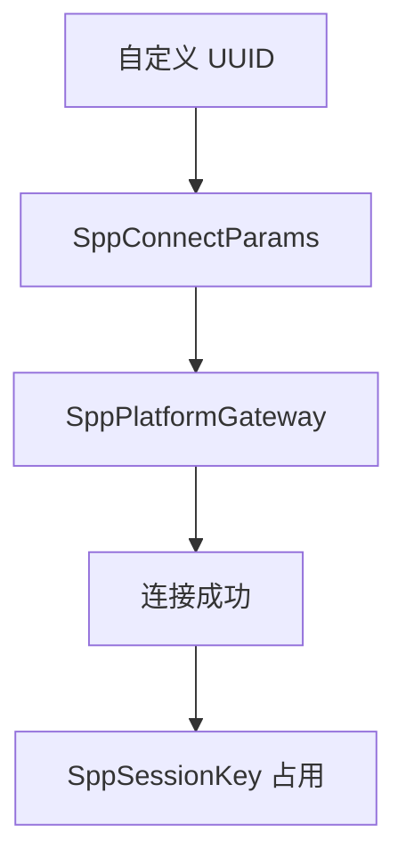
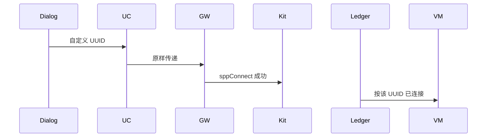
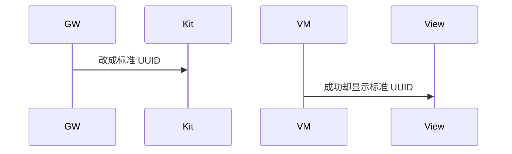

# BT-039 自定义 UUID 可连接

## 1. 条目与非目标

**判定：** 支持

**Given** 两端使用同一个自定义 UUID

**When** 客户端连接

**Then** 连接成功

**证据：** `套接字文档允许自定义 UUID`。行为以已接受的研究笔记和清单为准，本文件不重开行业调查。

**本条输入：** 用户输入且两端一致的自定义 UUID。

**本条输出：** `sppConnect` 使用该 UUID 并成功。账本键包含该 UUID。

**本条失败：** 连接前把自定义 UUID 替换成标准串口。

**本条所有者：** 输入在 `SppConnectDialogController`。参数是 `SppConnectParams`。去重键是 `SppSessionKey` 的地址加 UUID。连接仍走 `SppPlatformGateway`。

**非目标：**

- 不验证对端是否真的注册了该 UUID 之外的业务。
- 不拒绝非标准 UUID。
- 不新增 `common/yobluetooth` 以外的蓝牙栈，不增加包装层或版本兼容层。版本判断留在本条调用点。

## 2. 模块边界与分层

本组是SPP 字节流。依赖方向是 `product/phone` → `features/bluetooth` → `common/yobluetooth`。权限、生命周期和系统设置走 `common/platform` 与 `common/debug_core`。字节与 `Result` 走 `common/core`。日志门面走 `common/yolog`。收藏、会话记录和导出走 `common/storage`。`common/youi_kit` 只提供通用控件，不解释蓝牙状态。

**调用点：** UUID 字符串在 `SppPlatformGateway` 写入 `SppOptions`，没有预设覆盖。

| 包 | 类型 | 职责 |
| --- | --- | --- |
| features/bluetooth | SppConnectDialogController | 接受自定义 UUID |
| common/yobluetooth | SppConnectParams | 原样保存 |
| common/yobluetooth | SppSessionKey | 地址加 UUID |
| common/yobluetooth | SppPlatformGateway | 传给 sppConnect |

**设计前：** 预设若在网关里覆盖参数，自定义 UUID 会丢。

**设计后：** 网关使用参数中的 UUID。成功后账本按该键占用，与标准 UUID 会话可以区分。

## 3. 架构图

本组总图在 [`BT-037.md`](BT-037.md)。下图只覆盖本条。

## 4. 序列图

### 成功路径

### 错误路径

## 5. 数据模型

领域模型放在 `common/yobluetooth`，持久化模型放在 `common/storage`，平台传输对象只出现在数据源调用点，跨层用 `common/core` 的 `Result` 与 `ResultError`。错误只带类别和结构化字段，不把界面句子塞进邻层错误。

| 模型 | 所在层 | 字段 | 来源 |
| --- | --- | --- | --- |
| SppConnectParams | 领域 | 用户 uuid | 对话框 |
| SppSessionKey | 领域 | classicDeviceId 与 serviceUuid | 账本 |

## 6. 层间接口

| 从 | 到 | 接口 | 成功 | 失败 |
| --- | --- | --- | --- | --- |
| SppConnectDialogController | ConnectSppUseCase | 参数 | 自定义 UUID | 格式非法则不连接 |
| SppPlatformGateway | socket | SppOptions.uuid | 与输入一致 | 不替换 |

下层不持有页面类型。结果用 `Result` 或已有观察者回传。`common/yobluetooth` 的 `Index.ets` 继续只导出用例、领域模型和必要门面，不把数据源具体类变成第二套公开栈。

## 7. 权限与生命周期

与标准 UUID 相同。

该会话的关闭只释放这个键，不释放同设备上的另一个 UUID。

## 8. 日志

- `BtLogTag.SPP` 记录 uuidKind=custom。
- 领域标签加在已有 `BtLogTag`，不在 `common/yolog` 的 `YoLogTag` 里再开一套蓝牙标签。
- 日志走 `YoLog`，不在页面里直接写 hilog。

## 9. 反模式

- 白名单只允许 00001101。
- 自定义成功后改写收藏里的 UUID。
- 用新的蓝牙 HAR、适配器或 `ApiCompat` 把本条版本差异包起来。版本判断只留在上面写明的调用点。
- 页面或 `common/youi_kit` 直接调用 `ohos.bluetooth.*`。
