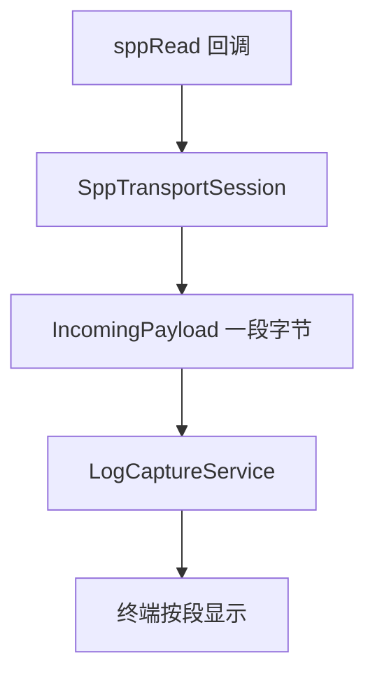
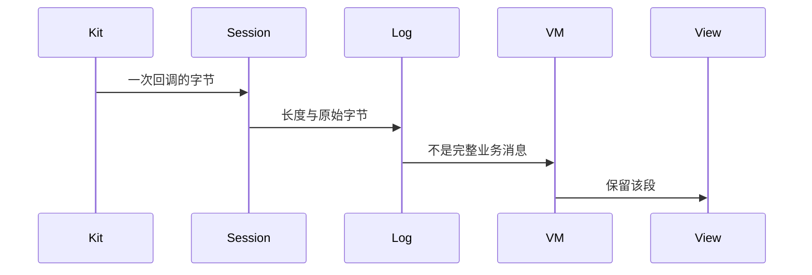
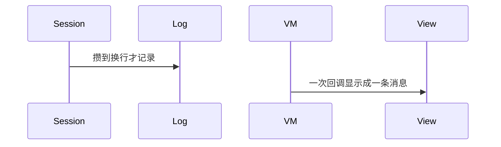

# BT-040 一次读取是一段字节

## 1. 条目与非目标

**判定：** 支持

**Given** SPP 已连接，对端连续发送多于一次回调的数据

**When** 收到 `sppRead` 或 `sppReadAsync` 数据

**Then** 日志保留该次字节及长度；不把一次回调显示成一条完整业务消息

**证据：** `HarmonyOS 套接字为字节流。FAQ「socket.sppReadAsync 循环读取异常」要求按流读取`。行为以已接受的研究笔记和清单为准，本文件不重开行业调查。

**本条输入：** 一次 `sppRead` 或 `sppReadAsync` 回调中的字节。

**本条输出：** 日志一条对应这次字节和长度。`IncomingPayload.isCompleteMessage` 为 false。

**本条失败：** 按换行把一次回调拆成或拼成一条业务消息再显示。

**本条所有者：** 读取在 `SppTransportSession`。载荷契约在 `common/debug_core` 的 `IncomingPayload`。记录由 `LogCaptureService` 保存。终端展示在 `SppTerminalViewModel`。

**非目标：**

- 不在传输层做协议分包。
- 不把 HEX 展示变成另一份数据。
- 不新增 `common/yobluetooth` 以外的蓝牙栈，不增加包装层或版本兼容层。版本判断留在本条调用点。

## 2. 模块边界与分层

本组是SPP 字节流。依赖方向是 `product/phone` → `features/bluetooth` → `common/yobluetooth`。权限、生命周期和系统设置走 `common/platform` 与 `common/debug_core`。字节与 `Result` 走 `common/core`。日志门面走 `common/yolog`。收藏、会话记录和导出走 `common/storage`。`common/youi_kit` 只提供通用控件，不解释蓝牙状态。

**调用点：** 读调用在 `SppRfcommClient` 与 `SppTransportSession`，不新增解析栈。

| 包 | 类型 | 职责 |
| --- | --- | --- |
| common/yobluetooth | SppTransportSession | 按回调交出字节 |
| common/debug_core | IncomingPayload | isCompleteMessage=false |
| common/debug_core | LogCaptureService | 记录本次长度 |
| features/bluetooth | SppTerminalViewModel | 按段展示 |
| common/core | ByteUtil | 需要时做展示转换，不改变分段 |

**设计前：** 读循环若缓存到换行才上抛，日志会丢掉平台回调边界。

**设计后：** 一次回调一条记录，保留长度。换行只影响显示偏好，不改变记录边界。

## 3. 架构图

本组总图在 [`BT-037.md`](BT-037.md)。下图只覆盖本条。

## 4. 序列图

### 成功路径

### 错误路径

## 5. 数据模型

领域模型放在 `common/yobluetooth`，持久化模型放在 `common/storage`，平台传输对象只出现在数据源调用点，跨层用 `common/core` 的 `Result` 与 `ResultError`。错误只带类别和结构化字段，不把界面句子塞进邻层错误。

| 模型 | 所在层 | 字段 | 来源 |
| --- | --- | --- | --- |
| IncomingPayload | debug_core | bytes 与 isCompleteMessage=false | 一次读取 |
| DebugLogRecord | debug_core | 方向与长度 | 捕获服务 |

## 6. 层间接口

| 从 | 到 | 接口 | 成功 | 失败 |
| --- | --- | --- | --- | --- |
| SppTransportSession | LogCaptureService | captureBytes | 一段原始字节 | 不标完整消息 |
| SppTerminalViewModel | 视图 | 段 | 显示长度 | 不合并为业务帧 |

下层不持有页面类型。结果用 `Result` 或已有观察者回传。`common/yobluetooth` 的 `Index.ets` 继续只导出用例、领域模型和必要门面，不把数据源具体类变成第二套公开栈。

## 7. 权限与生命周期

已连接后的读取不新申请权限。

读循环属于该会话。断开时停止，未读完的缓冲按已到达的段记录，不补一条假消息。

## 8. 日志

- `BtLogTag.SPP` 记录 readBytes=长度。原始字节进会话日志，不进 HiLog 全文当业务消息。
- 领域标签加在已有 `BtLogTag`，不在 `common/yolog` 的 `YoLogTag` 里再开一套蓝牙标签。
- 日志走 `YoLog`，不在页面里直接写 hilog。

## 9. 反模式

- 在 `SppRfcommClient` 里按 AT 或换行组包。
- 丢弃长度为 0 以外的半段。
- 用新的蓝牙 HAR、适配器或 `ApiCompat` 把本条版本差异包起来。版本判断只留在上面写明的调用点。
- 页面或 `common/youi_kit` 直接调用 `ohos.bluetooth.*`。
