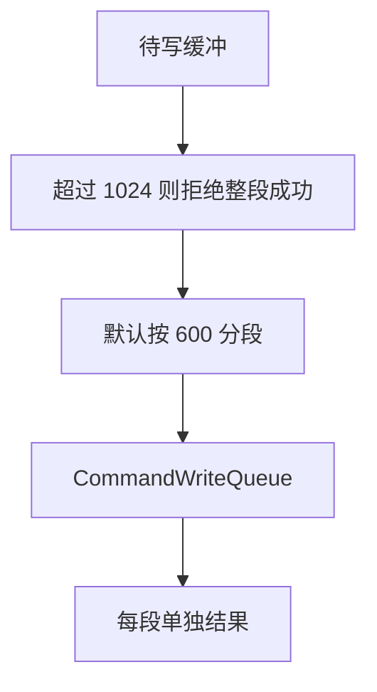
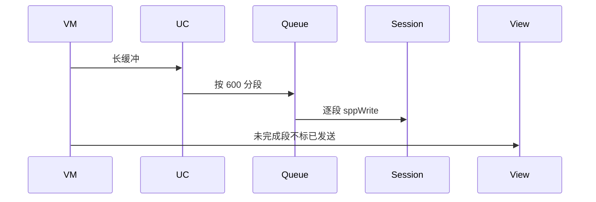
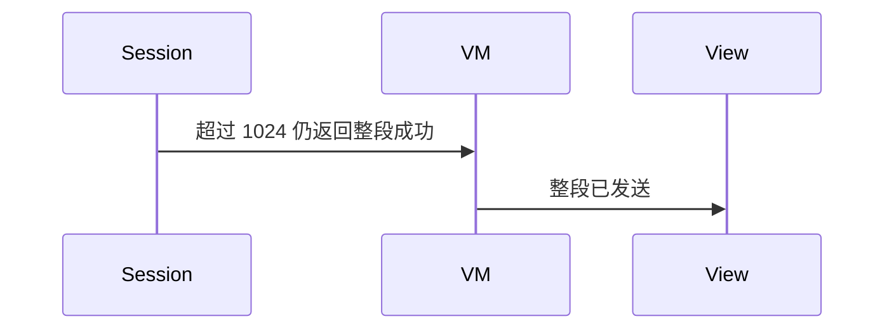

# BT-041 单次写入超过建议上限时失败可见

## 1. 条目与非目标

**判定：** 支持

**Given** SPP RFCOMM 已连接

**When** 一次写入超过 1024 字节

**Then** 不把整段标成已发送；可见失败或要求分段。建议上限 600 作为默认分段长度

**证据：** `FAQ 双模篇：最好控制在 600 字节以下，不建议超过 1024 字节`。行为以已接受的研究笔记和清单为准，本文件不重开行业调查。

**本条输入：** 一次超过 1024 字节的 RFCOMM 写入，或需要按 600 分段的缓冲。

**本条输出：** 超过 1024 的单次写入不标成整段已发送。默认分段长度 600，来自常量。

**本条失败：** 把超过 1024 的整段标成已发送。

**本条所有者：** 常量 `BluetoothConstants.SPP_MAX_WRITE_BYTES` 为 1024。默认分段放在同一常量类的新字段，由 `SendSppCommandUseCase` 与 `CommandWriteQueue` 使用。实际写在 `SppTransportSession`。

**非目标：**

- 不把 600 说成平台硬限制。
- 不为此新建第二套写队列。
- 不新增 `common/yobluetooth` 以外的蓝牙栈，不增加包装层或版本兼容层。版本判断留在本条调用点。

## 2. 模块边界与分层

本组是SPP 字节流。依赖方向是 `product/phone` → `features/bluetooth` → `common/yobluetooth`。权限、生命周期和系统设置走 `common/platform` 与 `common/debug_core`。字节与 `Result` 走 `common/core`。日志门面走 `common/yolog`。收藏、会话记录和导出走 `common/storage`。`common/youi_kit` 只提供通用控件，不解释蓝牙状态。

**调用点：** 长度判断在 `SendSppCommandUseCase` 进入 `SppPlatformGateway` 之前。网关仍是唯一写调用点。

| 包 | 类型 | 职责 |
| --- | --- | --- |
| common/yobluetooth | BluetoothConstants | 1024 上限与 600 默认分段 |
| common/yobluetooth | SendSppCommandUseCase | 超限则分段或失败 |
| common/yobluetooth | CommandWriteQueue | 按段排队 |
| features/bluetooth | SppTerminalViewModel | 未完成不显示整段已发送 |

**设计前：** 一次 write 的成功容易被终端当成整段已发送。

**设计后：** 单次超过 1024 不进入一次成功记录。默认按 600 分段，每段单独成功或失败。

## 3. 架构图

本组总图在 [`BT-037.md`](BT-037.md)。下图只覆盖本条。

## 4. 序列图

### 成功路径

### 错误路径

## 5. 数据模型

领域模型放在 `common/yobluetooth`，持久化模型放在 `common/storage`，平台传输对象只出现在数据源调用点，跨层用 `common/core` 的 `Result` 与 `ResultError`。错误只带类别和结构化字段，不把界面句子塞进邻层错误。

| 模型 | 所在层 | 字段 | 来源 |
| --- | --- | --- | --- |
| WriteResult | debug_core 契约 | bytesWritten | 一段 |
| SPP_MAX_WRITE_BYTES | 常量 | 1024 | 不建议超过 |
| 默认分段 | 常量 | 600 | 建议上限 |

## 6. 层间接口

| 从 | 到 | 接口 | 成功 | 失败 |
| --- | --- | --- | --- | --- |
| SendSppCommandUseCase | CommandWriteQueue | enqueue | 按段 | 整段超限不报成功 |
| SppTransportSession | socket | sppWrite | 一段结果 | 失败可见 |

下层不持有页面类型。结果用 `Result` 或已有观察者回传。`common/yobluetooth` 的 `Index.ets` 继续只导出用例、领域模型和必要门面，不把数据源具体类变成第二套公开栈。

## 7. 权限与生命周期

写入不新增权限。

分段期间用户仍可停止，停止丢弃尚未写出的段。

## 8. 日志

- `BtLogTag.SPP` 记录 segmentBytes 与 rejectedOver1024。
- 领域标签加在已有 `BtLogTag`，不在 `common/yolog` 的 `YoLogTag` 里再开一套蓝牙标签。
- 日志走 `YoLog`，不在页面里直接写 hilog。

## 9. 反模式

- 把 600 写成平台错误码。
- 只显示最后一段成功就标全部已发送。
- 用新的蓝牙 HAR、适配器或 `ApiCompat` 把本条版本差异包起来。版本判断只留在上面写明的调用点。
- 页面或 `common/youi_kit` 直接调用 `ohos.bluetooth.*`。
