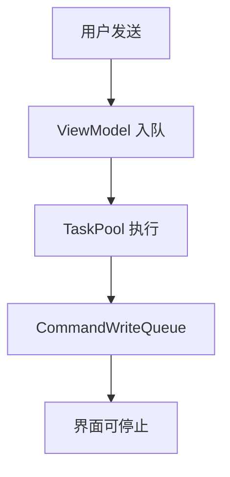
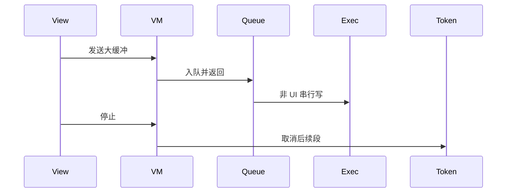
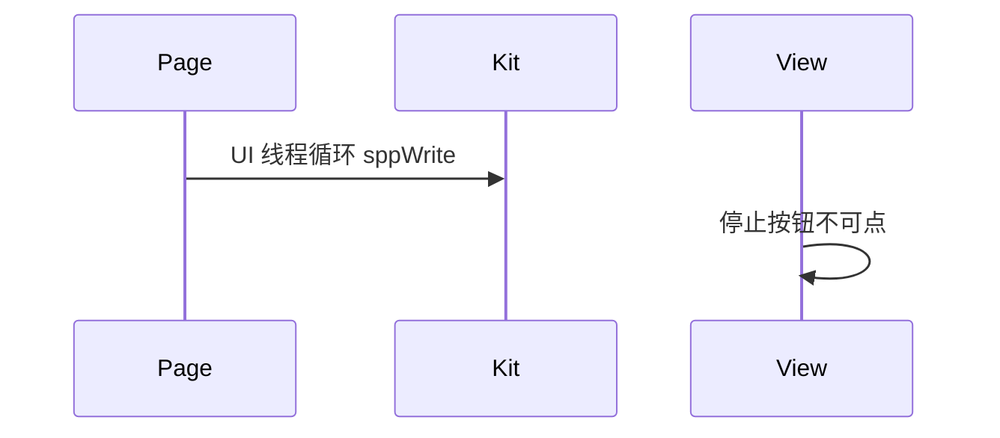

# BT-042 大数据写出不冻结界面

## 1. 条目与非目标

**判定：** 支持

**Given** 需要发送大于一次建议长度的缓冲

**When** 用户发送

**Then** 界面仍可停止发送；写入不在主线程上堵死

**证据：** `FAQ「蓝牙发送大数据导致主线程卡死」`。行为以已接受的研究笔记和清单为准，本文件不重开行业调查。

**本条输入：** 大于一段的发送缓冲。

**本条输出：** 界面可点停止。写操作不堵在页面线程。已排队的后续段可以被取消。

**本条失败：** 在 `SppTerminalPage` 或 ViewModel 的 UI 线程里循环 `sppWrite`。

**本条所有者：** 队列是 `CommandWriteQueue`。执行器使用 `common/core` 的 `ITaskExecutor` 与 `common/platform` 的 `TaskPoolTaskExecutor` 注册结果。停止用 `CancellationToken`。页面只发命令。

**非目标：**

- 不把 TaskPool 封装成蓝牙专用线程池模块。
- 不在停止时杀掉整个进程。
- 不新增 `common/yobluetooth` 以外的蓝牙栈，不增加包装层或版本兼容层。版本判断留在本条调用点。

## 2. 模块边界与分层

本组是SPP 字节流。依赖方向是 `product/phone` → `features/bluetooth` → `common/yobluetooth`。权限、生命周期和系统设置走 `common/platform` 与 `common/debug_core`。字节与 `Result` 走 `common/core`。日志门面走 `common/yolog`。收藏、会话记录和导出走 `common/storage`。`common/youi_kit` 只提供通用控件，不解释蓝牙状态。

**调用点：** `sppWrite` 仍只在 `SppTransportSession`。它不被页面直接调用。

| 包 | 类型 | 职责 |
| --- | --- | --- |
| features/bluetooth | SppTerminalViewModel | 提交发送与停止 |
| common/core | CancellationToken | 停止尚未写出的段 |
| common/platform | TaskPoolTaskExecutor | 承担可移出 UI 的工作 |
| common/yobluetooth | CommandWriteQueue | 串行写 |
| product/phone | SppTerminalPage | 不执行写循环 |

**设计前：** 大数据若在页面调用栈里同步写完，停止按钮没有机会。

**设计后：** 页面只改状态。队列在调用点外串行写。取消令牌停下后续段，当前段的失败可见。

## 3. 架构图

本组总图在 [`BT-037.md`](BT-037.md)。下图只覆盖本条。

## 4. 序列图

### 成功路径

### 错误路径

## 5. 数据模型

领域模型放在 `common/yobluetooth`，持久化模型放在 `common/storage`，平台传输对象只出现在数据源调用点，跨层用 `common/core` 的 `Result` 与 `ResultError`。错误只带类别和结构化字段，不把界面句子塞进邻层错误。

| 模型 | 所在层 | 字段 | 来源 |
| --- | --- | --- | --- |
| CancellationToken | common/core | 取消后续段 | 用户停止 |
| WriteOptions | debug_core | chunkSize | 600 默认 |

## 6. 层间接口

| 从 | 到 | 接口 | 成功 | 失败 |
| --- | --- | --- | --- | --- |
| SppTerminalViewModel | SendSppCommandUseCase | 发送 | 立即返回已入队 | 队列满则 YW-BT-1401 |
| SendSppCommandUseCase | CommandWriteQueue | 写入 | 段完成 | 取消则停止后续 |

下层不持有页面类型。结果用 `Result` 或已有观察者回传。`common/yobluetooth` 的 `Index.ets` 继续只导出用例、领域模型和必要门面，不把数据源具体类变成第二套公开栈。

## 7. 权限与生命周期

不涉及新权限。

页面消失不把未完成写留在 UI 回调里。会话断开时取消令牌。

## 8. 日志

- `BtLogTag.SPP` 记录 queued 与 cancelled，不在每段阻塞时打同步日志。
- 领域标签加在已有 `BtLogTag`，不在 `common/yolog` 的 `YoLogTag` 里再开一套蓝牙标签。
- 日志走 `YoLog`，不在页面里直接写 hilog。

## 9. 反模式

- 用 sleep 让出 UI。
- 在 ArkUI 构建函数里写套接字。
- 用新的蓝牙 HAR、适配器或 `ApiCompat` 把本条版本差异包起来。版本判断只留在上面写明的调用点。
- 页面或 `common/youi_kit` 直接调用 `ohos.bluetooth.*`。
