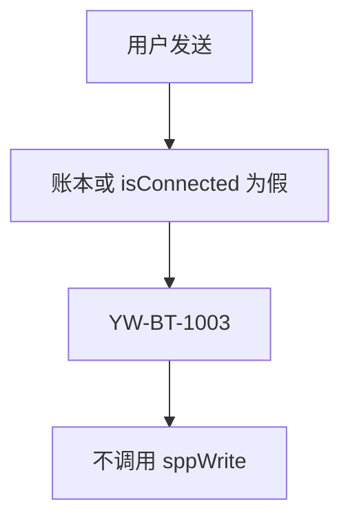
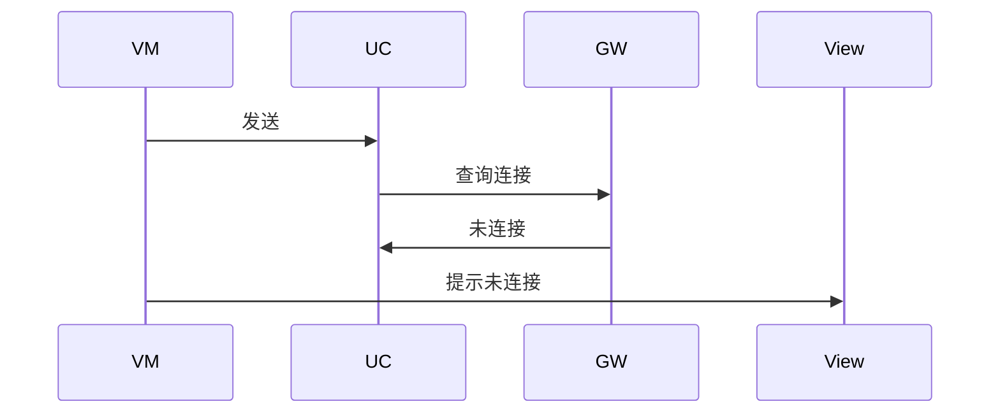
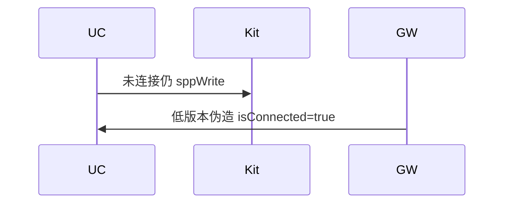

# BT-043 未连接时发送失败

## 1. 条目与非目标

**判定：** 支持

**Given** SPP 未连接或 `isConnected`（API 22+）为假

**When** 用户发送

**Then** 不写入；提示未连接

**证据：** `错误码 2900005；socket.isConnected API 22`。行为以已接受的研究笔记和清单为准，本文件不重开行业调查。

**本条输入：** 账本未连接，或 API 22+ 上 `isConnected` 为假。

**本条输出：** 不调用 `sppWrite`。提示未连接，领域码 `YW-BT-1003`。

**本条失败：** 未连接仍写入，或 API 22 以下伪造 `isConnected` 为真。

**本条所有者：** API 22+ 的 `isConnected` 在 `SppPlatformGateway` 查询。更低版本以 `SppSessionLedger` 相位为准。`SendSppCommandUseCase` 在写之前拒绝。

**非目标：**

- 不把 2900005 显示成已发送 0 字节的成功。
- 不用兼容层统一两种查询。
- 不新增 `common/yobluetooth` 以外的蓝牙栈，不增加包装层或版本兼容层。版本判断留在本条调用点。

## 2. 模块边界与分层

本组是SPP 字节流。依赖方向是 `product/phone` → `features/bluetooth` → `common/yobluetooth`。权限、生命周期和系统设置走 `common/platform` 与 `common/debug_core`。字节与 `Result` 走 `common/core`。日志门面走 `common/yolog`。收藏、会话记录和导出走 `common/storage`。`common/youi_kit` 只提供通用控件，不解释蓝牙状态。

**调用点：** `socket.isConnected` 的版本判断在 `SppPlatformGateway`。

| 包 | 类型 | 职责 |
| --- | --- | --- |
| common/yobluetooth | SppSessionLedger | 相位不是已连接则拒绝 |
| common/yobluetooth | SppPlatformGateway | API 22+ 再读 isConnected |
| common/yobluetooth | SendSppCommandUseCase | 失败则不入队 |
| features/bluetooth | SppTerminalViewModel | 提示未连接 |

**设计前：** 只看本地相位会在 API 22+ 套接字已断开时继续写。

**设计后：** 有 `isConnected` 的版本在网关调用它。没有该方法的版本不编造返回值，只信账本。两种都失败时不写。

## 3. 架构图

本组总图在 [`BT-037.md`](BT-037.md)。下图只覆盖本条。

## 4. 序列图

### 成功路径

### 错误路径

## 5. 数据模型

领域模型放在 `common/yobluetooth`，持久化模型放在 `common/storage`，平台传输对象只出现在数据源调用点，跨层用 `common/core` 的 `Result` 与 `ResultError`。错误只带类别和结构化字段，不把界面句子塞进邻层错误。

| 模型 | 所在层 | 字段 | 来源 |
| --- | --- | --- | --- |
| ResultError YW-BT-1003 | 领域 | NOT_CONNECTED | 发送前 |
| SppLedgerPhase | 领域 | 非 connected | 账本 |

## 6. 层间接口

| 从 | 到 | 接口 | 成功 | 失败 |
| --- | --- | --- | --- | --- |
| SendSppCommandUseCase | SppPlatformGateway | isConnected | API 22+ 布尔 | 低版本不调用该方法 |
| SendSppCommandUseCase | CommandWriteQueue | enqueue | 已连接才入队 | 未连接不入队 |

下层不持有页面类型。结果用 `Result` 或已有观察者回传。`common/yobluetooth` 的 `Index.ets` 继续只导出用例、领域模型和必要门面，不把数据源具体类变成第二套公开栈。

## 7. 权限与生命周期

不因未连接去重新申请权限。

未连接不启动写任务。

## 8. 日志

- `BtLogTag.SPP` 记录 writeRejected=notConnected。平台 2900005 保留平台码。
- 领域标签加在已有 `BtLogTag`，不在 `common/yolog` 的 `YoLogTag` 里再开一套蓝牙标签。
- 日志走 `YoLog`，不在页面里直接写 hilog。

## 9. 反模式

- 捕获 2900005 后自动重连并补写。
- 在领域层用 if 版本包一个永远为真的 isConnected。
- 用新的蓝牙 HAR、适配器或 `ApiCompat` 把本条版本差异包起来。版本判断只留在上面写明的调用点。
- 页面或 `common/youi_kit` 直接调用 `ohos.bluetooth.*`。
