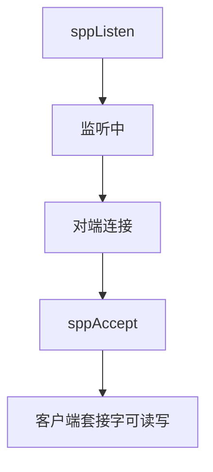
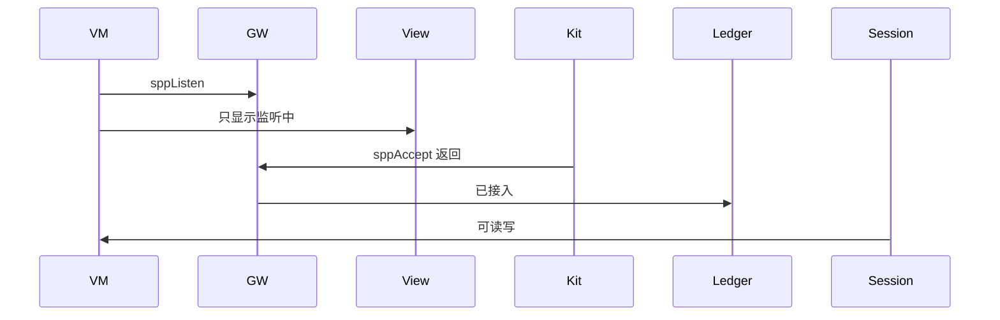
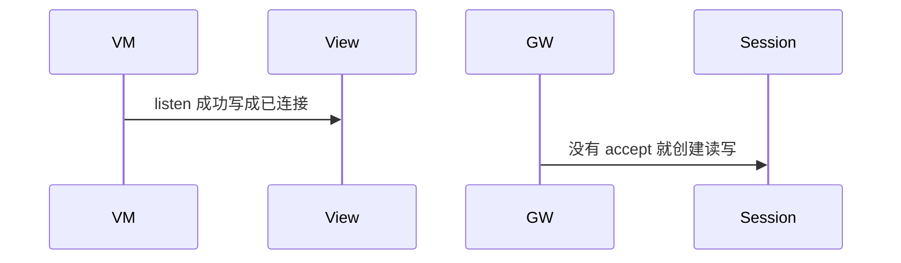

# BT-044 服务端可接受客户端

## 1. 条目与非目标

**判定：** 支持

**Given** 本机 `sppListen` 已注册 UUID

**When** 对端用同一 UUID 连接且 `sppAccept` 返回

**Then** 本机出现已接入的客户端套接字，可读写

**证据：** `socket.sppListen、socket.sppAccept`。行为以已接受的研究笔记和清单为准，本文件不重开行业调查。

**本条输入：** 本机已用同一 UUID `sppListen`，对端连接，`sppAccept` 返回。

**本条输出：** 账本出现服务端接入的客户端套接字，可读写。

**本条失败：** listen 成功就被当成已有客户端。

**本条所有者：** 服务端调用放在已有 `SppPlatformGateway`，不新建套接字包。会话仍是 `SppTransportSession`。状态在 `SppMainViewModel` 可扩展的服务端相位，页面仍由 `product/phone` 装配。

**非目标：**

- 不把 listen 显示成已连接。
- 不另建 SPP 服务端栈。
- 不新增 `common/yobluetooth` 以外的蓝牙栈，不增加包装层或版本兼容层。版本判断留在本条调用点。

## 2. 模块边界与分层

本组是SPP 字节流。依赖方向是 `product/phone` → `features/bluetooth` → `common/yobluetooth`。权限、生命周期和系统设置走 `common/platform` 与 `common/debug_core`。字节与 `Result` 走 `common/core`。日志门面走 `common/yolog`。收藏、会话记录和导出走 `common/storage`。`common/youi_kit` 只提供通用控件，不解释蓝牙状态。

**调用点：** `sppListen` 与 `sppAccept` 加在 `SppPlatformGateway`。

| 包 | 类型 | 职责 |
| --- | --- | --- |
| common/yobluetooth | SppPlatformGateway | sppListen 与 sppAccept |
| common/yobluetooth | SppSessionLedger | accept 后占用会话 |
| common/yobluetooth | SppTransportSession | 读写该客户端套接字 |
| features/bluetooth | SppMainViewModel | 区分监听中与已接入 |
| common/debug_core | CapabilityId.BLUETOOTH_SPP_SERVER | 能力标识已存在 |

**设计前：** 网关只有客户端连接时，listen 成功没有会话模型。

**设计后：** 监听与已接入是两个相位。只有 `sppAccept` 返回才创建可读写会话。

## 3. 架构图

本组总图在 [`BT-037.md`](BT-037.md)。下图只覆盖本条。

## 4. 序列图

### 成功路径

### 错误路径

## 5. 数据模型

领域模型放在 `common/yobluetooth`，持久化模型放在 `common/storage`，平台传输对象只出现在数据源调用点，跨层用 `common/core` 的 `Result` 与 `ResultError`。错误只带类别和结构化字段，不把界面句子塞进邻层错误。

| 模型 | 所在层 | 字段 | 来源 |
| --- | --- | --- | --- |
| SppConnectionPhase | 领域 | listening 与 connected | 两段 |
| SppSessionDescriptor | 领域 | server 侧客户端 | accept 之后 |

## 6. 层间接口

| 从 | 到 | 接口 | 成功 | 失败 |
| --- | --- | --- | --- | --- |
| SppMainViewModel | SppPlatformGateway | listen | 监听中 | 失败可见 |
| SppPlatformGateway | socket | sppAccept | 客户端套接字 | 未返回则不可读写 |

下层不持有页面类型。结果用 `Result` 或已有观察者回传。`common/yobluetooth` 的 `Index.ets` 继续只导出用例、领域模型和必要门面，不把数据源具体类变成第二套公开栈。

## 7. 权限与生命周期

服务端仍使用 `ACCESS_BLUETOOTH`。

停止监听时关闭服务端套接字并 `off`。已接入客户端另按断开条目清理。

## 8. 日志

- `BtLogTag.SPP` 记录 listening 与 accepted，两者分开。
- 领域标签加在已有 `BtLogTag`，不在 `common/yolog` 的 `YoLogTag` 里再开一套蓝牙标签。
- 日志走 `YoLog`，不在页面里直接写 hilog。

## 9. 反模式

- 用客户端 `sppConnect` 连自己来模拟 accept。
- accept 前开放写入。
- 用新的蓝牙 HAR、适配器或 `ApiCompat` 把本条版本差异包起来。版本判断只留在上面写明的调用点。
- 页面或 `common/youi_kit` 直接调用 `ohos.bluetooth.*`。
