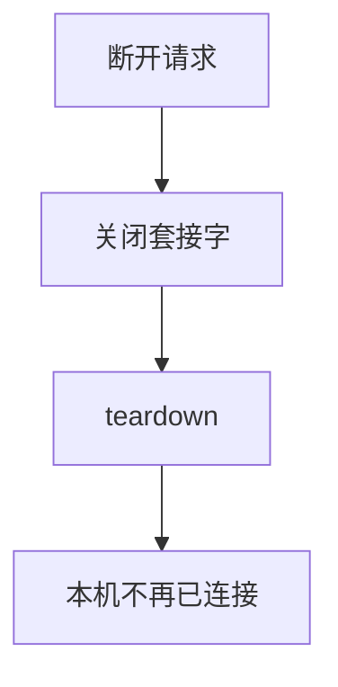
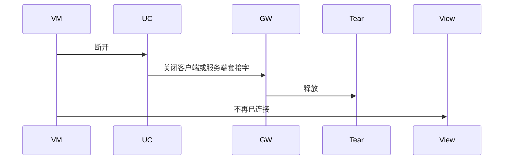
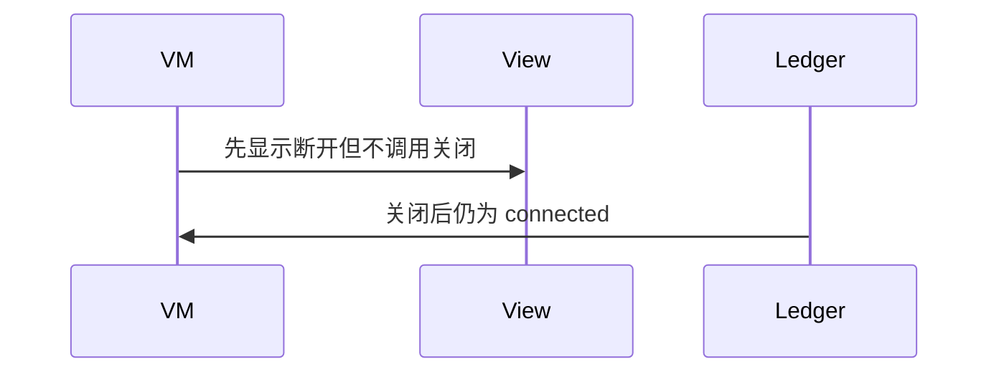

# BT-045 服务端关闭后对端看到断开

## 1. 条目与非目标

**判定：** 支持

**Given** SPP 会话已建立

**When** 本机 `sppCloseClientSocket` 或关闭服务端套接字

**Then** 对端读写失败或断开，本机会话不再是已连接

**证据：** `传统蓝牙连接和传输数据指南的断开步骤`。行为以已接受的研究笔记和清单为准，本文件不重开行业调查。

**本条输入：** 已建立的 SPP 会话上，本机关闭客户端或服务端套接字。

**本条输出：** 本机账本不再是已连接。对端随后读写失败或断开。

**本条失败：** 关闭后本机仍显示已连接。

**本条所有者：** 关闭在 `DisconnectSppUseCase` 与 `SppSessionTeardown`，调用 `SppPlatformGateway`。本机状态以账本为准。

**非目标：**

- 不保证对端 UI 文案。
- 不在关闭后自动重听并显示从未断开。
- 不新增 `common/yobluetooth` 以外的蓝牙栈，不增加包装层或版本兼容层。版本判断留在本条调用点。

## 2. 模块边界与分层

本组是SPP 字节流。依赖方向是 `product/phone` → `features/bluetooth` → `common/yobluetooth`。权限、生命周期和系统设置走 `common/platform` 与 `common/debug_core`。字节与 `Result` 走 `common/core`。日志门面走 `common/yolog`。收藏、会话记录和导出走 `common/storage`。`common/youi_kit` 只提供通用控件，不解释蓝牙状态。

**调用点：** 关闭方法在 `SppPlatformGateway`。

| 包 | 类型 | 职责 |
| --- | --- | --- |
| features/bluetooth | SppTerminalViewModel | 请求断开 |
| common/yobluetooth | DisconnectSppUseCase | 关闭套接字 |
| common/yobluetooth | SppPlatformGateway | sppCloseClientSocket 或关闭服务端 |
| common/yobluetooth | SppSessionTeardown | 账本离开已连接 |

**设计前：** 只改界面状态而不关套接字，对端仍看到连接。

**设计后：** 先关平台套接字，再改账本。本机不再已连接。

## 3. 架构图

本组总图在 [`BT-037.md`](BT-037.md)。下图只覆盖本条。

## 4. 序列图

### 成功路径

### 错误路径

## 5. 数据模型

领域模型放在 `common/yobluetooth`，持久化模型放在 `common/storage`，平台传输对象只出现在数据源调用点，跨层用 `common/core` 的 `Result` 与 `ResultError`。错误只带类别和结构化字段，不把界面句子塞进邻层错误。

| 模型 | 所在层 | 字段 | 来源 |
| --- | --- | --- | --- |
| SppLedgerPhase | 领域 | 离开 connected | teardown |
| TransportStateSnapshot | debug_core | disconnected | 会话 |

## 6. 层间接口

| 从 | 到 | 接口 | 成功 | 失败 |
| --- | --- | --- | --- | --- |
| DisconnectSppUseCase | SppPlatformGateway | close | 套接字关闭 | 关闭失败可见 |
| SppSessionTeardown | SppSessionLedger | release | 非已连接 | 不保留可写 |

下层不持有页面类型。结果用 `Result` 或已有观察者回传。`common/yobluetooth` 的 `Index.ets` 继续只导出用例、领域模型和必要门面，不把数据源具体类变成第二套公开栈。

## 7. 权限与生命周期

断开不需要新权限。

关闭时取消读订阅和写队列。页面离开若仍要保持，由后台条目决定，不在本条偷偷保持。

## 8. 日志

- `BtLogTag.SPP` 记录 closeClient 或 closeServer，随后 phase=closed。
- 领域标签加在已有 `BtLogTag`，不在 `common/yolog` 的 `YoLogTag` 里再开一套蓝牙标签。
- 日志走 `YoLog`，不在页面里直接写 hilog。

## 9. 反模式

- 只 `off` 回调不关套接字。
- 关闭失败仍清除界面为成功断开且不报错。
- 用新的蓝牙 HAR、适配器或 `ApiCompat` 把本条版本差异包起来。版本判断只留在上面写明的调用点。
- 页面或 `common/youi_kit` 直接调用 `ohos.bluetooth.*`。
