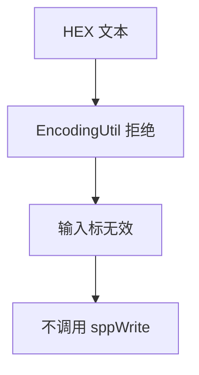
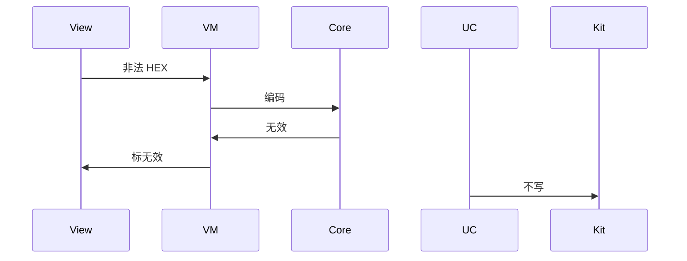
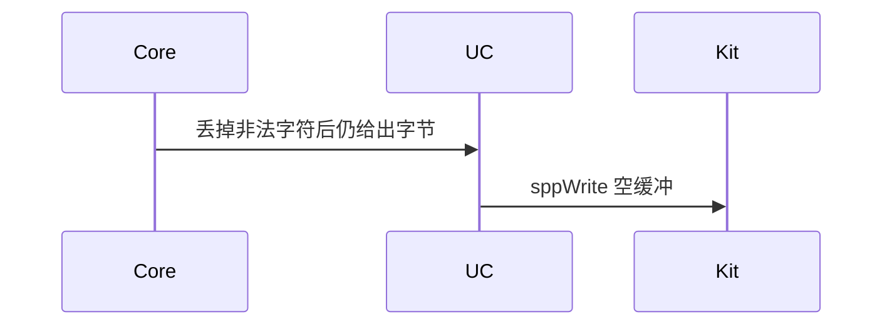

# BT-046 HEX 非法输入不发送

## 1. 条目与非目标

**判定：** 支持

**Given** 输入模式为 HEX，文本含非十六进制字符或奇数个半字节

**When** 用户发送

**Then** 不调用 `sppWrite`；输入标为无效

**证据：** `平台只接收 ArrayBuffer。非法 HEX 在进入套接字前拒绝`。行为以已接受的研究笔记和清单为准，本文件不重开行业调查。

**本条输入：** HEX 模式下含非十六进制字符或奇数个半字节的文本。

**本条输出：** 输入标为无效。`sppWrite` 不调用。

**本条失败：** 把非法文本编成空缓冲发送，或截断半字节后发送。

**本条所有者：** 校验使用 `common/core` 的 `EncodingUtil`。发送用例在失败时不入队。`SppTerminalViewModel` 标无效。GATT 写若同样走 HEX，也先用该工具，不复制第二套规则。

**非目标：**

- 不在套接字层接受字符串。
- 不自动删掉非法字符再发送。
- 不新增 `common/yobluetooth` 以外的蓝牙栈，不增加包装层或版本兼容层。版本判断留在本条调用点。

## 2. 模块边界与分层

本组是SPP 字节流。依赖方向是 `product/phone` → `features/bluetooth` → `common/yobluetooth`。权限、生命周期和系统设置走 `common/platform` 与 `common/debug_core`。字节与 `Result` 走 `common/core`。日志门面走 `common/yolog`。收藏、会话记录和导出走 `common/storage`。`common/youi_kit` 只提供通用控件，不解释蓝牙状态。

**调用点：** 没有套接字调用点。编码在 `common/core`。

| 包 | 类型 | 职责 |
| --- | --- | --- |
| features/bluetooth | SppTerminalViewModel | 标输入无效 |
| common/core | EncodingUtil | 拒绝奇数长度或非十六进制 |
| common/yobluetooth | SendSppCommandUseCase | 失败则不写 |
| common/yobluetooth | SppTransportSession | 本条不到达 |

**设计前：** 终端若先去掉非法字符再编码，会发出用户没输入的字节。

**设计后：** `EncodingUtil` 失败直接返回。队列与 `sppWrite` 都不收到缓冲。

## 3. 架构图

本组总图在 [`BT-037.md`](BT-037.md)。下图只覆盖本条。

## 4. 序列图

### 成功路径

### 错误路径

## 5. 数据模型

领域模型放在 `common/yobluetooth`，持久化模型放在 `common/storage`，平台传输对象只出现在数据源调用点，跨层用 `common/core` 的 `Result` 与 `ResultError`。错误只带类别和结构化字段，不把界面句子塞进邻层错误。

| 模型 | 所在层 | 字段 | 来源 |
| --- | --- | --- | --- |
| ResultError CORE-ENC-003 | common/core | 非法 HEX | EncodingUtil |
| 发送缓冲 | 领域 | 本条不产生 | 无字节 |

## 6. 层间接口

| 从 | 到 | 接口 | 成功 | 失败 |
| --- | --- | --- | --- | --- |
| SppTerminalViewModel | EncodingUtil | hex 到字节 | 合法才有字节 | 无效 |
| SendSppCommandUseCase | SppTransportSession | write | 本条不调用 | 禁止空写 |

下层不持有页面类型。结果用 `Result` 或已有观察者回传。`common/yobluetooth` 的 `Index.ets` 继续只导出用例、领域模型和必要门面，不把数据源具体类变成第二套公开栈。

## 7. 权限与生命周期

不涉及。

无效输入不创建写任务。

## 8. 日志

- `BtLogTag.SPP` 记录 hexInvalid=1。不记录用户原始隐私文本到导出以外的调试通道。
- 领域标签加在已有 `BtLogTag`，不在 `common/yolog` 的 `YoLogTag` 里再开一套蓝牙标签。
- 日志走 `YoLog`，不在页面里直接写 hilog。

## 9. 反模式

- 在页面里写另一套 HEX 正则。
- 奇数长度自动补 0 后发送。
- 用新的蓝牙 HAR、适配器或 `ApiCompat` 把本条版本差异包起来。版本判断只留在上面写明的调用点。
- 页面或 `common/youi_kit` 直接调用 `ohos.bluetooth.*`。
