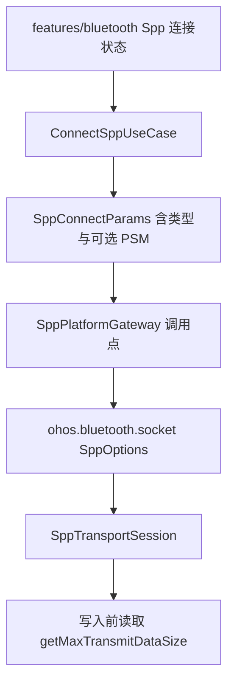
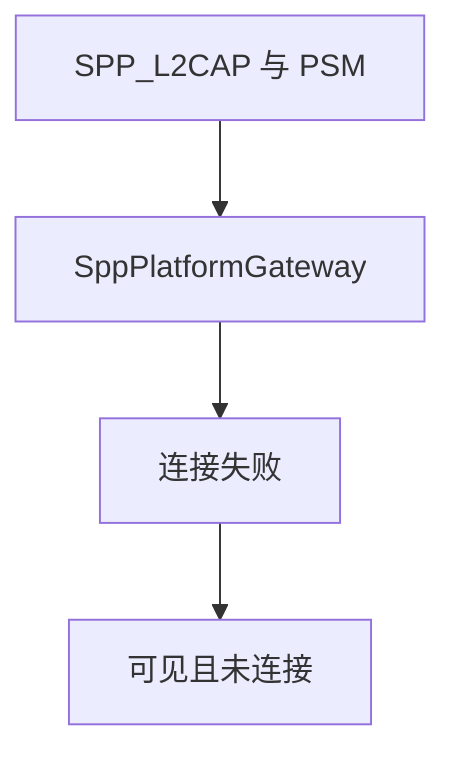
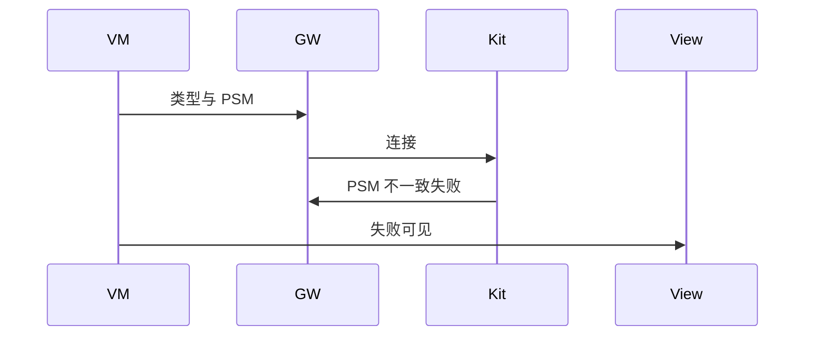
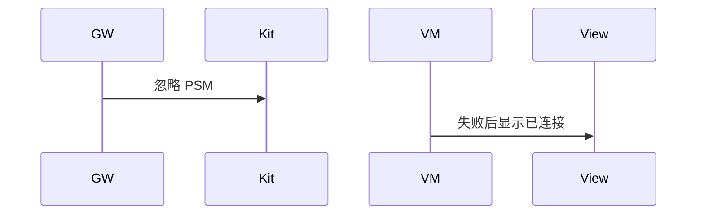

# BT-047 L2CAP 的 PSM 必须与对端一致

## 1. 条目与非目标

**判定：** 支持

**Given** 类型为 `SPP_L2CAP` 或 `SPP_L2CAP_BLE`

**When** 客户端 PSM 与服务端 `getL2capPsm` 不一致

**Then** 连接失败可见

**证据：** `SppOptions.psm、SppType`。行为以已接受的研究笔记和清单为准，本文件不重开行业调查。

**本条输入：** L2CAP 类型下与对端不一致的 PSM。

**本条输出：** 连接失败可见，不进入已连接。

**本条失败：** PSM 不一致仍显示已连接。

**本条所有者：** 类型和 PSM 放在已有 `SppConnectParams`，由 `SppPlatformGateway` 写入 `SppOptions`。失败清理复用 `SppSessionTeardown`。

**非目标：**

- 不新建 L2CAP 模块。
- 不在 PSM 失败后改走 RFCOMM 并显示同一次成功。
- 不新增 `common/yobluetooth` 以外的蓝牙栈，不增加包装层或版本兼容层。版本判断留在本条调用点。

## 2. 模块边界与分层

本组是L2CAP。依赖方向是 `product/phone` → `features/bluetooth` → `common/yobluetooth`。权限、生命周期和系统设置走 `common/platform` 与 `common/debug_core`。字节与 `Result` 走 `common/core`。日志门面走 `common/yolog`。收藏、会话记录和导出走 `common/storage`。`common/youi_kit` 只提供通用控件，不解释蓝牙状态。

**调用点：** `SppOptions` 在 `SppPlatformGateway` 组装。

| 包 | 类型 | 职责 |
| --- | --- | --- |
| features/bluetooth | 连接参数状态 | 提交类型与 PSM |
| common/yobluetooth | SppConnectParams | 保存 sppType 与 psm |
| common/yobluetooth | SppPlatformGateway | 按类型连接 |
| common/yobluetooth | SppSessionTeardown | 失败则不留已连接 |

**设计前：** 参数只有 UUID 时，L2CAP 无法表达 PSM。

**设计后：** 同一网关按 `SppType` 填 PSM。不一致由平台拒绝，界面显示失败。

## 3. 架构图

本组总图放在本文件。L2CAP里其余条目各自再画本条链路，链接不能代替本条的输入、输出、失败和所有者。

本条链路：

## 4. 序列图

### 成功路径

### 错误路径

## 5. 数据模型

领域模型放在 `common/yobluetooth`，持久化模型放在 `common/storage`，平台传输对象只出现在数据源调用点，跨层用 `common/core` 的 `Result` 与 `ResultError`。错误只带类别和结构化字段，不把界面句子塞进邻层错误。

| 模型 | 所在层 | 字段 | 来源 |
| --- | --- | --- | --- |
| SppConnectParams | 领域 | type 与 psm | 用户 |
| ConnectSppResult | 领域 | 失败 | 平台 |

## 6. 层间接口

| 从 | 到 | 接口 | 成功 | 失败 |
| --- | --- | --- | --- | --- |
| ConnectSppUseCase | SppPlatformGateway | connect L2CAP | PSM 一致才成功 | 不一致失败 |
| SppPlatformGateway | socket | SppOptions.psm | 传用户值 | 不改成 0 冒充成功 |

下层不持有页面类型。结果用 `Result` 或已有观察者回传。`common/yobluetooth` 的 `Index.ets` 继续只导出用例、领域模型和必要门面，不把数据源具体类变成第二套公开栈。

## 7. 权限与生命周期

仍是 `ACCESS_BLUETOOTH`。

失败不占用已连接槽位。

## 8. 日志

- `BtLogTag.SPP` 记录 type=l2cap psmMismatch=1。
- 领域标签加在已有 `BtLogTag`，不在 `common/yolog` 的 `YoLogTag` 里再开一套蓝牙标签。
- 日志走 `YoLog`，不在页面里直接写 hilog。

## 9. 反模式

- PSM 失败自动改 RFCOMM。
- 新建 `common/yol2cap`。
- 用新的蓝牙 HAR、适配器或 `ApiCompat` 把本条版本差异包起来。版本判断只留在上面写明的调用点。
- 页面或 `common/youi_kit` 直接调用 `ohos.bluetooth.*`。
